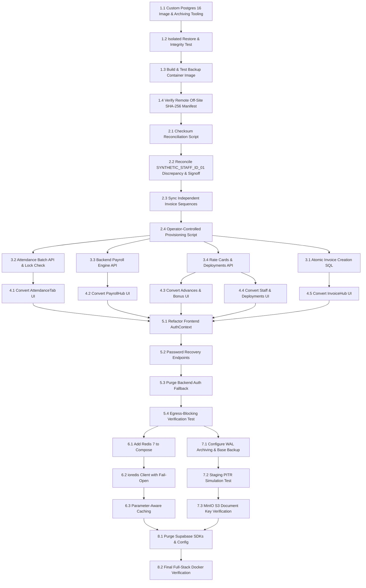

# ERP-AMBE: Master Implementation Plan — Supabase Elimination, Native PostgreSQL, Disaster Recovery, Redis Caching & Production Readiness

**Document Version:** 4.1.0 (Corrected Commands, Safe Recovery Workflow, and Explicit Readiness Gates)  
**Date:** October 19, 2026  
**Author Roles:** Principal Software Architect, Senior Backend Engineer, PostgreSQL Database Engineer, DevSecOps Engineer, Application Security Reviewer  
**Target Repository:** `D:\ERP-AMBE`  
**Execution Mandate:** This document is the working implementation specification for the coding agent. Follow it in phases; do not regenerate another plan or spend tokens re-reviewing the plan instead of executing approved implementation tasks. Implement only after satisfying the gates below. No production migration, destructive data operation, volume deletion, secret rotation, or cutover is authorized until its explicit safety gate passes. Any status marked PROPOSED, BLOCKED, or UNVERIFIED is not a completed capability. Employee-specific identifiers have been replaced with synthetic tokens in this corrected copy.

---

## Agent Operating Instructions (Read Before Implementation)

This file is the single working plan. **Do not create another `ERP_COMPLETE_IMPLEMENTATION_PLAN(n).md` revision and do not respond by generating yet another planning document.** Work on the real repository at `D:\ERP-AMBE` and execute the phases below.

1. Start by checking the branch, working tree, runtime versions, current Compose configuration, live schema metadata, and whether the Docker Linux engine is actually available. Do not assume an earlier audit is still current.
2. Implement Phase 1 in small, reviewable commits. Never target the live database or existing production volumes from a test. The current Windows/Docker host and independent disaster-recovery destination are documented blockers until re-verified.
3. For each task, make the code/config change, run the relevant checks, inspect the output, and report the real result. Never claim success because a command is written in this file.
4. Do not mark a gate VERIFIED/TESTED until it has run successfully in the specified isolated environment and evidence is captured. A build is not a restore test; a logical restore is not a PITR test.
5. Stop before any production migration, credential rotation, volume swap, deletion, or Supabase cutover. Those require the explicit human-approved change window and prerequisites in Section 13.4.
6. If an item is blocked by infrastructure or required approvals, implement unrelated safe tasks only when dependencies allow; state the exact blocker, do not invent a workaround, and do not create a replacement plan.

**Current decision:** NOT READY FOR PRODUCTION CUTOVER. Some non-production implementation work can proceed after the local Docker engine is restored, but backup restoration, independent DR storage, tax/payroll sign-off, and Supabase egress-blocking remain gates.

---
## 1. Executive Summary

ERP-AMBE is an enterprise facility management application serving two sister corporate entities: **Ambe Service** and **Ambe Service Facilities Private Limited (ASF)**. The platform is transitioning from a hybrid Supabase-dependent architecture to a fully independent, self-hosted, containerized stack.

A forensic inspection of the repository, the local WSL2 PostgreSQL 16.15 instance, the live schema, and the Docker assets establishes the true technical baseline:
1. **Mutation Layer Tethers:** Core entities (`invoices`, `sites`, `companies`) read natively from PostgreSQL via `pg.Pool`, but mutation operations (`createInvoice`, `updateInvoice`, `deleteInvoice`, and proforma approvals) continue to write to `supabaseAdmin` PostgREST clients.
2. **Direct Client Database Coupling:** 16 frontend React files (11 feature components, 3 page views, 2 lib clients) bypass Express APIs entirely, performing unvalidated client writes on `attendance_records`, `staff`, `employee_documents`, and `payroll_records`.
3. **Client-Side Financial Risk:** Statutory payroll deductions (EPF, ESIC, Professional Tax, net salary) are computed in browser JavaScript and upserted directly by the client into the database.
4. **PostgreSQL Version Divergence:** The existing `docker-compose.yml` specifies `postgres:15-alpine`, whereas the local operational database is `PostgreSQL 16.15 (Ubuntu 24.04)`, creating a major-version incompatibility risk during dump restoration.
5. **Cold Volume Trap:** Launching `docker-compose.yml` with an empty named volume `erp_postgres_volume` runs schema migrations but leaves the database empty (0 invoices, 0 staff, 0 sites). An operator-controlled, tracked provisioning procedure must be established.
6. **Recovery Architecture Safety:** Reverting the live database after business resumes causes catastrophic loss of post-cutover transactions. A dual-track recovery strategy—Point-In-Time Recovery (PITR) for database corruption, and zero-data-loss Application Rollback for code defects—must be established.
7. **Missing Production Services:** Redis is absent from Compose and backend dependencies; automated containerized backups require secure, non-interactive scheduling.

This revised plan establishes the exact sequence to eliminate Supabase completely, enforce server-side financial integrity, standardize on PostgreSQL 16 with volume safety, integrate Redis caching with parameter and authorization isolation, and validate the complete Docker stack without risk of post-cutover data loss.

---

## 2. Verified Starting State (Forensic Baseline)

The table below preserves the previous plan’s reported audit snapshot. This editing pass has not connected to the user’s database or Docker daemon and does not independently re-run these checks. The coding agent must refresh the snapshot from the real repository/environment before any cutover decision.

| Area | Component | Status | Verified Evidence & Concrete Inspection Metrics |
|---|---|---|---|
| **Database Engine** | Local PostgreSQL (WSL2 Ubuntu 24.04) | **VERIFIED** | Engine: `PostgreSQL 16.15 (Ubuntu 16.15-0ubuntu0.24.04.1)`. Connection pool configured in `backend/src/db/pool.ts` (max 20 connections, idle timeout 30s). Health check active. |
| **Relational Data** | 19 Relational Tables in `erp_facility` | **VERIFIED** | Direct query on `localhost:5432/erp_facility`: `companies` (2), `sites` (16), `clients` (10), `work_orders` (16), `work_order_quotas` (28), `rate_cards` (20), `staff` (65), `attendance_records` (1,024), `invoices` (61), `invoice_items` (197), `employee_documents` (120), `materials` (0), `bonus_disbursements` (0), `attendance_sheets` (0), `site_deployments` (0), `app_users` (1), `user_roles` (2), `refresh_tokens` (1,107). |
| **Payroll Parity** | `payroll_records` (111 rows) | **VERIFIED** | Local DB contains **111** payroll records, reportedly matching the current Supabase count. Row-count parity does **not** resolve the separately documented ESIC calculation discrepancy. The relevant historical row remains synthetic/redacted in this plan and requires Finance Controller review before any recalculation or cutover. |
| **Schema Reality** | Relational Column Realities | **VERIFIED** | `public.staff`: actual columns are `biometric_code`, `employee_name` (no `full_name` or `employee_id`). `public.payroll_records`: actual columns are `net_salary`, `total_net_salary` (no `net_wages`). `public.sites`: no `client_state_code` or `site_state_code` columns; state code is parsed from `gstin`. `public.invoices`: currently lacks `uq_company_type_invoice_no`. `public.invoice_items`: has `cgst_rate` and `sgst_rate`, lacks `igst_rate`. |
| **Normalization** | Relational Normalization | **VERIFIED** | Migrations 16–19 created `clients` (10), `work_orders` (16), `work_order_quotas` (28), `invoice_items` (197). Financial subtotal variance between line items and invoice headers is **₹0.00**. |
| **Object Storage** | MinIO S3-Compatible Storage | **VERIFIED** | Live bucket `ambeuploads` verified on `https://storage.ambeservice.com`. `OracleStorageService.checkBucketExists()` returned `true`. |
| **Authentication** | Native User Store & JWT Engine | **PARTIAL** | `public.app_users` table created with bcrypt hashing; `nativeAuthService.ts` issues valid JWTs; but frontend `AuthContext.tsx` still hooks into Supabase Auth. |
| **Docker Compose** | Multi-Stage Compose Stack | **PARTIAL** | `docker compose config` validates. Existing Compose file references `postgres:15-alpine` (mismatched with local v16 engine), and Redis/Backup services are absent. |
| **Existing Scripts** | Local Backup & Restore Scripts | **REPORTED IN PRIOR AUDIT** | `scripts/backup.sh` and `scripts/restore.sh` were reported as local unencrypted utilities. New backup/recovery files under `infra/postgres/` and `infra/backup/`, plus `scripts/provision_database.sh`, remain proposed until verified in the current repository. |
| **Caching** | Redis Service | **NOT DONE** | Redis is absent from `docker-compose.yml`, backend `package.json`, and service logic. |

---

## 3. PostgreSQL 15 to 16 Major-Version Migration, Tooling ADR & Volume Safety

### 3.1 The Incompatible Volume Problem
If a Docker host previously initialized a volume named `erp_postgres_volume` using `postgres:15-alpine`, upgrading the Compose image directly to `postgres:16-alpine` against that existing volume will cause PostgreSQL to immediately crash on startup:
```text
FATAL: database files are incompatible with server
DETAIL: The data directory was initialized by PostgreSQL version 15, which is not compatible with this version 16.
```
**Under no circumstances will a PostgreSQL 15 data directory be mounted directly into a PostgreSQL 16 container.**

### 3.2 Volume Migration & Upgrade Protocol
Safe migration requires the following controls; no procedure can guarantee zero risk:
1. **Volume Inspection:** Check whether `erp_postgres_volume` exists and inspect its engine version:
   ```bash
   docker volume inspect erp_postgres_volume >/dev/null 2>&1 && \
   docker run --rm -v erp_postgres_volume:/data alpine cat /data/PG_VERSION 2>/dev/null || echo "NEW"
   ```
2. **Dedicated Version 16 Volume:** Define a new, explicitly named volume in `docker-compose.yml`:
   ```yaml
   volumes:
     postgres_data_v16:
       name: erp_postgres_data_v16
   ```
3. **Preservation of Legacy Volume:** The existing `erp_postgres_volume` (if present) remains completely untouched and immutable as a fallback.
4. **Logical Dump & Restore:** Migration between v15 and v16 is performed strictly via logical SQL text dump (`pg_dump` with `--clean --if-exists --no-owner --no-privileges`).
5. **Post-Restore Catalog Re-indexing:** Following restoration into PostgreSQL 16, execute:
   ```sql
   REINDEX DATABASE erp_facility;
   ANALYZE VERBOSE;
   ```

### 3.3 Architectural Decision Record (ADR): Backup & Recovery Tooling Evaluation

#### 3.3.1 Evaluation Matrix: pgBackRest vs WAL-G vs Hardened Native Alpine pg_basebackup

| Capability | pgBackRest (Debian / Enterprise) | WAL-G (Go Binary) | Hardened Native pg_basebackup + AWS CLI (Alpine) |
|---|---|---|---|
| **S3 Protocol Support** | Native AWS/MinIO/Ceph client built-in | Native S3 client built-in | S3 via `aws-cli` apk package |
| **PostgreSQL 16 Compatibility** | Complete (Stanza management) | Complete (WAL-G 3.x) | Native core binary (`pg_basebackup`) |
| **Multi-Timeline PITR** | Automatic timeline branching & recovery | Supported via storage prefix | Handled via `recovery_target_timeline = 'latest'` |
| **Container Footprint** | ~350 MB (Debian Bookworm base required) | ~80 MB (Static Go binary) | ~60 MB (`postgres:16-alpine` + `aws-cli`) |
| **Alpine Linux Availability** | Experimental / requires build from source | External GitHub binary release | **First-class native packages in Alpine APK** |
| **Recovery Complexity** | Low (Single CLI command `pgbackrest restore`) | Low (Single CLI command `wal-g backup-fetch`) | Moderate (Requires shell script `pg-restore-wal`) |

#### 3.3.2 Architectural Decision
1. **Primary Target (Alpine Native):** For the ERP-AMBE standalone container stack, standardizing on **`postgres:16-alpine` with native `pg_basebackup -Fp -X stream` and `aws-cli`** is selected. This eliminates third-party binary downloads, avoids Alpine compile dependencies, and strictly utilizes PostgreSQL's official native streaming replication protocol.
2. **Alternative for future evaluation:** pgBackRest may be evaluated as a maintained backup manager if native backup operations prove too complex. This plan defines only the selected native PostgreSQL 16 + S3-compatible workflow; do not mix pgBackRest commands into it without a separate tested architecture decision.

### 3.4 Canonical PostgreSQL 16 Image, WAL Archiving, Credentials, and Replication

There is exactly one PostgreSQL Dockerfile and one PostgreSQL configuration path. Production Compose and all physical-recovery test containers must use the same built image, with runtime settings overridden only when explicitly documented.

#### 3.4.1 Canonical image and configuration path

Create these files (they are currently proposed, not present until implementation confirms otherwise):

- `infra/postgres/Dockerfile`
- `infra/postgres/postgresql.conf`
- `infra/postgres/entrypoint-wrapper.sh`
- `infra/postgres/pg-archive-wal.sh`
- `infra/postgres/pg-restore-wal.sh`

Canonical Dockerfile:

```dockerfile
FROM postgres:16-alpine
RUN apk --no-cache add aws-cli bash curl coreutils gnupg
COPY infra/postgres/postgresql.conf /etc/postgresql/postgresql.conf
COPY infra/postgres/entrypoint-wrapper.sh /usr/local/bin/entrypoint-wrapper.sh
COPY infra/postgres/pg-archive-wal.sh /usr/local/bin/pg-archive-wal
COPY infra/postgres/pg-restore-wal.sh /usr/local/bin/pg-restore-wal
RUN chmod 755 /usr/local/bin/entrypoint-wrapper.sh \
              /usr/local/bin/pg-archive-wal \
              /usr/local/bin/pg-restore-wal
ENTRYPOINT ["/usr/local/bin/entrypoint-wrapper.sh"]
CMD ["postgres", "-c", "config_file=/etc/postgresql/postgresql.conf"]
```

The explicit `COPY` of `postgresql.conf` is required because the image starts PostgreSQL with `/etc/postgresql/postgresql.conf`. Compose must build this Dockerfile using the repository root as build context, or adjust all `COPY` paths consistently. Do not keep a second conflicting Dockerfile definition elsewhere in this plan.

`infra/postgres/postgresql.conf` must at minimum define `wal_level = replica`, `archive_mode = on`, `archive_command = '/usr/local/bin/pg-archive-wal "%p" "%f"'`, and `archive_timeout = 300`. Add only settings that have been reviewed against the deployed PostgreSQL version and Compose network. Ensure PostgreSQL's configured data directory and mounted volume match the official image layout.

#### 3.4.2 Consistent credentials for both WAL directions

The official PostgreSQL entrypoint initially runs with sufficient privilege to initialize the data directory and then starts PostgreSQL as the `postgres` OS user. The wrapper must preserve that behavior rather than bypassing it.

Canonical wrapper behavior:

1. Verify it starts as root when the runtime requires secret-file provisioning; fail clearly if the deployment model cannot provide secure ownership.
2. Determine the UID/GID dynamically with `id -u postgres` and `id -g postgres`; do not scatter hard-coded UID assumptions through scripts.
3. Create `/var/lib/postgresql/.aws` owned by that UID/GID with mode `0700`.
4. Copy the mounted read-only secret `/run/secrets/aws_dr_credentials` to `/var/lib/postgresql/.aws/credentials`, set owner to the discovered PostgreSQL UID/GID and mode `0400`, and export `AWS_SHARED_CREDENTIALS_FILE=/var/lib/postgresql/.aws/credentials` for the official entrypoint and child processes.
5. In production/DR mode, fail closed if the secret is missing. A local unit-test mode may explicitly disable external archiving, but must not silently start a production-ready database without credentials.
6. Finish with `exec /usr/local/bin/docker-entrypoint.sh "$@"` so signals and shutdown are handled correctly.
7. Compose must pass non-secret `S3_ENDPOINT_URL`, `DR_S3_BUCKET`, and the selected `DR_S3_PREFIX` to PostgreSQL as environment/configuration values. The helpers must explicitly load the approved non-secret config when PostgreSQL invokes them; cron jobs must load it too because cron has a minimal environment.

The backup service must provision the same credential file for any temporary PostgreSQL process started as the `postgres` user. It must not assume a root-owned `/root/.aws/credentials` is readable by PostgreSQL. Secrets must not be printed, put in command arguments, or written into a broadly readable environment file.

#### 3.4.3 WAL archive/restore helper contract

`pg-archive-wal.sh` receives exactly two arguments: the source file path (`%p`) and archive filename (`%f`). It validates arguments, loads non-secret settings from the read-only backup configuration, checks that the canonical credential file is readable, and uploads to `s3://${DR_S3_BUCKET}/${DR_S3_PREFIX}/${WAL_FILE}` using the configured independent S3 endpoint. Production sets `DR_S3_PREFIX=wal`; tests use a separate bucket or unique run-specific prefix, never the production WAL prefix. The destination must be configured explicitly; do not silently default to the primary MinIO endpoint. Return exit code 0 only after the upload command reports success. On upload failure, return nonzero so PostgreSQL retries and monitoring can alert.

`pg-restore-wal.sh` receives exactly two arguments: filename (`%f`) and destination path (`%p`). It retrieves `s3://${DR_S3_BUCKET}/${DR_S3_PREFIX}/${WAL_FILE}` to the requested destination. It must return nonzero when the requested archive item does not exist, because PostgreSQL uses that outcome to identify the end of the available archive. It must also support `.history` files. Log filenames and error classes, never credentials.

Both helpers use the same settings and credential path, and must be tested as the `postgres` OS user in a disposable environment. The test must upload a uniquely named synthetic file to an isolated test prefix, fetch it, compare cryptographic hashes, and then clean up that test object. Never upload a fake WAL file into the production WAL prefix.

#### 3.4.4 Least-privileged replication role

Physical base backups use a dedicated `LOGIN REPLICATION` role, not the application database role. Create/rotate its credential only through the approved secret-management workflow. Do not put literal production passwords in SQL migrations or this plan.

The `pg_hba.conf` replication rule must restrict access to the actual Compose backup service/network CIDR, use `scram-sha-256`, and be derived from the final network configuration rather than assuming `172.18.0.0/16` without checking. The backup service's `.pgpass` file must be mode `0600` and include a `replication` entry as well as the required logical-dump connection. Escape `:` and `\` correctly if the credential format permits those characters; preferably generate credentials that do not need `.pgpass` escaping.

**Acceptance test:** run `pg_basebackup -h postgres -p 5432 -U erp_replication -D <fresh-temp-directory> -Fp -X stream` in staging. It must exit 0 without an interactive prompt, write `backup_label` and a valid backup manifest, and leave all production volumes untouched. A preflight must fail if the database has user-defined tablespaces that the workflow does not support; do not tar only PGDATA and silently omit external tablespace data.

## 4. Database Bootstrap: Operator-Controlled Provisioning vs Health Checks

### 4.1 The Danger of Automatic Restoration
Automatically restoring a production database dump merely because a container's database is empty is hazardous:
- An engineer spinning up a test or staging environment could inadvertently overwrite schemas or expose production data.
- Health checks that probe for specific application rows (`SELECT count(*) FROM companies`) create circular startup dependencies during initial deployment.

### 4.2 Explicit Separation of Concerns
1. **Infrastructural Health Check (Docker Level):**
   - The PostgreSQL container health check strictly verifies network and query readiness:
     ```yaml
     healthcheck:
       test: ["CMD-SHELL", "pg_isready -U ${POSTGRES_USER:-erp_admin} -d ${POSTGRES_DB:-erp_facility}"]
       interval: 10s
       timeout: 5s
       retries: 5
       start_period: 10s
     ```
   - It **never** queries application tables to determine container health.
2. **Operator-Controlled Provisioning Script (`scripts/provision_database.sh`):**
   - Production data restoration is an explicit, interactive or pipeline-controlled operation requiring confirmation:
     ```bash
     ./scripts/provision_database.sh --target-url "$DATABASE_URL" --backup-file "./backups/erp_facility_verified.sql.gz" --confirm
     ```
   - **Safety Pre-Checks:**
     - Computes and verifies SHA-256 checksum of the backup archive against a known hash.
     - Probes target database: If tables already exist, it aborts unless `--force-overwrite` is passed.
     - Restores into a new, explicitly selected empty target database/volume in a disposable or approved staging environment. Do not claim the complete restore is transactional unless the exact dump/restore operation and all DDL support that guarantee.
     - Runs schema migration tracking table verification (`public.schema_migrations`).
     - Logs operator identity, timestamp, backup filename, and row counts to `provision.log`.

---

## 5. Schema-Aware Reconciliation, Financial Integrity & Authoritative Invoicing

### 5.1 Financial-Grade Payroll Record Reconciliation & Statutory Analysis
A forensic query of the local PostgreSQL instance (`localhost:5432/erp_facility`) confirms that **111 payroll records** are present, matching the cloud Supabase count:
- **Disputed Record Verified Present:** `id: [REDACTED_PAYROLL_RECORD_ID]` (Employee: `[SYNTHETIC_STAFF_ID_01]`, Site: `[SYNTHETIC_SITE_A]`, Period: September 2026).
- **Financial Values Verified in Database:**
  - `earned_basic`: ₹6,900.00
  - `earned_hra`: ₹828.00
  - `earned_other`: ₹120.00
  - `earned_conveyance`: ₹960.00
  - `earned_gross`: ₹8,808.00
  - `epf_deduction`: ₹828.00
  - `esic_deduction`: ₹58.00
  - `pt_deduction`: ₹0.00
  - `net_salary`: ₹7,922.00 (Column in schema is `net_salary`, NOT `net_wages`)
  - `earned_part_bonus`: ₹178.00
  - `total_net_salary`: ₹8,100.00

#### 5.1.1 Payroll calculation discrepancy — finance review required

The previous audit reported an ESIC deduction of ₹58.00 for a row with `earned_gross` of ₹8,808.00; simple arithmetic at 0.75% of that gross amount yields ₹66.06. This arithmetic alone does not establish the legally applicable wage base, contribution treatment, covered period, attendance/proration rules, or whether components are includible. The previous document’s suggestion that allowances were excluded or the amount prorated was a hypothesis, not evidence.

The same audit reported `epf_deduction` of ₹828.00 against `earned_basic` of ₹6,900.00; that arithmetic reconciles at 12%, but this alone is not a complete statutory payroll audit.

**Required treatment:** keep the disputed row unchanged and formally on hold. A Finance Controller/payroll specialist must verify the applicable official rule, wage-base components, days/proration, configuration used at the time, and source-system calculation. Record the decision in the restricted audit artifact. No engineer or migration script may infer legal treatment or silently overwrite the historic result. Row-count parity does not resolve a payroll-value discrepancy.

---

### 5.2 Database Migration 20: IGST Support, Idempotency, Constraints, and Sequence Synchronization

The current schema audit reports that `public.invoice_items` has `cgst_rate` and `sgst_rate` but no `igst_rate`, while `public.invoices` lacks `uq_company_type_invoice_no` and `idempotency_key`. Verify these facts against the current schema immediately before migration; this plan is not proof that the database has not changed.

**Before applying Migration 20:** create and verify a recoverable backup; run a staging migration; inspect duplicate `(company_id, type, invoice_no)` tuples; inspect existing null/unsupported invoice types; confirm the intended invoice status/type model; inspect existing sequence values and invoice formats. If the uniqueness preflight finds duplicates or malformed numbers, abort and route them for finance review. Do not delete or silently renumber historical invoices.

Migration file: `backend/src/db/migrations/20_add_igst_and_invoice_constraints.sql`.

The migration must:

1. Add `igst_rate NUMERIC(5,2) NOT NULL DEFAULT 0` to `public.invoice_items` only after confirming the expected rate scale and legacy backfill policy with the financial-system owner.
2. Add nullable `cgst_amount NUMERIC(14,2)`, `sgst_amount NUMERIC(14,2)`, and `igst_amount NUMERIC(14,2)` columns to `public.invoice_items` so new invoices can persist the exact rounded line-level tax amounts used by the header/PDF. Keep historical amount columns nullable until Finance approves a backfill rule; do not silently backfill zero or infer historic tax treatment from today's rules.
3. Add nullable `idempotency_key UUID` and `idempotency_request_hash TEXT` to `public.invoices`, preserving historic rows with null keys.
4. Add `uq_company_type_invoice_no` on `(company_id, type, invoice_no)` and `uq_invoices_idempotency` on `(company_id, idempotency_key)` only after preflight duplicate checks pass. Implement migration re-runs safely by checking existing column/constraint names; do not swallow unrelated migration errors.
5. Avoid adding unconditional total constraints that may reject valid legacy records or credit/adjustment documents before the business semantics are established.
6. Synchronize the per-company invoice counters independently for Tax and Proforma invoices. Set stored counter state to the maximum of its current valid value and the maximum suffix already issued; use `0` (not `1`) as the empty baseline when the service increments the counter to generate the first number. Preserve a higher valid existing counter. The first-number format must be covered by explicit tests.

Sequence synchronization must scope by both company and invoice type and parse only the trailing numeric suffix. Preflight all suffixes for integer overflow and malformed formats before the update. Use a transaction for the migration when supported by all statements. The application service must lock the company sequence row while checking idempotency and allocating the next number.

Do not apply this migration to production until it has passed staging tests, a current backup has been restored successfully, and the explicit change window is approved.

### 5.3 Authoritative Server-Side Invoice Calculation & Financial Integrity Engine

#### 5.3.1 Input, authorization, and authoritative data contract

The frontend submits relational identifiers, invoice type/date/period, an idempotency UUID, and operational line inputs only. Client-submitted subtotal, tax, grand total, tax jurisdiction, tax rates, generated invoice number, or calculated line amount must never be authoritative.

The backend must, in this order:

1. Authenticate the user and enforce their company/site authorization from server-side authorization data. A caller-supplied `company_id` is not proof of access. `SUPER_ADMIN` access must be an explicit role rule.
2. Validate the invoice type against the actual supported values and confirm the site's relationship to the company, including whether a client/work order is required by the existing business rules.
3. Validate the `idempotency_key` as a UUID, all line values and string lengths, date and billing period, positive/allowed quantities, `working_days` bounds, and maximum payload size.
4. Resolve tax configuration from a finance-approved authoritative source. Do not hardcode 9%/9%/18% into the service without a confirmed tax category/rate configuration and Finance Controller approval. Proforma invoices must follow the approved business policy for whether tax is displayed/calculated.
5. Determine place of supply from a valid recipient GSTIN state prefix when applicable, or an explicit verified state-code field supplied from approved client/site master data. The present schema audit says those state-code columns do not exist. If required data is missing, add and backfill a validated field through a separate reviewed migration; do not guess jurisdiction from substring search across free-text addresses and never default to Maharashtra. Reject unresolved cases with a structured 422 response.
6. Compute all amounts server-side using exact decimal arithmetic (`decimal.js` or another reviewed decimal library) or a fully specified integer-minor-unit design that parses decimal strings without binary floating-point rounding. Store exact values in PostgreSQL `NUMERIC` columns. The implementation must reject values outside configured precision/range rather than overflow.
7. Use one documented rounding policy (line-level vs invoice-level) approved by Finance and reconcile that same policy in stored rows, totals, PDFs, exports, and tests. Persist the rate and amounts needed to reproduce the issued invoice; do not rely on current tax settings to re-render historic invoices.

#### 5.3.2 Transactional creation and idempotency algorithm

Implement in `backend/src/services/invoiceQueryService.ts` (or the canonical service found during repository inspection). All invoice header, invoice items, sequence allocation, and idempotency association must commit or roll back atomically.

Required algorithm:

1. Authenticate and authorize before database mutation.
2. Begin transaction and lock the relevant company sequence row (`SELECT ... FOR UPDATE`) to serialize allocation for that company.
3. Compute a canonical request hash from validated business inputs. Check `(company_id, idempotency_key)` inside the transaction. If an invoice exists with the same request hash, return that invoice without allocating a number. If the key exists with a different hash, return HTTP 409; never silently return an unrelated invoice.
4. Verify company/site/client/work-order relationships and load the approved tax configuration from database records while respecting authorization scope.
5. Calculate amounts using the approved decimal implementation and rounding policy. Validate generated numeric values and the intended schema/status enum values.
6. Increment the correct company invoice counter and generate the number. The SQL identifier for the counter/prefix must come only from a fixed allowlist determined by a validated invoice type; never interpolate a request value as an identifier.
7. Insert the header with idempotency key and request hash, then insert every normalized line item with tax rates and persisted tax amounts according to the actual migrated schema. On any failure, rollback all writes and the counter allocation.
8. Return success only after commit. Add database unique constraints as a final concurrency guard and handle the unique-key conflict by re-reading the matching idempotent invoice in a fresh/valid transaction, verifying the request hash and returning it.

A company-row lock before the idempotency lookup may serialize same-company requests and is acceptable at the expected scale. The final implementation may use a different proven atomic pattern, but it must satisfy all above invariants.

Do not assume the current schema has `draft` as a valid status: inspect existing enum/check constraints and frontend/API expectations, then use the actual supported status values.

#### 5.3.3 Invoice numbering, cancellation, and retries

- Failed invoice creation must roll back the header, all line items, and sequence increment in the same database transaction.
- A retry using the same idempotency key and same canonical payload returns the originally committed invoice; reusing the key with a different payload returns a conflict.
- After issuance, cancelled/voided invoices must remain auditable under the approved financial process; do not delete an issued invoice to reuse its number. Confirm tax/legal treatment with the Finance Controller.
- Do not promise that every business sequence will be gapless after issued invoices are cancelled. The invariant is uniqueness, controlled allocation, no duplicate numbers, and complete auditability of active/cancelled/voided records.

#### 5.3.4 Historical data and invoice rendering

Migration must preserve the historic invoice's stored amounts and rendered meaning. Adding `igst_rate` with default zero is not sufficient to infer missing historic tax data. Backfill only under a reviewed rule; otherwise preserve historical fields and flag unknown tax details for finance reconciliation. PDF, email, and export paths must use the persisted values for that invoice and must not recalculate historic totals from today's tax configuration.

### 5.4 Financial Reconciliation & Concurrency Stress Testing Gates

#### 5.4.1 Schema-aligned subtotal reconciliation

The following query checks subtotal consistency using the current normalized line-item amount column. It does not pretend that tax amounts exist as columns if the schema stores only tax rates.

```sql
SELECT i.id, i.invoice_no, i.sub_total AS header_sub_total,
       COALESCE(SUM(ii.amount), 0)::numeric AS line_items_sub_total,
       ROUND(ABS(i.sub_total - COALESCE(SUM(ii.amount), 0)), 2) AS variance
FROM public.invoices AS i
LEFT JOIN public.invoice_items AS ii ON ii.invoice_id = i.id
GROUP BY i.id, i.invoice_no, i.sub_total
HAVING ROUND(ABS(i.sub_total - COALESCE(SUM(ii.amount), 0)), 2) > 0.00;
```

Expected result for the verified historic baseline was zero rows, but rerun it before cutover. Separately validate tax and grand totals using the persisted tax-amount columns and Finance-approved historical rules; if tax amounts are not persisted, first define their storage and migration/backfill policy rather than using a fabricated `cgst`/`sgst` column query.

#### 5.4.2 Required integration tests

`backend/test/invoice_concurrency.test.ts` (proposed until confirmed present) must cover:

1. Concurrent Tax and Proforma invoice creation for each company, with zero duplicate `(company_id, type, invoice_no)` pairs.
2. Concurrent identical idempotency key + payload requests: exactly one committed invoice; all successful retries return that same invoice.
3. Reuse of an idempotency key with a different payload: HTTP 409 and no mutation.
4. First invoice for a company with null/zero sequence counters produces the expected first number, and initialization for a company with existing invoices does not collide.
5. A synthetic failure during line-item insertion rolls back header, line items and sequence increment.
6. Cross-company user requests are rejected even if they supply a valid company/site UUID.
7. Interstate, intrastate, and unresolved place-of-supply test fixtures use Finance-approved tax configurations and rounding expectations.
8. Rendered PDF/export totals equal persisted database totals for historic and newly issued invoices.

The gate passes only with test output and database assertions reviewed. Test status remains PROPOSED until run.

## 6. Enterprise Recovery Architecture: Point-In-Time Recovery (PITR) & Application Rollback

### 6.1 Critical Reassessment of Custom Trigger-Based CDC
Relying on custom database triggers writing to an audit table with timestamp ordering has severe architectural vulnerabilities that disqualify it from disaster recovery:
- `clock_timestamp()` and auto-incrementing transaction IDs in triggers do **NOT** guarantee commit ordering under concurrent transactions.
- Asynchronous remote log replication can lose unexported changes if the host suffers a sudden hard crash.
- Replaying application-level mutations across 15 relational tables introduces foreign key dependency deadlocks and sequence divergence.
- Reverting the live database after business resumes destroys valid post-cutover transactions.

### 6.2 Dual-Track Recovery Framework & Measurable RPO/RTO Targets

Classify incidents before acting:

- **Track A — stateless application release/UI defect:** roll back to the previous immutable application image while leaving PostgreSQL untouched. This preserves committed database writes but does not automatically repair incorrect data that a buggy release may already have written.
- **Track B — database corruption/accidental destructive change/host failure:** isolate traffic, preserve the original volume for forensics, restore a separate PostgreSQL 16 recovery volume from a verified physical base backup and WAL archive, recover to a deliberately selected time/restore point, run integrity checks, and only then plan a controlled traffic/volume switch.
- **Track C — portable logical recovery:** restore the most recent verified logical dump into a clean cluster/database. It does not support WAL replay or second-accurate PITR.

#### 6.2.1 Targets, not guarantees

| Recovery path | Initial design target | Status | Important limitation |
|---|---|---|---|
| Application image rollback | Target RTO <= 5 minutes; no committed transaction loss caused by the application image switch | PROPOSED until measured | Incorrect writes already committed by faulty code need data repair; rollback does not correct them. Schema changes must be backward-compatible. |
| Physical restore + PITR | Target RPO/RTO set after a measured staging drill; preliminary operational objective is RPO <= 5 minutes and RTO <= 30 minutes | NOT PROVEN | Asynchronous WAL archive delivery can lag or fail. `archive_timeout=300` does not guarantee that WAL reached independent storage within five minutes. |
| Logical dump restore | Target RPO based on verified dump cadence; preliminary objective is <= 24 hours | TESTED LOCALLY ONLY if existing restore evidence is confirmed; isolated-container drill remains PROPOSED | A daily dump cannot recover later changes and is not a PITR backup. Do not label the objective proven until timings are measured. |

Do not use the phrase “zero data loss” for host failure unless synchronous replication or another design that demonstrably meets that requirement has been deployed and tested. Until remote archive health and recovery-point freshness are monitored, the honest hardware-disaster RPO is **unbounded by the design** during an archive outage.

#### 6.2.2 Monitoring and breach handling

Monitoring must include `pg_stat_archiver` (`archived_count`, `last_archived_wal`, `last_archived_time`, `failed_count`, `last_failed_wal`, `last_failed_time`), storage free space, age of the last confirmed remote WAL object, upload failures, and an alert when the archive target is breached. Do not alert solely on `now() - last_archived_time` when the database has had no WAL-generating activity; correlate with activity/forced WAL switches and archive queue/failure state.

Proposed initial thresholds: warning when a recent archive upload fails or the remote archive freshness exceeds 10 minutes during active workload; critical at 15 minutes or if local `pg_wal` approaches 85% of its allocated volume. These are operational thresholds to tune after baseline measurement, not guarantees. On breach, notify the owner, stop retention pruning, investigate upload/auth/network/disk pressure, and document that the intended RPO is currently not met. Do not delete WAL to free space; expand storage or use an approved emergency action.

### 6.3 Track A: Application Image Rollback Without Database Rewind

When a release breaks application behavior:

1. Enable the approved maintenance/traffic-drain mechanism.
2. Leave the PostgreSQL service and all database volumes running and untouched.
3. Deploy the previously built immutable backend/frontend image tags. Do not `git checkout` over a developer's working tree and do not use `docker compose down` if it would unnecessarily stop the database.
4. Verify readiness and critical read/write workflows against the current database. If a bad release already wrote incorrect data, record an incident and repair those rows through a separately reviewed, audited data-fix procedure.
5. Reopen traffic only after health and business checks pass.

Example (service names and image tags must be confirmed from the real Compose file):

```bash
docker compose stop backend frontend
docker compose up -d --no-deps backend frontend
curl --fail http://localhost:5000/api/health
```

Prefer immutable release tags/digests, a tested rollback command, and schema migrations that preserve backward compatibility. This procedure is a design template, not a tested RTO claim.

### 6.4 Track B: PostgreSQL 16 Physical Backup and Point-In-Time Recovery

#### 6.4.1 One canonical backup artifact format

Use PostgreSQL 16 `pg_basebackup` in plain-directory format with streamed WAL (`-Fp -X stream`) to a new temporary directory, then package the complete directory into a compressed archive, encrypt it, create a portable SHA-256 sidecar, upload both objects, download them back, and verify the downloaded copies. Do not use the unsupported combination `-D - -Ft -z -X stream`.

Proposed script: `infra/backup/physical-base-backup.sh` (not yet implemented unless the repository confirms otherwise). Required safeguards:

- `set -Eeuo pipefail`; temporary work directory with `trap` cleanup.
- Verify `S3_ENDPOINT_URL`, `DR_S3_BUCKET`, secret files and the explicit operator confirmation that the target has been independently provisioned.
- Check for user-defined tablespaces before backup. If any exist and the workflow has not implemented/tested tablespace mapping, abort rather than omit them.
- Run `pg_basebackup -h "$PGHOST" -p "$PGPORT" -U erp_replication -D "$RAW_BACKUP_DIR" -Fp -X stream --checkpoint=fast` with a fresh empty destination and secure `.pgpass`.
- Create `erp_base_<UTC_TIMESTAMP>.tar.gz.gpg` using GnuPG in batch/loopback mode with a mounted passphrase file; never pass the passphrase as a command-line literal.
- Generate the checksum from inside the work directory so its manifest contains only the archive basename: `(cd "$WORK_DIR" && sha256sum "$ARCHIVE_NAME") > "$ARCHIVE_NAME.sha256"`.
- Upload the archive and sidecar under `s3://${DR_S3_BUCKET}/base_backups/`.
- Download **both** objects into a separate verification directory, run `sha256sum -c`, then decrypt and consume the full gzip/tar stream (`gpg --decrypt ... | tar -tzf - >/dev/null`) with `pipefail` enabled.
- Only after remote checksum and full-stream verification succeed, write a SUCCESS audit event. Any failure must result in a FAILED event and nonzero job exit. Do not report success based only on an upload exit code or archive header.
- Do not delete local scratch data before verification. Temporary scratch data can be removed after verification; the remote source is retained.

The backup is not considered independent/off-site merely because it is in a separate bucket. Section 7.5 records the current DR storage independence blocker.

#### 6.4.2 WAL archiving configuration and caveats

Canonical `infra/postgres/postgresql.conf` settings include:

```conf
wal_level = replica
archive_mode = on
archive_command = '/usr/local/bin/pg-archive-wal "%p" "%f"'
archive_timeout = 300
```

`archive_timeout=300` asks PostgreSQL to switch a WAL segment after the interval when database activity has occurred. It does not force an upload to finish, prove remote durability, or bound data loss during an outage. The archiver command must return nonzero on upload failure so PostgreSQL can retry. Monitor remote object freshness and local WAL growth.

The production archive prefix is `s3://${DR_S3_BUCKET}/wal/` (`DR_S3_PREFIX=wal`). Archive all files PostgreSQL passes to `archive_command`, including timeline `.history` files. Preserve timeline history files indefinitely unless an explicitly reviewed retention system proves they are no longer needed.

#### 6.4.3 Safe retention policy

**Automated destructive retention is disabled in the initial implementation.** Do not add `aws s3 rm` loops that compare filenames lexicographically or prune WAL based on the starting segment of only one backup. Such code does not prove that all retained base backups and timeline branches remain recoverable.

Until a tested retention manager and recoverability checks are in place:

- Keep uploaded base backups, WAL segments, timeline history files and manifests.
- Monitor remote capacity and local `pg_wal` capacity; alert before exhaustion.
- Do not claim long-term retention policy is complete.
- If storage pressure occurs, do not run ad-hoc delete commands. Escalate and provision capacity or follow a reviewed incident procedure.

If retention is later automated, it must keep every WAL segment and history file needed by every retained backup across all retained timelines, and must prove that at least the configured recovery points remain restorable before and after pruning. This requires a disposable recovery test before enabling delete permissions.

#### 6.4.4 Recovery helper behavior

`infra/postgres/pg-restore-wal.sh` is the sole helper used by PostgreSQL `restore_command`. It must use the same explicitly configured S3 endpoint/bucket and `/var/lib/postgresql/.aws/credentials` path established by the canonical wrapper. It downloads `%f` to `%p`, supports `.history` files, and returns nonzero if the requested object is missing. Never embed secrets in `postgresql.auto.conf` or `restore_command`.

#### 6.4.5 Manual PITR restore runbook (operator-controlled)

This procedure is a runbook template to implement and test in staging; it is not a command sequence to execute against production until approved.

1. Declare an incident; stop/drain application traffic. Record the incident time and preserve relevant logs.
2. Stop the affected PostgreSQL process before copying the original volume. Preserve the original volume unchanged for forensics. Do not treat `docker volume create` as a copy. Use a reviewed, volume-aware copy/snapshot procedure and verify the preserved copy before proceeding.
3. Create a **new empty recovery volume**. Download the chosen remote base-backup archive and its sidecar using the recovery script; verify the downloaded checksum before decrypting. Require that the target volume is the new recovery volume and that its data directory is empty. Do not use hard-coded backup timestamps or blindly `rm -rf` an arbitrary directory.
4. Decrypt and extract the archive into the new data directory with the `postgres` UID/GID determined from the built image. Verify required files such as `PG_VERSION`, `backup_label`, `backup_manifest`, and valid data-directory permissions.
5. Verify `restore_command` and credentials work from the recovery PostgreSQL OS user. Create `recovery.signal`; add only the intended `restore_command`, one recovery target (`recovery_target_time` **or** `recovery_target_name`), `recovery_target_timeline='latest'` as appropriate, and `recovery_target_action='promote'`. Remove/replace stale recovery settings instead of appending duplicate contradictory settings. Choose a target after the base backup end and before the destructive event.
6. Start recovery on an isolated network/port with no application traffic. Keep recovery archiving disabled or direct it to a separate test prefix until promotion and review are complete; never allow a test timeline to overwrite the production archive.
7. Wait for the recovery process to finish, check startup logs, verify the expected recovery target was reached, and run schema, foreign-key, row-count, financial-reconciliation and document-key checks. A database accepting connections alone is not sufficient.
8. Require operator approval of the validation report before planning any production volume/service switch. Preserve the original volume and remote source backups through sign-off and the defined post-incident retention period.

#### 6.4.6 Mandatory synthetic PITR certification test

A disposable staging cluster must prove actual WAL replay, not merely that a base backup can start:

1. Create an isolated PostgreSQL 16 test cluster and configure archiving into an isolated test prefix.
2. Configure the test archive helper to use a unique disposable bucket or prefix that cannot overlap production WAL keys.
3. Insert and commit marker `PITR_KEEP_1`.
4. Take a physical base backup and record its end position/time.
5. Insert and commit marker `PITR_KEEP_2`; create a named restore point immediately before the destructive test operation.
6. Execute a deliberately destructive change only inside the disposable staging database, commit it, force a WAL segment switch, and wait until every required segment and timeline file is verified in the test archive.
7. Restore the base backup into a fresh recovery directory and set `recovery_target_name` to the restore point, with `recovery.signal`, the canonical restore helper and target action `promote`.
8. Verify `PITR_KEEP_1` and `PITR_KEEP_2` are present, the destructive change is absent, the restore point/timeline behavior matches logs, and financial/schema integrity checks pass.
9. Destroy only the explicitly named disposable test resources after evidence is captured. No production table or bucket object may be used for the destructive operation.

Status remains **PROPOSED** until this test is executed and its logs/assertions are reviewed.

#### 6.4.7 Weekly physical restore test versus PITR test

The weekly physical restore test downloads/verifies a recent remote base backup, restores it into an isolated temporary PGDATA, runs archive recovery through the available WAL archive, starts PostgreSQL on a private Unix socket (no network listener), runs integrity checks, and tears down that **temporary cluster only**. It must not set `recovery_target='immediate'` and describe that as proof of WAL replay beyond the backup. The synthetic PITR certification in 6.4.6 is the required test for a known post-backup transaction and target point.

### 6.5 Logical vs Physical Backup Testing

#### 6.5.1 What each method proves

| Method | What it contains | What a successful test proves | What it does not prove |
|---|---|---|---|
| Logical backup (`pg_dump`) | Logical database objects/data | SQL dump can be decrypted, restored in a clean compatible instance, and verified | It does not provide WAL-based PITR or physical cluster recovery. |
| Physical base backup + WAL | Physical PostgreSQL cluster snapshot plus the required WAL/timeline history | Cluster can be restored and recovered using its base backup and archive | A base-backup startup test alone does not prove target-time PITR. |
| Synthetic PITR drill | Isolated test writes, backup, subsequent WAL, and a named restore point before a destructive test operation | Recovery restores the expected pre-destructive state from archived WAL | It does not establish independence of DR storage unless run against the independently provisioned destination. |

#### 6.5.2 Logical restore acceptance test

Run this test in a separate disposable PostgreSQL 16 process/container with its own temporary data directory and private socket. Never restore test data into the production `postgres` Compose service, and never connect a test script to a production-named database and issue `DROP DATABASE` there.

The logical backup job must create the encrypted remote artifact and checksum described in Section 7. The test must:

1. Download the exact archive and sidecar, run `sha256sum -c` against the downloaded artifact, and decrypt it.
2. Start a clean disposable cluster/instance and create an empty test database.
3. Restore with `psql --set ON_ERROR_STOP=1`; `set -Eeuo pipefail` must propagate decompression and SQL errors.
4. Compare the restored table-count metadata against the count snapshot generated for that exact backup, test key foreign-key relationships, and run subtotal/tax checks that match the actual schema and approved rounding policy.
5. Capture test logs and exit status, stop the temporary server, and delete only its uniquely named scratch directory after successful cleanup.

#### 6.5.3 PITR staging drill acceptance test

Use the synthetic procedure in Section 6.4.6. Assert a committed record before the restore point exists, the deliberate destructive staging operation after the restore point is absent, the target point appears in PostgreSQL logs, and required WAL/timeline objects were fetched from the configured archive. Do not use static wall-clock placeholders such as `10:12:00` without recording the actual date, timezone and transaction times for that test run.

#### 6.5.4 Evidence policy

Every test result is labelled `PROPOSED`, `BLOCKED`, `TESTED IN ISOLATION`, or `VERIFIED` with date, commit, command, exit status, relevant log path, and reviewer. Tests in a plan are expected results, not evidence. A locally tested logical restore does not make a physical PITR gate proven.

## 7. Scheduled Backup Service, Artifacts, and Recovery Tests

### 7.1 Canonical locations and naming

Use one canonical location per concern; do not repurpose the existing `scripts/backup.sh` if it remains the local unencrypted backup script.

Proposed new files:

- `infra/backup/Dockerfile`
- `infra/backup/entrypoint.sh`
- `infra/backup/run-monitored-job.sh`
- `infra/backup/backup-config.sh` (non-secret deployment configuration, mounted read-only and excluded from source control if it contains environment-specific endpoints)
- `infra/backup/logical-backup-job.sh`
- `infra/backup/physical-base-backup.sh`
- `infra/backup/weekly-logical-restore-test.sh`
- `infra/backup/weekly-physical-restore-test.sh`

Use these remote prefixes consistently:

- `s3://${DR_S3_BUCKET}/logical/erp_facility_<UTC_TIMESTAMP>.sql.gz.gpg`
- `s3://${DR_S3_BUCKET}/base_backups/erp_base_<UTC_TIMESTAMP>.tar.gz.gpg`
- `s3://${DR_S3_BUCKET}/wal/<PostgreSQL archive filename>`
- matching `.sha256` sidecar for every logical or physical archive
- `s3://${DR_S3_BUCKET}/objects/` for object-storage backup, subject to the separate object metadata/integrity procedure

`S3_ENDPOINT_URL` and `DR_S3_BUCKET` must be explicit, non-secret configuration values. Do not silently default to `https://storage.ambeservice.com` or call its bucket independent. The scripts must fail closed if destination configuration, credentials, GPG passphrase file, or the operator's DR-independence verification is absent.

### 7.2 Backup container

Canonical Dockerfile (build context is repository root):

```dockerfile
FROM postgres:16-alpine
RUN apk --no-cache add aws-cli bash coreutils gnupg gzip jq su-exec tzdata
ENV TZ=UTC
RUN cp /usr/share/zoneinfo/UTC /etc/localtime && echo UTC > /etc/timezone
WORKDIR /backups
COPY infra/postgres/postgresql.conf /etc/postgresql/postgresql.conf
COPY infra/backup/entrypoint.sh /usr/local/bin/backup-entrypoint.sh
COPY infra/backup/run-monitored-job.sh /usr/local/bin/run-monitored-job.sh
COPY infra/backup/logical-backup-job.sh /usr/local/bin/logical-backup-job.sh
COPY infra/backup/physical-base-backup.sh /usr/local/bin/physical-base-backup.sh
COPY infra/backup/weekly-logical-restore-test.sh /usr/local/bin/weekly-logical-restore-test.sh
COPY infra/backup/weekly-physical-restore-test.sh /usr/local/bin/weekly-physical-restore-test.sh
COPY infra/postgres/pg-restore-wal.sh /usr/local/bin/pg-restore-wal
RUN chmod 755 /usr/local/bin/backup-entrypoint.sh \
              /usr/local/bin/run-monitored-job.sh \
              /usr/local/bin/logical-backup-job.sh \
              /usr/local/bin/physical-base-backup.sh \
              /usr/local/bin/weekly-logical-restore-test.sh \
              /usr/local/bin/weekly-physical-restore-test.sh \
              /usr/local/bin/pg-restore-wal
ENTRYPOINT ["/usr/local/bin/backup-entrypoint.sh"]
```

The entrypoint must check required tools, load **only non-secret** runtime config, build `/root/.pgpass` with mode `0600` for client commands run as root, and stage the mounted S3 credential file at `/var/lib/postgresql/.aws/credentials` for temporary PostgreSQL recovery processes. Every job script must explicitly export `AWS_SHARED_CREDENTIALS_FILE=/var/lib/postgresql/.aws/credentials`; do not rely on Docker environment variables being inherited by cron. Determine `postgres` UID/GID dynamically and set directory/file ownership/modes. Do not copy secrets into source-controlled files or print them in logs.

Scripts executed by cron must source the same read-only non-secret config explicitly; do not assume environment variables automatically survive into cron. Logs should be persisted to the configured log volume or external log system, and job failures must exit nonzero and trigger a visible alert. Use `date -u` for audit timestamps. Each scheduled job must have an overlap guard so a previous run cannot be clobbered by a second invocation.

### 7.3 Logical backup job

`infra/backup/logical-backup-job.sh` must implement the complete behavior; do not map the current local-only `scripts/backup.sh` into this role without implementing and verifying the missing steps.

Workflow:

1. Validate config/secrets and confirm the DR destination is approved and independent.
2. Capture a schema version and pre-backup row-count report for operational visibility. Unless counts are taken from a shared consistent snapshot with `pg_dump`, label these counts as approximate and do not use them as exact same-snapshot restore assertions. Exact data parity is a separate staging reconciliation gate.
3. Run `pg_dump` in plain format with explicit target host/database/user and reviewed `--no-owner --no-privileges` options. Compress and encrypt to `erp_facility_<timestamp>.sql.gz.gpg` using batch GPG and the mounted passphrase file. `set -Eeuo pipefail` must detect dump/compression/encryption failures.
4. Generate a portable manifest using only the basename, upload the encrypted dump and manifest to the matching `logical/` prefix, and record schema version/approximate counts without row-level personal data.
5. Download the remote copies into a verification directory, check the SHA-256 manifest, decrypt and validate the complete gzip/SQL stream, and only then write a SUCCESS audit event.
6. Keep a failure event with the job name, timestamp, exit code and non-sensitive error classification. Never write passwords, tokens or employee records into logs.

### 7.4 Physical base backup job

`infra/backup/physical-base-backup.sh` follows the pipeline in Section 6.4.1. It uses `pg_basebackup -Fp -X stream` to a fresh directory, packages and encrypts the complete backup, uploads and downloads the archive/manifest, validates checksum and the full archive stream, then logs SUCCESS. It does not run retention deletion.

Both backup types need a separately recorded successful remote-verification time. Upload success without read-back verification is not a successful backup.

### 7.5 UTC schedule and monitored runner

Run `crond` only after the container timezone is confirmed UTC and the scripts/config are present. The intended schedule is:

```cron
0 1 * * * /usr/local/bin/run-monitored-job.sh physical_base /usr/local/bin/physical-base-backup.sh
0 2 * * * /usr/local/bin/run-monitored-job.sh logical_dump /usr/local/bin/logical-backup-job.sh
0 3 * * 0 /usr/local/bin/run-monitored-job.sh weekly_logical_drill /usr/local/bin/weekly-logical-restore-test.sh
0 5 * * 0 /usr/local/bin/run-monitored-job.sh weekly_physical_drill /usr/local/bin/weekly-physical-restore-test.sh
```

The monitored runner records start/end time, job name, exit code and status; it must preserve the child job's nonzero exit. The cron configuration in the built/running container must be inspected and each job manually invoked once in staging before relying on schedule timing. A present crontab is not proof the daemon ran a job.

### 7.6 Weekly logical restore drill

`weekly-logical-restore-test.sh` downloads the latest successful **logical** archive and its `.sha256` sidecar, verifies the checksum, decrypts it, creates a unique scratch directory owned by the PostgreSQL OS user, and starts a disposable PostgreSQL 16 process with its own fresh PGDATA, private Unix socket, no network listener, and archiving disabled. It restores using `psql --set ON_ERROR_STOP=1` with strict shell pipeline checks, confirms all required application tables exist, runs FK/orphan and subtotal invariants, emits current row counts for review, records the audit result, stops the temporary cluster, and deletes only that unique scratch directory. Exact source-vs-restore parity is a separate reconciliation gate unless a shared consistent snapshot is implemented.

It must never issue `DROP DATABASE` against the production Compose PostgreSQL service. If the archive, checksum, required table, SQL restore, or integrity check fails, the job fails and alerts.

### 7.7 Weekly physical restore drill

`weekly-physical-restore-test.sh` downloads the latest successful physical base archive and sidecar to a unique work directory, verifies the downloaded checksum, decrypts and fully extracts into a fresh temporary PGDATA, sets ownership using the actual UID/GID of the `postgres` user, creates a private socket directory that the PostgreSQL user can traverse, and starts a temporary PostgreSQL process without an external network listener.

The test uses the canonical `pg-restore-wal` helper and read-only test configuration to replay all available archived WAL to the end of the available archive. Do not set `recovery_target='immediate'` and claim that this proves post-backup WAL replay. Check server logs, table counts for review, FK/orphan and financial invariants, record end-of-recovery evidence, shut the instance down, and clean up only that uniquely named temporary PGDATA/socket directory. Exact row-count equality with the source is not expected unless counts are captured from the same consistent backup snapshot.

The temporary PostgreSQL process must start with `/etc/postgresql/postgresql.conf` explicitly selected, `archive_mode=off`, `listen_addresses=` empty, and its own private socket directory. Its parent scratch directory and socket directory must be accessible to the `postgres` OS user. The weekly physical restore job is distinct from the synthetic, target-specific PITR certification in Section 6.4.6. Its status must not imply that the synthetic target-time test passed.

### 7.8 SHA-256 and object-storage backup

S3 ETags are not treated as file checksums. The manifest must be generated from the exact encrypted artifact basename; after upload, download both remote objects and run `sha256sum -c`. Full archive decrypt/gzip/tar validation is an additional check, not a substitute for the SHA-256 comparison.

Database backups alone do not preserve binary objects. A separate object-storage job must sync the required MinIO data into the independently provisioned DR destination, preserve required metadata/versioning policy, and compare all referenced storage keys against `employee_documents`, invoice/company document metadata, and any other actual tables found during repository audit. It must verify the actual objects, not only bucket existence. Do not decommission the source storage or Supabase bucket until object coverage is signed off.

### 7.9 Disaster-recovery storage independence: BLOCKER

The current endpoint `https://storage.ambeservice.com` is reported to be the primary self-hosted MinIO service. A second bucket there is not independent disaster recovery. Provision a separate provider/account/region or other demonstrably independent storage failure domain, with separate least-privileged credentials, retention/versioning or immutability where available, encryption, and a tested recovery path. Record the actual provider/account boundary and evidence in restricted infrastructure documentation.

Until that prerequisite and an end-to-end read-back/restore test pass, label DR independence **UNRESOLVED**, do not claim production-grade off-site backup, and do not approve cutover.

## 8. Redis Caching: Authorization Isolation, Bounded Cache Wait, and Post-Commit Invalidation

### 8.1 Cache only approved read paths

Redis is an ephemeral cache, never the source of truth. Do not use it to allocate invoice numbers or store authoritative payroll/attendance/invoice mutations. Initially cache only approved read endpoints whose freshness and access scope are documented. Exclude payroll records, employee documents, authentication secrets and other sensitive row-level data unless a separate security review explicitly approves caching.

Every cache key must be built by one shared helper from the authenticated server-side request context:

`erp:v1:company:{company_id}:role:{role}:user:{user_id}:scope:{scope_hash}:entity:{entity}:query:{canonical_query_hash}`

The canonical query hash includes every query/body-derived field that changes the response (filter, search, pagination, order, time range and feature flags). The scope hash captures assigned site IDs and other row-level authorization grants. Do not construct keys from untrusted raw strings alone. Using user ID in keys is conservative and avoids serving one user's scoped response to another user.

| Route | Key dimensions | Initial TTL | Mutation invalidation |
|---|---|---:|---|
| `GET /api/sites` | company, role, user, assigned-site scope, normalized query | 5 min | Versioned company/site cache namespace; bump after commit |
| `GET /api/companies` | authorized company, role, user, scope | 5 min | Bump affected company namespace after commit |
| `GET /api/rate-cards` | company, site, role, user, scope, normalized query | 5 min | Bump company/rate-card namespace after commit |
| `GET /api/staff` | company, role, user, assigned-site scope, normalized query | 1 min; only if security-reviewed | Bump affected staff/site namespace after commit |
| `GET /api/invoices/summary` | company, role, user, permission scope, period, normalized filters | 30 sec; only if security-reviewed | Bump company/invoice namespace after commit |

Do not use Redis `KEYS` on production. Use versioned namespace/generation keys or bounded `SCAN`-based invalidation with an explicit timeout. If invalidation fails after commit, log/alert the stale-cache risk and return the committed write result; do not rethrow an error that makes the user think the database transaction failed. Keep TTLs bounded so failed invalidation cannot leave stale data indefinitely.

### 8.2 Post-commit invalidation

Invalidate or bump cache versions strictly after the PostgreSQL transaction commits. Never purge inside an uncommitted transaction, because concurrent reads can repopulate stale data. If the DB commit fails, do not invalidate as if the write succeeded. If cache invalidation fails after a successful commit, return the committed result while generating a visible warning/metric; the plan does not claim that stale reads are impossible.

### 8.3 Bounded Redis wait and fail-open behavior

The original 2,000 ms connection timeout contradicted the promised one-second fallback. Correct this by defining a separate, explicit cache wait budget (initial target <= 200–250 ms per cache attempt) and not promising that the entire API request completes in that period. Database latency and query workload are independent. Use compatible ioredis settings supported by the version pinned in `backend/package.json`; test both unreachable hosts and refused connections.

Example starting point, subject to version-specific API validation:

```ts
const redis = new Redis({
  host: process.env.REDIS_HOST ?? 'redis',
  port: Number(process.env.REDIS_PORT ?? 6379),
  connectTimeout: 250,
  commandTimeout: 250,
  maxRetriesPerRequest: 0,
  enableOfflineQueue: false,
  lazyConnect: true,
  retryStrategy: (attempt) => Math.min(attempt * 100, 1000),
});
```

Every cache read/write must catch cache-specific connection, command and serialization failures and fall back to PostgreSQL. Apply a bounded wait to the cache operation; do not leave a pending cache command holding up a request. Do not swallow database errors from `fetchDbFn`. Verify the exact timeout semantics against the pinned ioredis version before promising any latency threshold.

Acceptance tests must simulate Redis stopped, unreachable, slow, recovering, and failing invalidation after a successful database commit. Confirm no cross-company data is returned and that a DB mutation that committed successfully is not reported as failed solely because Redis invalidation failed.

## 9. User Migration, Password Recovery & Egress Blocking Test

### 9.1 User Credential Migration Strategy: Cryptographic Token Onboarding (Zero Shared Passwords)
- **Background:** Supabase stores passwords hashed with bcrypt in `auth.users`. Because cloud platforms restrict direct superuser access to export password hashes, an explicit, secure onboarding strategy is mandatory:
  1. **Strict Elimination of Shared Passwords:** Zero default or shared initial passwords are used for administrators or staff. No plaintext or temporary passwords exist in seed scripts or environment files.
  2. **Cryptographic Invitation Tokens:**
     - Administrator and user accounts are provisioned in `public.app_users` with `password_hash = NULL`, `is_active = true`, and an invitation token record in `public.user_invitations`:
       ```sql
       CREATE TABLE IF NOT EXISTS public.user_invitations (
         id UUID PRIMARY KEY DEFAULT gen_random_uuid(),
         user_id UUID NOT NULL REFERENCES public.app_users(id) ON DELETE CASCADE,
         token_hash TEXT NOT NULL UNIQUE,
         expires_at TIMESTAMPTZ NOT NULL,
         used_at TIMESTAMPTZ,
         created_at TIMESTAMPTZ NOT NULL DEFAULT NOW()
       );
       CREATE INDEX IF NOT EXISTS idx_user_invitations_token ON public.user_invitations(token_hash);
       ```
     - Token is generated via `crypto.randomBytes(32).toString('hex')` (256-bit entropy).
     - Only `sha256(token)` is stored in the database.
     - Token has a strict 48-hour expiration TTL.
  3. **Onboarding Activation Flow (`/auth/set-password?token=...`):**
     - User receives a cryptographically signed onboarding link via secure communication channel.
     - Endpoint `POST /api/auth/set-initial-password` verifies token hash, verifies `expires_at > NOW()`, ensures `used_at IS NULL`, computes `bcrypt.hash(password, 12)`, updates `public.app_users.password_hash`, and marks `used_at = NOW()` inside a single atomic transaction.
  4. **Self-Service Password Reset:**
     - Endpoints `POST /api/auth/forgot-password` and `POST /api/auth/reset-password` use the same cryptographic token architecture with a 15-minute expiration TTL and rate limiting (max 3 requests per IP/user per hour).

### 9.2 Staging Egress-Blocking Test
Before any Supabase SDK or configuration file is removed:
1. In the staging environment, configure firewall rules / iptables to block all outbound TCP traffic to Supabase hosts (`*.supabase.co`, port 443 and 5432).
2. Execute the complete end-to-end regression test suite:
   - User authentication and token refresh.
   - Daily attendance entry and month locking.
   - Rate card creation and staff deployment.
   - Invoice creation, tax calculation, and PDF view.
   - Payroll calculation and payslip generation.
3. Verify that 100% of workflows succeed with 0 outbound network requests to Supabase.

---

## 10. Dependency Graph & Acceptance Gates

### 10.1 One-Time Pre-Cutover Verification vs Ongoing Health Checks
- **One-Time Pre-Cutover Checks (Baseline Parity):**
  - Table counts match historical baseline (`invoices = 61`, `sites = 16`, `staff = 65`, `attendance = 1,024`).
  - Invoice subtotal vs line items variance = ₹0.00.
  - S3 document keys match 120 metadata records.
- **Ongoing Production Health Checks (Dynamic Invariants):**
  - Database ping latency < 50ms.
  - Zero unmapped foreign keys (`sites.client_id IS NOT NULL`, `work_orders.site_id IS NOT NULL`).
  - Automated backup completed within last 26 hours.
  - MinIO storage bucket reporting healthy.

### 10.2 Dependency Graph



---

### 10.3 Acceptance Gate Matrix

All statuses below begin as **PROPOSED** unless current, reproducible evidence proves otherwise. Commands are templates to adapt to the canonical repository paths after implementation; do not execute destructive examples against production. Keep test evidence (commit, command, date, exit status, logs) with the engineering task.

| Gate | Requirement | Evidence/command | Pass criteria | Failure handling | Initial status |
|---|---|---|---|---|---|
| GATE-01 | PostgreSQL 16 image/config/volume safety | Build image; inspect config path; start using a new disposable volume; query `SHOW server_version;` and `SHOW config_file;` | Major version 16; config path exists; legacy volume untouched | Stop; preserve all volumes; fix image/config mismatch | PROPOSED/BLOCKED until Docker available |
| GATE-02 | Replication role and non-interactive base backup | `pg_basebackup -Fp -X stream` into a fresh staging directory | Exit 0; manifest/backup_label present; no prompt; output readable | Inspect `pg_hba.conf`, `.pgpass` mode and privileges | PROPOSED |
| GATE-03 | WAL credential test | Upload/fetch a uniquely named test object in an isolated prefix as OS user `postgres` | Same SHA-256; credentials unreadable to unrelated users; test object removed only from its unique prefix | Fail closed; do not enable archiving in production | PROPOSED |
| GATE-04 | Physical backup remote integrity | Create base backup; encrypt; upload archive and portable manifest; download and verify | Downloaded SHA-256 matches; full encrypted gzip/tar stream validates | Mark FAILED and alert; no success event | PROPOSED |
| GATE-05 | Logical backup remote integrity | `pg_dump` -> gzip -> encryption -> upload -> remote read-back | Downloaded manifest matches archive; decryption, gzip and SQL-stream validation succeed | Mark FAILED; never silently retain only local copy | PROPOSED |
| GATE-06 | Synthetic target-time PITR | Disposable staging cluster procedure in Section 6.4.6 | Marker before target present; destructive test after target absent; required WAL/history retrieved; integrity tests pass | Keep cutover blocked; diagnose missing WAL, credentials, target config | PROPOSED |
| GATE-07 | Isolated logical restore | `weekly-logical-restore-test.sh` in disposable temporary cluster | SQL restore stops on any error; required tables are present; FK/orphan/subtotal invariants pass; counts are recorded; exact parity is handled by a separate reconciliation gate | Fail job and alert; retain logs; cleanup only scratch cluster | PROPOSED |
| GATE-08 | Weekly physical restore | `weekly-physical-restore-test.sh` | Verified archive; temporary PGDATA starts after replaying available WAL; schema/count/FK checks pass; no network listener | Fail job; preserve logs; do not claim PITR certification | PROPOSED |
| GATE-09 | Invoice correctness and idempotency | Invoice unit/integration test suite | No sequence collisions; idempotency returns same invoice for identical key+payload; mismatch returns 409; rollback atomic; unauthorized company rejected | Block invoice cutover | PROPOSED |
| GATE-10 | Payroll and data parity | Schema-aware row/key/field reconciliation + finance review | Differences enumerated, approved or quarantined; unresolved statutory row remains on hold | No automatic overwrite; escalate to Finance | PROPOSED |
| GATE-11 | Supabase egress block | Staging test blocks Supabase endpoints and runs all workflows | All core workflows pass; network telemetry shows no Supabase calls | Revert staging test only; locate remaining dependency | PROPOSED |
| GATE-12 | Redis fail-open/isolation | Tests with stopped/unreachable/slow Redis and different users/companies | Cache failures fall back; no data leaks; committed writes are not falsely reported as failed | Disable cache; PostgreSQL remains source of truth | PROPOSED |
| GATE-13 | Cron and audit pipeline | Inspect `crontab -l`, running `crond`, manually execute every job | Four intended schedules present; each job leaves verified audit result with accurate exit status | Disable schedule until scripts/config are corrected | PROPOSED |
| GATE-14 | Independent DR storage | Restricted infrastructure evidence + remote read-back/restore | Separate provider/account/failure domain and separate credentials; restore is proven without primary MinIO | Production cutover blocked | UNRESOLVED |

Do not use `docker stop erp-redis` or any example that writes an invoice/site against production as an acceptance test. Run destructive/fault-injection tests only in disposable staging with synthetic records.

## 11. Phase-by-Phase Implementation Tasks

All tasks are initially **PROPOSED** unless actual execution evidence is recorded. The agent should implement in this order and should not regenerate this plan as a substitute for execution.

```text
PHASE 0 — ENVIRONMENT PREFLIGHT (BLOCKING)
[0.1] Inspect branch and working tree; preserve user changes.
[0.2] Verify Docker Desktop Linux engine: `docker info` must exit 0.
[0.3] Confirm the repository root, Compose config, schema, current backups, and actual service names.
[0.4] Confirm a separately provisioned DR destination and test credentials. If unavailable, keep DR and cutover blocked.

PHASE 1 — POSTGRESQL 16 IMAGE, BACKUPS, AND ISOLATED RESTORE (P0)
[1.1] Implement the single canonical files: infra/postgres/Dockerfile, postgresql.conf, entrypoint-wrapper.sh, pg-archive-wal.sh, pg-restore-wal.sh.
[1.2] Define/verify PostgreSQL 16 Compose service and a new explicitly named PG16 volume. Never reuse a PG15 data directory.
[1.3] Add infra/backup/Dockerfile, mounted non-secret backup-config mechanism, entrypoint, monitored runner, logical/physical backup jobs, and both isolated restore jobs.
[1.4] Implement remote archive + manifest read-back verification; no automated retention deletion yet.
[1.5] Run isolated logical restore and physical restore tests; fix failures, do not promote statuses without evidence.

PHASE 2 — DATA RECONCILIATION AND OPERATOR-CONTROLLED PROVISIONING (P0)
[2.1] Implement schema-aware reconciliation for rows, keys, field values, duplicate records, foreign keys and financial totals.
[2.2] Keep the historical ESIC/payroll variance on hold until the Finance Controller signs the restricted audit record.
[2.3] Preflight and implement Migration 20 in staging: IGST support, idempotency/request hash, unique invoice constraint and correct sequence initialization.
[2.4] Implement operator-controlled provisioning into a new target; verify backup checksum and post-restore integrity. No automatic restore on empty DB.

PHASE 3 — SERVER-SIDE FINANCIAL AND MUTATION APIs (P0)
[3.1] Replace invoice mutation writes still going through Supabase with a native atomic PostgreSQL service.
[3.2] Implement invoice authorization, approved tax configuration, exact decimal arithmetic, idempotency and auditability.
[3.3] Implement batch attendance API with period/month-lock validation and transaction semantics.
[3.4] Move payroll computation/approval and staff/deployment/rate-card mutations to validated backend APIs.
[3.5] Verify output against historic invoices/payroll and existing PDF/export expectations.

PHASE 4 — FRONTEND API MIGRATION (P0)
[4.1] Migrate attendance, payroll/payslip, advances/bonus, staff/deployment/rate cards, invoice hub and document operations from direct Supabase writes to backend APIs.
[4.2] Remove direct client database writes one workflow at a time with regression tests.
[4.3] Re-run a repository-wide Supabase dependency scan after each group.

PHASE 5 — NATIVE AUTHENTICATION AND EGRESS-BLOCK TEST (P0)
[5.1] Complete native JWT/session lifecycle, authorization middleware, refresh-token revocation, rate limits, and audit logs.
[5.2] Implement cryptographic one-time invitations/password reset; no shared initial passwords.
[5.3] Remove Supabase auth fallback only after all users have a tested onboarding path.
[5.4] Block Supabase egress in staging and run the full business workflow suite. Do not revoke production keys until cutover freeze and explicit approval.

PHASE 6 — REDIS (P1; AFTER CORRECTNESS)
[6.1] Add Redis service with bounded resources and health checks.
[6.2] Add only approved cache-aside GET endpoints with authorization-complete key builder.
[6.3] Test connection timeout, command timeout, stale key handling and post-commit invalidation failure.
[6.4] Keep payroll, attendance mutation and invoice sequence generation independent of Redis.

PHASE 7 — WAL/PITR CERTIFICATION AND OBJECT-STORAGE RECONCILIATION (P0)
[7.1] Enable/test continuous WAL archiving only after independent DR storage and credentials are available.
[7.2] Execute the synthetic target-time PITR test (GATE-06) and weekly physical restore test (GATE-08) separately.
[7.3] Verify every referenced document/object exists in independent DR storage and can be fetched/decrypted/restored as designed.

PHASE 8 — CUTOVER READINESS, NOT AUTOMATIC CUTOVER (P0)
[8.1] Produce evidence for all gates, finance approvals, account onboarding, object parity and DR independence.
[8.2] Freeze writes during approved cutover; reconcile final deltas; obtain human sign-off.
[8.3] Only after explicit sign-off, execute the separate, reviewed production cutover runbook.
[8.4] Keep legacy data/volumes and rollback access under documented retention; never delete them during initial stabilization.
```

The existing `scripts/backup.sh` and `scripts/restore.sh` were reported as local unencrypted utilities. Keep them separate unless their current implementation is inspected and deliberately upgraded. All newly referenced files in this section must be created and tested before their gates can pass.

## 12. Remaining Uncertainties & Operational Risk Register

| Risk ID | Risk | Priority | Resolution condition | Status |
|---|---|---|---|---|
| RISK-01 | Docker Linux engine reported offline on the target host | P0 | `docker info` and staging image build pass on the target environment | BLOCKED until rechecked |
| RISK-02 | Disaster-recovery storage shares primary MinIO infrastructure | P0 | Independent provider/account/failure domain, separate credentials and successful remote restore evidence | UNRESOLVED |
| RISK-03 | Physical backup/PITR workflow has not been demonstrated end-to-end | P0 | Physical remote restore plus synthetic target-time WAL replay passes in isolated staging | PROPOSED |
| RISK-04 | PostgreSQL 15/16 data-directory incompatibility risk | P0 | PG16 uses a new volume and logical/physical migration path verified without touching legacy volume | PROPOSED |
| RISK-05 | Supabase direct writes and mutation paths remain | P0 | Inventory zeroes out; core workflows pass with Supabase egress blocked before decommission | PROPOSED |
| RISK-06 | Invoice schema/idempotency/tax model incomplete | P0 | Reviewed migration, exact financial arithmetic, authorization and concurrency tests pass in staging | PROPOSED |
| RISK-07 | Payroll/ESIC row has unresolved calculation explanation | P1 | Finance Controller's documented decision is recorded; no speculative recalculation | ON HOLD |
| RISK-08 | Historical object references may be missing from MinIO/DR | P0 | All referenced object keys and object content/metadata verified in the independent destination | UNRESOLVED |
| RISK-09 | Redis key scope and request timeout behavior untested | P1 | Per-user/company isolation and failure-mode tests pass; no authoritative writes depend on Redis | PROPOSED |
| RISK-10 | User migration/password activation not implemented or tested | P0 | Invitation/reset flows, token revocation, all admin/staff test logins and authorization regression pass | PROPOSED |
| RISK-11 | No automated retention policy is enabled | P1 | Tested recoverability-aware retention is implemented; until then retention deletion stays disabled | EXPLICIT LIMITATION |
| RISK-12 | Cron schedules and audit reporting not executed | P1 | Container config inspected; each job manually run; schedule execution and alert path verified | PROPOSED |

These statuses reflect the evidence described by the uploaded plan and must be revalidated against the real repository/environment before action. Do not treat a proposed configuration as an operational capability.

### 13.1 Corrections applied to this plan document (not implementation evidence)

| Area | Required correction now defined in Version 4.1.0 | What remains unproven |
|---|---|---|
| Canonical PostgreSQL image | One Dockerfile and config path; config is explicitly copied; production and recovery use the same image | Docker build and runtime not executed in this review |
| Credentials | One credential path readable by the actual PostgreSQL OS user; no root-only credential assumption for recovery | Credential staging/upload/fetch test pending |
| Base backup | Directory-format `pg_basebackup -Fp -X stream`; full archive packaging; portable SHA-256; download/read-back validation | Remote archive not executed/verified here |
| PITR | Known pre-target marker, post-target destructive staging change, named restore point and explicit assertions | Synthetic PITR test pending |
| Retention | Automated deletion disabled until a real recoverability-aware retention policy is tested | Capacity/retention operations remain to be designed and measured |
| Logical restore | Separate disposable PostgreSQL process/cluster, SQL errors fail the job, schema and financial invariants verified | Logical backup job/restore drill pending |
| Invoice engine | Server authorization, no jurisdiction default, approved tax source, decimal-safe arithmetic, transactionally enforced idempotency | Migration/service/test suite not executed |
| Redis | Keys include authenticated request scope; contradictory one-second guarantee removed; bounded cache wait is a design target | ioredis version behavior and outage tests pending |
| DR independence | Current self-hosted MinIO endpoint explicitly labelled not independent | Separate storage provider/account and restore evidence pending |

### 13.2 Evidence/status vocabulary

- **VERIFIED:** current evidence reviewed and directly establishes the claim.
- **TESTED IN ISOLATION:** a repeatable test ran against disposable resources and its output was reviewed.
- **PROPOSED:** documented future work; no claim of execution.
- **BLOCKED:** a known prerequisite is unavailable.
- **UNRESOLVED:** insufficient evidence exists to make the decision safely.

A script reference, expected output, configuration snippet or previous claim is not evidence of a successful test. Keep raw employee and payroll row evidence outside this plan in the access-controlled audit artifact.

### 13.3 Final go/no-go gates

Production cutover remains prohibited until every P0 below has evidence and named human approval:

1. Docker engine is running and canonical PG16/backup images build and start safely.
2. The full logical backup → remote read-back → isolated logical restore chain passes.
3. The full physical backup → remote read-back → isolated physical restore chain passes.
4. A synthetic target-time PITR drill proves pre-target data is preserved and post-target destructive test data is absent.
5. DR storage is in an independent failure domain and its artifacts are restored successfully using only the documented DR credentials and runbook.
6. Migration 20 has passed duplicate/data preflight, staging migration and invoice concurrency/idempotency/tax tests.
7. Payroll and historical tax variances are approved or quarantined by Finance; row-count equality alone is not sign-off.
8. All critical workflows pass in staging with Supabase egress blocked; object storage dependencies are accounted for.
9. Authorization, cache isolation and user onboarding/password reset tests pass.
10. Rollback/cutover/restore runbooks have been rehearsed, and the original data volumes/backups remain preserved.

### 13.4 Final Architecture Audit Decision

```text
FINAL DECISION: NOT READY FOR PRODUCTION CUTOVER

Safe non-production implementation may proceed only after the local Docker
engine and repository state are re-verified. Production cutover is blocked by:

[P0] Docker engine/image builds and the recovery scripts have not been proven
[P0] Independent DR storage is not provisioned or evidenced
[P0] Physical backup restoration and synthetic target-time PITR are not tested
[P0] Migration 20 and authoritative invoice tests have not passed
[P0] Supabase egress-blocking and all-workflow migration tests have not passed
[P0] Historical object parity is not confirmed against independent storage
[P1] Finance Controller has not signed off the documented payroll variance

Do not interpret this document as authorization to execute a production
migration, alter live data, rotate/revoke live credentials, swap volumes, or
remove Supabase. Those are separate controlled operations after every gate passes.

The goal of this plan is to drive implementation and evidence collection—not to
claim perfection or repeat plan-generation cycles. Execute the approved phases,
fix real test failures, and report only actual results.
```

### 13.5 Technical References

Use version-appropriate documentation when validating implementation details:

- PostgreSQL 16 continuous archiving and PITR: https://www.postgresql.org/docs/16/continuous-archiving.html
- PostgreSQL 16 WAL and `archive_timeout`: https://www.postgresql.org/docs/16/runtime-config-wal.html
- PostgreSQL 16 `pg_basebackup`: https://www.postgresql.org/docs/16/app-pgbasebackup.html
- PostgreSQL 16 `pg_dump`: https://www.postgresql.org/docs/16/app-pgdump.html

These references describe PostgreSQL behavior; they do not prove that ERP-AMBE's future scripts or containers work.
