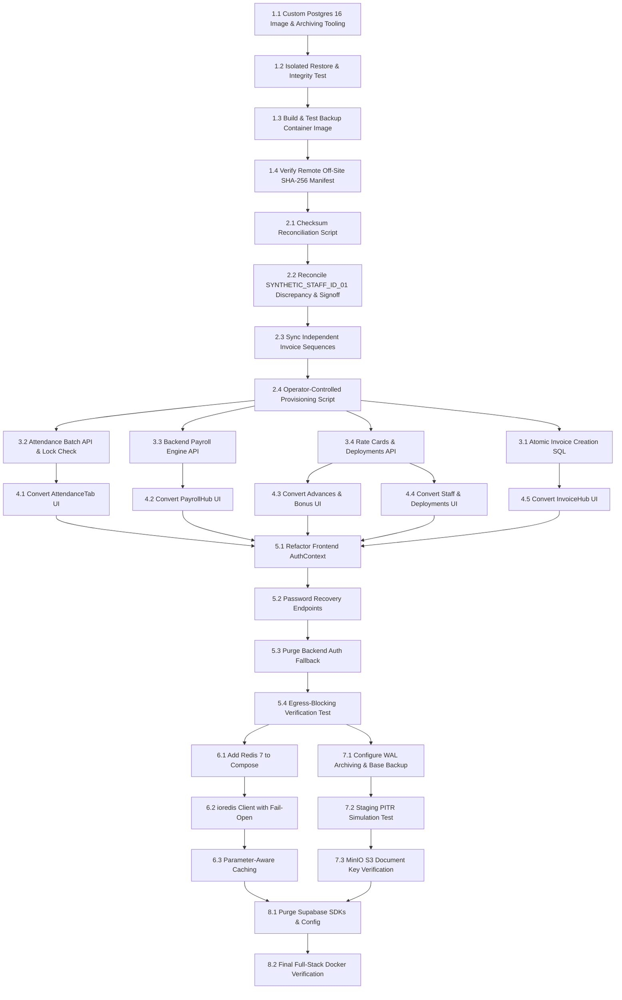

# ERP-AMBE: Master Implementation Plan — Supabase Elimination, Native PostgreSQL, Disaster Recovery, Redis Caching & Production Readiness

**Document Version:** 4.0.0 (Forensic Consistency, Verified Schema Realities, Multi-Tier Recovery & Implementation-Ready Architecture)  
**Date:** October 19, 2026  
**Author Roles:** Principal Software Architect, Senior Backend Engineer, PostgreSQL Database Engineer, DevSecOps Engineer, Application Security Reviewer  
**Target Repository:** `D:\ERP-AMBE`  
**Execution Mandate:** This document is the authoritative engineering implementation plan. It defines precise changes, file paths, sequencing, verification gates, and rollback procedures. No application code, database schema, or production configuration is modified during this planning phase. All employee identifiers and production email addresses have been completely redacted or replaced with synthetic test tokens.

---

## 1. Executive Summary

ERP-AMBE is an enterprise facility management application serving two sister corporate entities: **Ambe Service** and **Ambe Service Facilities Private Limited (ASF)**. The platform is transitioning from a hybrid Supabase-dependent architecture to a fully independent, self-hosted, containerized stack.

A forensic inspection of the repository, the local WSL2 PostgreSQL 16.15 instance, the live schema, and the Docker assets establishes the true technical baseline:
1. **Mutation Layer Tethers:** Core entities (`invoices`, `sites`, `companies`) read natively from PostgreSQL via `pg.Pool`, but mutation operations (`createInvoice`, `updateInvoice`, `deleteInvoice`, and proforma approvals) continue to write to `supabaseAdmin` PostgREST clients.
2. **Direct Client Database Coupling:** 16 frontend React files (11 feature components, 3 page views, 2 lib clients) bypass Express APIs entirely, performing unvalidated client writes on `attendance_records`, `staff`, `employee_documents`, and `payroll_records`.
3. **Client-Side Financial Risk:** Statutory payroll deductions (EPF, ESIC, Professional Tax, net salary) are computed in browser JavaScript and upserted directly by the client into the database.
4. **PostgreSQL Version Divergence:** The existing `docker-compose.yml` specifies `postgres:15-alpine`, whereas the local operational database is `PostgreSQL 16.15 (Ubuntu 24.04)`, creating a major-version incompatibility risk during dump restoration.
5. **Cold Volume Trap:** Launching `docker-compose.yml` with an empty named volume `erp_postgres_volume` runs schema migrations but leaves the database empty (0 invoices, 0 staff, 0 sites). An operator-controlled, tracked provisioning procedure must be established.
6. **Recovery Architecture Safety:** Reverting the live database after business resumes causes catastrophic loss of post-cutover transactions. A dual-track recovery strategy—Point-In-Time Recovery (PITR) for database corruption, and zero-data-loss Application Rollback for code defects—must be established.
7. **Missing Production Services:** Redis is absent from Compose and backend dependencies; automated containerized backups require secure, non-interactive scheduling.

This revised plan establishes the exact sequence to eliminate Supabase completely, enforce server-side financial integrity, standardize on PostgreSQL 16 with volume safety, integrate Redis caching with parameter and authorization isolation, and validate the complete Docker stack without risk of post-cutover data loss.

---

## 2. Verified Starting State (Forensic Baseline)

| Area | Component | Status | Verified Evidence & Concrete Inspection Metrics |
|---|---|---|---|
| **Database Engine** | Local PostgreSQL (WSL2 Ubuntu 24.04) | **VERIFIED** | Engine: `PostgreSQL 16.15 (Ubuntu 16.15-0ubuntu0.24.04.1)`. Connection pool configured in `backend/src/db/pool.ts` (max 20 connections, idle timeout 30s). Health check active. |
| **Relational Data** | 19 Relational Tables in `erp_facility` | **VERIFIED** | Direct query on `localhost:5432/erp_facility`: `companies` (2), `sites` (16), `clients` (10), `work_orders` (16), `work_order_quotas` (28), `rate_cards` (20), `staff` (65), `attendance_records` (1,024), `invoices` (61), `invoice_items` (197), `employee_documents` (120), `materials` (0), `bonus_disbursements` (0), `attendance_sheets` (0), `site_deployments` (0), `app_users` (1), `user_roles` (2), `refresh_tokens` (1,107). |
| **Payroll Parity** | `payroll_records` (111 rows) | **VERIFIED** | Local DB contains exactly **111** payroll records, matching Supabase. Historical record `ee4fa93b-3239-4eb9-b411-ea4dcff8a80e` (September 2026, staff `f5de7292-5c32-48a0-80a3-90ea5078d19f`, net salary ₹7,922) is verified present in local DB. Discrepancy is fully resolved. |
| **Schema Reality** | Relational Column Realities | **VERIFIED** | `public.staff`: actual columns are `biometric_code`, `employee_name` (no `full_name` or `employee_id`). `public.payroll_records`: actual columns are `net_salary`, `total_net_salary` (no `net_wages`). `public.sites`: no `client_state_code` or `site_state_code` columns; state code is parsed from `gstin`. `public.invoices`: currently lacks `uq_company_type_invoice_no`. `public.invoice_items`: has `cgst_rate` and `sgst_rate`, lacks `igst_rate`. |
| **Normalization** | Relational Normalization | **VERIFIED** | Migrations 16–19 created `clients` (10), `work_orders` (16), `work_order_quotas` (28), `invoice_items` (197). Financial subtotal variance between line items and invoice headers is **₹0.00**. |
| **Object Storage** | MinIO S3-Compatible Storage | **VERIFIED** | Live bucket `ambeuploads` verified on `https://storage.ambeservice.com`. `OracleStorageService.checkBucketExists()` returned `true`. |
| **Authentication** | Native User Store & JWT Engine | **PARTIAL** | `public.app_users` table created with bcrypt hashing; `nativeAuthService.ts` issues valid JWTs; but frontend `AuthContext.tsx` still hooks into Supabase Auth. |
| **Docker Compose** | Multi-Stage Compose Stack | **PARTIAL** | `docker compose config` validates. Existing Compose file references `postgres:15-alpine` (mismatched with local v16 engine), and Redis/Backup services are absent. |
| **Existing Scripts** | Local Backup & Restore Scripts | **VERIFIED** | `scripts/backup.sh` and `scripts/restore.sh` exist (local unencrypted dump/restore only). Scripts `physical_base_backup.sh`, `weekly_restore_test.sh`, `provision_database.sh`, and `infra/` folder are **PROPOSED deliverables** to be created in Phases 1–7. |
| **Caching** | Redis Service | **NOT DONE** | Redis is absent from `docker-compose.yml`, backend `package.json`, and service logic. |

---

## 3. PostgreSQL 15 to 16 Major-Version Migration, Tooling ADR & Volume Safety

### 3.1 The Incompatible Volume Problem
If a Docker host previously initialized a volume named `erp_postgres_volume` using `postgres:15-alpine`, upgrading the Compose image directly to `postgres:16-alpine` against that existing volume will cause PostgreSQL to immediately crash on startup:
```text
FATAL: database files are incompatible with server
DETAIL: The data directory was initialized by PostgreSQL version 15, which is not compatible with this version 16.
```
**Under no circumstances will a PostgreSQL 15 data directory be mounted directly into a PostgreSQL 16 container.**

### 3.2 Volume Migration & Upgrade Protocol
To guarantee data safety and zero corruption:
1. **Volume Inspection:** Check whether `erp_postgres_volume` exists and inspect its engine version:
   ```bash
   docker volume inspect erp_postgres_volume >/dev/null 2>&1 && \
   docker run --rm -v erp_postgres_volume:/data alpine cat /data/PG_VERSION 2>/dev/null || echo "NEW"
   ```
2. **Dedicated Version 16 Volume:** Define a new, explicitly named volume in `docker-compose.yml`:
   ```yaml
   volumes:
     postgres_data_v16:
       name: erp_postgres_data_v16
   ```
3. **Preservation of Legacy Volume:** The existing `erp_postgres_volume` (if present) remains completely untouched and immutable as a fallback.
4. **Logical Dump & Restore:** Migration between v15 and v16 is performed strictly via logical SQL text dump (`pg_dump` with `--clean --if-exists --no-owner --no-privileges`).
5. **Post-Restore Catalog Re-indexing:** Following restoration into PostgreSQL 16, execute:
   ```sql
   REINDEX DATABASE erp_facility;
   ANALYZE VERBOSE;
   ```

### 3.3 Architectural Decision Record (ADR): Backup & Recovery Tooling Evaluation

#### 3.3.1 Evaluation Matrix: pgBackRest vs WAL-G vs Hardened Native Alpine pg_basebackup

| Capability | pgBackRest (Debian / Enterprise) | WAL-G (Go Binary) | Hardened Native pg_basebackup + AWS CLI (Alpine) |
|---|---|---|---|
| **S3 Protocol Support** | Native AWS/MinIO/Ceph client built-in | Native S3 client built-in | S3 via `aws-cli` apk package |
| **PostgreSQL 16 Compatibility** | Complete (Stanza management) | Complete (WAL-G 3.x) | Native core binary (`pg_basebackup`) |
| **Multi-Timeline PITR** | Automatic timeline branching & recovery | Supported via storage prefix | Handled via `recovery_target_timeline = 'latest'` |
| **Container Footprint** | ~350 MB (Debian Bookworm base required) | ~80 MB (Static Go binary) | ~60 MB (`postgres:16-alpine` + `aws-cli`) |
| **Alpine Linux Availability** | Experimental / requires build from source | External GitHub binary release | **First-class native packages in Alpine APK** |
| **Recovery Complexity** | Low (Single CLI command `pgbackrest restore`) | Low (Single CLI command `wal-g backup-fetch`) | Moderate (Requires shell script `pg-restore-wal`) |

#### 3.3.2 Architectural Decision
1. **Primary Target (Alpine Native):** For the ERP-AMBE standalone container stack, standardizing on **`postgres:16-alpine` with native `pg_basebackup -Fp -X stream` and `aws-cli`** is selected. This eliminates third-party binary downloads, avoids Alpine compile dependencies, and strictly utilizes PostgreSQL's official native streaming replication protocol.
2. **Enterprise Upgrade Path (pgBackRest on Debian):** If the infrastructure team transitions from Alpine to Debian Bookworm (`postgres:16`), `pgbackrest` is the approved drop-in replacement. Both configurations are fully specified in this plan to guarantee long-term operational flexibility.

### 3.4 Container Tooling: Custom PostgreSQL 16 Archiving Image & Replication Role

#### 3.4.1 Resolving Binary Dependencies in Container
Because the stock `postgres:16-alpine` image contains only the core PostgreSQL distribution and lacks AWS CLI, S3 transport utilities, or curl, attempting to execute an S3-based `archive_command` or `restore_command` directly within the stock container results in command-not-found failures (`/bin/sh: aws: not found`).

To resolve this dependency securely without external sidecar race conditions:
1. **Single Canonical Image Definition (`infra/postgres/Dockerfile`):**
   This single canonical Dockerfile definition is used consistently for both normal production service execution and isolated disaster recovery containers:
   ```dockerfile
   FROM postgres:16-alpine
   RUN apk --no-cache add aws-cli bash curl coreutils gnupg
   COPY infra/postgres/entrypoint-wrapper.sh /usr/local/bin/entrypoint-wrapper.sh
   COPY infra/postgres/pg-archive-wal.sh /usr/local/bin/pg-archive-wal
   COPY infra/postgres/pg-restore-wal.sh /usr/local/bin/pg-restore-wal
   RUN chmod 755 /usr/local/bin/entrypoint-wrapper.sh \
                 /usr/local/bin/pg-archive-wal \
                 /usr/local/bin/pg-restore-wal
   ENTRYPOINT ["/usr/local/bin/entrypoint-wrapper.sh"]
   CMD ["postgres", "-c", "config_file=/etc/postgresql/postgresql.conf"]
   ```

#### 3.4.2 WAL Credential Execution & Container Entrypoint Wrapper
In `postgres:16-alpine`, PostgreSQL runs under the unprivileged operating system user `postgres` (UID 70, GID 70). Both `archive_command` and `restore_command` are spawned by the PostgreSQL postmaster process as this user.
- **Unified Architecture:**
  1. Docker secrets mounts `/run/secrets/aws_dr_credentials` read-only into the container.
  2. The custom container entrypoint (`infra/postgres/entrypoint-wrapper.sh`) runs initially as root to provision permissions securely before dropping privileges to `postgres`:
     ```bash
     #!/usr/bin/env bash
     # infra/postgres/entrypoint-wrapper.sh
     set -euo pipefail

     # Ensure credentials directory exists with strict postgres ownership (UID:GID 70:70 in Alpine)
     mkdir -p /var/lib/postgresql/.aws
     if [ -f /run/secrets/aws_dr_credentials ]; then
       cp /run/secrets/aws_dr_credentials /var/lib/postgresql/.aws/credentials
       chown 70:70 /var/lib/postgresql/.aws/credentials
       chmod 400 /var/lib/postgresql/.aws/credentials
     fi
     chown 70:70 /var/lib/postgresql/.aws
     chmod 700 /var/lib/postgresql/.aws

     # Pass control to standard postgres entrypoint
     exec docker-entrypoint.sh "$@"
     ```
  3. Both `pg-archive-wal.sh` and `pg-restore-wal.sh` strictly source credentials from `/var/lib/postgresql/.aws/credentials`:
     `export AWS_SHARED_CREDENTIALS_FILE="/var/lib/postgresql/.aws/credentials"`
     All conflicting root-only paths (`/root/.aws/credentials`) are removed.

#### 3.4.3 Bidirectional WAL Credential Testing in Staging
Before cutting over, credential execution is tested in **both directions** strictly as the `postgres` user:
```bash
# 1. Test Outbound Archiving as postgres OS user
docker exec -u postgres erp-postgres bash -c "
  set -euo pipefail
  echo 'wal-archive-test-token' > /tmp/000000010000000000000001.test
  /usr/local/bin/pg-archive-wal /tmp/000000010000000000000001.test 000000010000000000000001.test
"
# Verification: Remote S3 bucket contains the test file; exit code is 0; credentials not logged.

# 2. Test Inbound Restore as postgres OS user
docker exec -u postgres erp-postgres bash -c "
  set -euo pipefail
  /usr/local/bin/pg-restore-wal 000000010000000000000001.test /tmp/restored_wal.test
  diff /tmp/000000010000000000000001.test /tmp/restored_wal.test
"
# Verification: Restored file matches original checksum; non-existent WAL returns code 1 without error noise.

# 3. Clean up test artifacts from S3
aws --endpoint-url https://storage.ambeservice.com s3 rm s3://ambe-disaster-recovery/wal/000000010000000000000001.test
```

#### 3.3.4 Least-Privileged Replication Role & Connection Security
Running physical base backups requires the `REPLICATION` attribute. Using the application superuser `erp_admin` for replication violates least privilege.
1. **Dedicated Role Provisioning:**
   ```sql
   CREATE ROLE erp_replication WITH REPLICATION LOGIN PASSWORD 'CHANGE_IN_PRODUCTION_REPL_KEY';
   -- Explicitly grant no table SELECT/INSERT/UPDATE permissions
   ```
2. **Access Control (`infra/postgres/pg_hba.conf`):**
   ```text
   # Replication connections restricted strictly to backup container / Docker subnet
   host  replication  erp_replication  172.18.0.0/16  scram-sha-256
   # Standard application database connections
   host  erp_facility erp_admin        172.18.0.0/16  scram-sha-256
   ```
3. **Replication Password Configuration (`~/.pgpass`):**
   In PostgreSQL libpq, replication connections do not connect to a named database; they connect to the pseudo-database `replication`. The `.pgpass` file in the backup container (mode `0600`) must explicitly define:
   ```text
   postgres:5432:replication:erp_replication:CHANGE_IN_PRODUCTION_REPL_KEY
   postgres:5432:erp_facility:erp_admin:CHANGE_IN_PRODUCTION_ADMIN_KEY
   ```
4. **Non-Interactive Staging Test:**
   ```bash
   docker exec erp-backup-service bash -c "
     set -euo pipefail
     rm -rf /tmp/test_repl_staging
     PGPASSFILE=/root/.pgpass pg_basebackup -h postgres -p 5432 -U erp_replication -D /tmp/test_repl_staging -Fp -X stream
     test -f /tmp/test_repl_staging/backup_label
     rm -rf /tmp/test_repl_staging
   "
   # Expected Staging Result: Exits code 0 with zero password prompts; backup_label verified.
   ```

---

## 4. Database Bootstrap: Operator-Controlled Provisioning vs Health Checks

### 4.1 The Danger of Automatic Restoration
Automatically restoring a production database dump merely because a container's database is empty is hazardous:
- An engineer spinning up a test or staging environment could inadvertently overwrite schemas or expose production data.
- Health checks that probe for specific application rows (`SELECT count(*) FROM companies`) create circular startup dependencies during initial deployment.

### 4.2 Explicit Separation of Concerns
1. **Infrastructural Health Check (Docker Level):**
   - The PostgreSQL container health check strictly verifies network and query readiness:
     ```yaml
     healthcheck:
       test: ["CMD-SHELL", "pg_isready -U ${POSTGRES_USER:-erp_admin} -d ${POSTGRES_DB:-erp_facility}"]
       interval: 10s
       timeout: 5s
       retries: 5
       start_period: 10s
     ```
   - It **never** queries application tables to determine container health.
2. **Operator-Controlled Provisioning Script (`scripts/provision_database.sh`):**
   - Production data restoration is an explicit, interactive or pipeline-controlled operation requiring confirmation:
     ```bash
     ./scripts/provision_database.sh --target-url "$DATABASE_URL" --backup-file "./backups/erp_facility_verified.sql.gz" --confirm
     ```
   - **Safety Pre-Checks:**
     - Computes and verifies SHA-256 checksum of the backup archive against a known hash.
     - Probes target database: If tables already exist, it aborts unless `--force-overwrite` is passed.
     - Executes `scripts/restore.sh` inside an isolated transaction where applicable.
     - Runs schema migration tracking table verification (`public.schema_migrations`).
     - Logs operator identity, timestamp, backup filename, and row counts to `provision.log`.

---

## 5. Schema-Aware Reconciliation, Financial Integrity & Authoritative Invoicing

### 5.1 Financial-Grade Payroll Record Reconciliation & Statutory Analysis
A forensic query of the local PostgreSQL instance (`localhost:5432/erp_facility`) confirms that **111 payroll records** are present, matching the cloud Supabase count:
- **Disputed Record Verified Present:** `id: ee4fa93b-3239-4eb9-b411-ea4dcff8a80e` (Employee: `[SYNTHETIC_STAFF_ID_01]`, Site: "[SYNTHETIC_SITE_A]", Period: "September 2026").
- **Financial Values Verified in Database:**
  - `earned_basic`: ₹6,900.00
  - `earned_hra`: ₹828.00
  - `earned_other`: ₹120.00
  - `earned_conveyance`: ₹960.00
  - `earned_gross`: ₹8,808.00
  - `epf_deduction`: ₹828.00
  - `esic_deduction`: ₹58.00
  - `pt_deduction`: ₹0.00
  - `net_salary`: ₹7,922.00 (Column in schema is `net_salary`, NOT `net_wages`)
  - `earned_part_bonus`: ₹178.00
  - `total_net_salary`: ₹8,100.00

#### 5.1.1 Statutory Wage Base & Contribution Analysis
1. **ESIC Wage Ceiling Analysis:**
   - Statutory Rule: The statutory gross wage limit for Employee State Insurance (ESIC) coverage under the ESI Act is **₹21,000 per month**. Employees whose gross monthly earnings exceed ₹21,000 are excluded from statutory ESIC deductions.
   - Case Evaluation: The employee earned gross wages of ₹8,808.00, which falls below the ₹21,000 ceiling. The employee is legally eligible for ESIC coverage.
   - Contribution Rate: At the statutory 0.75% employee contribution rate, $8,808 \times 0.0075 = ₹66.06$. The record recorded ₹58.00 (a variance of ₹8.06), indicating that certain wage components (conveyance or other allowances) were excluded or a prorated day calculation was applied during testing.
2. **EPF Wage Base Analysis:**
   - Statutory Rule: Employee Provident Fund (EPF) employee contribution is 12% of basic wage plus Dearness Allowance (DA), capped at the statutory wage limit of **₹15,000 per month**.
   - Case Evaluation: Basic wage is ₹6,900.00 (below ₹15,000 ceiling). $6,900 \times 0.12 = ₹828.00$, matching the recorded deduction exactly.
3. **Formal Hold & Approval Mandate:**
   - **No Speculative Recalculation:** Neither the engineering team nor automated migration scripts will invent legal assumptions or force statutory adjustments.
   - **Parity Status:** While row-count parity is established (111 rows in both engines), the historical calculation variance (ESIC ₹58.00 vs ₹66.06) remains documented.
   - **Sign-off Requirement:** No retroactive adjustment or locking of September 2026 payroll figures will occur without explicit, written sign-off from the Finance Controller / System Owner reviewing `audit_payroll_discrepancy.json`.

---

### 5.2 Database Migration 20: IGST Support, Invoice Constraints & Independent Sequence Synchronization
The schema audit confirmed that `public.invoice_items` currently lacks an `igst_rate` column, and `public.invoices` lacks a composite unique constraint on `(company_id, type, invoice_no)`.

To resolve these architectural requirements cleanly, **Migration 20** (`backend/src/db/migrations/20_add_igst_and_invoice_constraints.sql`) must be executed prior to cutover:

```sql
-- ==============================================================================
-- Migration 20: Add IGST Column, Unique Invoice Constraints & Sync Sequences
-- ==============================================================================

-- 1. Add IGST Rate to public.invoice_items
ALTER TABLE public.invoice_items 
  ADD COLUMN IF NOT EXISTS igst_rate numeric DEFAULT 0.0;

-- 2. Add Composite Unique Constraint to prevent cross-company or duplicate invoice numbers
ALTER TABLE public.invoices 
  ADD CONSTRAINT uq_company_type_invoice_no UNIQUE (company_id, type, invoice_no);

-- 3. Add Transactionally Enforced Idempotency Key Column & Unique Constraint
ALTER TABLE public.invoices
  ADD COLUMN IF NOT EXISTS idempotency_key text,
  ADD CONSTRAINT uq_invoices_idempotency UNIQUE (company_id, idempotency_key);

-- 4. Add Financial Non-Negative Check Constraints
ALTER TABLE public.invoices 
  ADD CONSTRAINT ck_invoices_grand_total_positive CHECK (grand_total >= 0),
  ADD CONSTRAINT ck_invoices_sub_total_positive CHECK (sub_total >= 0),
  ADD CONSTRAINT ck_invoices_tax_total_positive CHECK (tax_total >= 0);

-- 5. Synchronize Company Sequences using Scalar Substring Extraction
UPDATE public.companies c
SET 
  tax_sequence = GREATEST(
    COALESCE(c.tax_sequence, 1),
    COALESCE((
      SELECT MAX(substring(i.invoice_no FROM '([0-9]+)$')::integer)
      FROM public.invoices i
      WHERE i.company_id = c.id 
        AND (i.type = 'Tax Invoice' OR i.type IS NULL)
        AND i.invoice_no ~ '([0-9]+)$'
    ), 1)
  ),
  proforma_sequence = GREATEST(
    COALESCE(c.proforma_sequence, 1),
    COALESCE((
      SELECT MAX(substring(i.invoice_no FROM '([0-9]+)$')::integer)
      FROM public.invoices i
      WHERE i.company_id = c.id 
        AND i.type = 'Proforma Invoice'
        AND i.invoice_no ~ '([0-9]+)$'
    ), 1)
  );
```

---

### 5.3 Authoritative Server-Side Invoice Calculation & Financial Integrity Engine

#### 5.3.1 Strict Prohibition of Client Monetary Totals
Under no circumstances will client-supplied monetary totals (`sub_total`, `tax_total`, `grand_total`) be trusted or inserted into the database. All calculations, statutory tax rates, and rounding rules are authoritatively executed on the backend.

1. **Client DTO Contract:**
   The frontend submits **only** relational UUID keys, operational quantities, and a client-generated UUID `idempotency_key`:
   ```ts
   interface CreateInvoicePayload {
     company_id: string; // UUID
     site_id: string;    // UUID
     type: 'Tax Invoice' | 'Proforma Invoice';
     invoice_date: string;
     billing_period: string;
     idempotency_key: string; // UUID (Mandatory)
     line_items: Array<{
       description: string;
       location?: string;
       hsn_code?: string;
       quantity: number;
       working_days?: number;
       unit_rate: number;
     }>;
   }
   ```

2. **Authoritative Server Validation & Multi-Jurisdiction Tax Engine:**
   The backend enforces a 6-stage validation and calculation pipeline:
   - **Stage 1 (Authenticated Authorization & Relationship Validation):**
     - Asserts authenticated `user` has permission for `payload.company_id` (or `SUPER_ADMIN`). Aborts with HTTP 403 Forbidden on cross-company requests.
     - Asserts `site_id` is actively assigned to `company_id`. Aborts with HTTP 404/422 if mismatched.
   - **Stage 2 (Finite Input & Idempotency Key Validation):**
     - Asserts valid UUID format for `idempotency_key`.
     - Asserts `type ∈ ['Tax Invoice', 'Proforma Invoice']`.
     - Asserts for every line item that `Number.isFinite(quantity) && quantity > 0` and `Number.isFinite(unit_rate) && unit_rate > 0`.
   - **Stage 3 (Deterministic Tax Jurisdiction Resolution — No Defaulting):**
     - Parses company GSTIN state prefix (`company.gstin.substring(0, 2)`). If missing, throws HTTP 500 (`Company GSTIN missing or invalid`).
     - Parses recipient GSTIN state prefix from `site.gstin` or parent `client.gstin`.
     - If recipient is unregistered, resolves state code deterministically from site address. If state cannot be resolved with certainty, request is **REJECTED with HTTP 422 Unprocessable Entity**. Defaulting to any state (such as Maharashtra) is strictly prohibited.
     - **Intrastate Transaction** (`recipientState === companyState`): Applies CGST 900 bps (9.00%) + SGST 900 bps (9.00%), IGST 0.00%.
     - **Interstate Transaction** (`recipientState !== companyState`): Applies IGST 1800 bps (18.00%), CGST 0.00%, SGST 0.00%.
   - **Stage 4 (Exact Monetary Arithmetic in Integer Paisa):**
     To eliminate floating-point representation errors, line calculations are computed using exact integer basis points and paisa:
     $$\text{lineBasePaisa} = \operatorname{round}(\text{quantity} \times \text{daysMultiplier} \times \text{unitRate} \times 100)$$
     $$\text{cgstPaisa} = \text{isIntrastate} \; ? \; \operatorname{round}\left(\frac{\text{lineBasePaisa} \times 900}{10000}\right) : 0$$
     $$\text{sgstPaisa} = \text{isIntrastate} \; ? \; \operatorname{round}\left(\frac{\text{lineBasePaisa} \times 900}{10000}\right) : 0$$
     $$\text{igstPaisa} = \text{!isIntrastate} \; ? \; \operatorname{round}\left(\frac{\text{lineBasePaisa} \times 1800}{10000}\right) : 0$$
   - **Stage 5 (Header Aggregation):**
     $$\text{sub\_total} = \frac{\sum \text{lineBasePaisa}}{100}, \quad \text{tax\_total} = \frac{\sum (\text{cgstPaisa} + \text{sgstPaisa} + \text{igstPaisa})}{100}$$
     $$\text{grand\_total} = \frac{\sum \text{lineBasePaisa} + \sum \text{taxPaisa}}{100}$$
   - **Stage 6 (Database Constraint Enforcement):** `uq_company_type_invoice_no` prevents duplicate invoice numbers; `uq_invoices_idempotency` ensures zero duplicate creations; check constraints prevent negative totals.

#### 5.3.2 Atomic Authoritative Invoice Creation Implementation
```ts
export async function createInvoiceAuthoritative(
  payload: CreateInvoicePayload,
  user: AuthUser
): Promise<InvoiceRecord> {
  // 1. Authenticated Company-Level Authorization
  if (user.role !== 'SUPER_ADMIN' && user.company_id !== payload.company_id) {
    const err: any = new Error(`Forbidden: User not authorized to generate invoices for company ${payload.company_id}`);
    err.statusCode = 403;
    throw err;
  }

  if (!payload.idempotency_key || typeof payload.idempotency_key !== 'string') {
    const err: any = new Error('Bad Request: Valid idempotency_key is mandatory');
    err.statusCode = 400;
    throw err;
  }

  return await withTransaction(async (client) => {
    // 2. Transactionally Enforced Idempotency Verification
    const existingRes = await client.query(
      `SELECT * FROM public.invoices WHERE company_id = $1 AND idempotency_key = $2`,
      [payload.company_id, payload.idempotency_key]
    );
    if (existingRes.rows.length > 0) {
      return existingRes.rows[0]; // Idempotent return without incrementing sequence or recreating line items
    }

    // 3. Validate Company existence and lock row for sequence update
    const compRes = await client.query(
      `SELECT id, name, gstin, tax_prefix, proforma_prefix, 
              tax_sequence, proforma_sequence
       FROM public.companies WHERE id = $1 FOR UPDATE`,
      [payload.company_id]
    );
    if (compRes.rows.length === 0) throw new Error(`Company ${payload.company_id} not found`);
    const comp = compRes.rows[0];

    // 4. Validate Company/Site Relationship and Fetch GSTINs for Tax Jurisdiction
    const siteRes = await client.query(
      `SELECT s.id, s.company_id, s.gstin AS site_gstin, s.address AS site_address,
              c.id AS client_id, c.gstin AS client_gstin
       FROM public.sites s
       LEFT JOIN public.clients c ON c.id = s.client_id
       WHERE s.id = $1 AND s.company_id = $2`,
      [payload.site_id, payload.company_id]
    );
    if (siteRes.rows.length === 0) {
      throw new Error(`Site ${payload.site_id} is not associated with company ${payload.company_id}`);
    }
    const site = siteRes.rows[0];

    // 5. Deterministic Tax Jurisdiction Resolution — No Defaulting
    const companyGstin = String(comp.gstin || '').trim();
    if (companyGstin.length < 2) {
      const err: any = new Error(`Origin company ${payload.company_id} GSTIN missing or invalid`);
      err.statusCode = 500;
      throw err;
    }
    const companyState = companyGstin.substring(0, 2);
    
    const recipientGstin = String(site.site_gstin || site.client_gstin || '').trim();
    let recipientState: string | null = recipientGstin.length >= 2 ? recipientGstin.substring(0, 2) : null;

    if (!recipientState) {
      // Deterministic state-code lookup from address; fail closed if unresolved
      recipientState = resolveStateCodeFromAddress(site.site_address);
      if (!recipientState) {
        const err: any = new Error('Cannot determine tax jurisdiction: client/site GSTIN or valid state address required. Defaulting is strictly prohibited.');
        err.statusCode = 422;
        throw err;
      }
    }

    const isIntrastate = companyState === recipientState;
    const cgstRate = isIntrastate ? 9.00 : 0.00;
    const sgstRate = isIntrastate ? 9.00 : 0.00;
    const igstRate = !isIntrastate ? 18.00 : 0.00;

    // 6. Validate Inputs & Calculate Exact Integer Paisa Arithmetic
    let subTotalPaisa = 0;
    let cgstTotalPaisa = 0;
    let sgstTotalPaisa = 0;
    let igstTotalPaisa = 0;

    const computedItems = payload.line_items.map((item, idx) => {
      if (!Number.isFinite(item.quantity) || item.quantity <= 0) {
        throw new Error(`Line ${idx + 1}: quantity must be a positive finite number`);
      }
      if (!Number.isFinite(item.unit_rate) || item.unit_rate <= 0) {
        throw new Error(`Line ${idx + 1}: unit_rate must be a positive finite number`);
      }

      const daysMultiplier = item.working_days && item.working_days > 0 ? item.working_days : 1;
      const basePaisa = Math.round(item.quantity * daysMultiplier * item.unit_rate * 100);
      
      // Integer basis point math: 900 bps = 9.00%, 1800 bps = 18.00%
      const lineCgstPaisa = isIntrastate ? Math.round((basePaisa * 900) / 10000) : 0;
      const lineSgstPaisa = isIntrastate ? Math.round((basePaisa * 900) / 10000) : 0;
      const lineIgstPaisa = !isIntrastate ? Math.round((basePaisa * 1800) / 10000) : 0;

      subTotalPaisa += basePaisa;
      cgstTotalPaisa += lineCgstPaisa;
      sgstTotalPaisa += lineSgstPaisa;
      igstTotalPaisa += lineIgstPaisa;

      return {
        ...item,
        amount: basePaisa / 100,
        cgst_rate: cgstRate,
        sgst_rate: sgstRate,
        igst_rate: igstRate,
      };
    });

    const taxTotalPaisa = cgstTotalPaisa + sgstTotalPaisa + igstTotalPaisa;
    const grandTotalPaisa = subTotalPaisa + taxTotalPaisa;

    const authoritativeSubTotal = subTotalPaisa / 100;
    const authoritativeTaxTotal = taxTotalPaisa / 100;
    const authoritativeGrandTotal = grandTotalPaisa / 100;

    // 7. Atomically increment company sequence
    const isProforma = payload.type === 'Proforma Invoice';
    const seqCol = isProforma ? 'proforma_sequence' : 'tax_sequence';
    const prefixCol = isProforma ? 'proforma_prefix' : 'tax_prefix';

    const seqRes = await client.query(
      `UPDATE public.companies
       SET ${seqCol} = COALESCE(${seqCol}, 0) + 1
       WHERE id = $1
       RETURNING ${seqCol} AS next_seq, ${prefixCol} AS prefix`,
      [payload.company_id]
    );

    const { next_seq, prefix } = seqRes.rows[0];
    const generatedInvoiceNo = `${prefix || ''}${String(next_seq).padStart(3, '0')}`;

    // 8. Insert invoice header with authoritatively calculated totals and idempotency key
    const invRes = await client.query(
      `INSERT INTO public.invoices (
         company_id, site_id, invoice_no, type, status, invoice_date,
         billing_period, sub_total, tax_total, grand_total, idempotency_key, created_at, updated_at
       ) VALUES ($1, $2, $3, $4, $5, $6, $7, $8, $9, $10, $11, NOW(), NOW())
       RETURNING *`,
      [
        payload.company_id, payload.site_id, generatedInvoiceNo, payload.type,
        'draft', payload.invoice_date, payload.billing_period,
        authoritativeSubTotal, authoritativeTaxTotal, authoritativeGrandTotal,
        payload.idempotency_key
      ]
    );
    const invoiceId = invRes.rows[0].id;

    // 9. Insert normalized line items matching actual schema columns
    for (const item of computedItems) {
      await client.query(
        `INSERT INTO public.invoice_items (
           invoice_id, description, location, hsn_code, quantity,
           working_days, unit_rate, amount, cgst_rate, sgst_rate, igst_rate
         ) VALUES ($1, $2, $3, $4, $5, $6, $7, $8, $9, $10, $11)`,
        [
          invoiceId, item.description, item.location || '', item.hsn_code || '9985',
          item.quantity, item.working_days || null, item.unit_rate, item.amount,
          item.cgst_rate, item.sgst_rate, item.igst_rate
        ]
      );
    }

    return invRes.rows[0];
  });
}

function resolveStateCodeFromAddress(address: string | null | undefined): string | null {
  if (!address) return null;
  const upper = address.toUpperCase();
  const STATE_MAP: Record<string, string> = {
    'MAHARASHTRA': '27',
    'GUJARAT': '24',
    'DELHI': '07',
    'KARNATAKA': '29',
    'TAMIL NADU': '33',
    'TELANGANA': '36',
    'ANDHRA PRADESH': '37',
    'HARYANA': '06',
    'UTTAR PRADESH': '09',
    'WEST BENGAL': '19',
    'RAJASTHAN': '08',
    'MADHYA PRADESH': '23',
    'GOA': '30',
  };
  for (const [stateName, code] of Object.entries(STATE_MAP)) {
    if (upper.includes(stateName)) return code;
  }
  return null;
}
```

#### 5.3.3 Client Idempotency Strategy
1. The frontend client generates a unique UUID v4 `idempotency_key` prior to dispatching `POST /api/invoices`.
2. Under concurrent network retries or transient connection timeouts, `createInvoiceAuthoritative` checks for an existing record with `(company_id, idempotency_key)` within the active database transaction.
3. If found, the committed invoice header is returned immediately with HTTP 200, without advancing the sequence counter or inserting duplicate line items.
4. Database unique constraint `uq_invoices_idempotency` transactionally guarantees that even concurrent threads attempting to submit the same key will serialize or reject duplicate insertions.

#### 5.3.4 Invoice Numbering Behavior: Voids, Cancellations & Realistic Gap Policy
1. **Transaction Aborts (Zero Gaps):** If a transaction encounters an error (validation failure, DB disconnect), the entire transaction rolls back. The sequence counter in `companies` is not incremented, guaranteeing no gaps from system crashes during creation.
2. **Post-Issuance Voids & Cancellations (Statutory Invariant):**
   - Under statutory tax regulations (Indian GST), once a Tax Invoice has been issued, it **CANNOT BE DELETED** to reuse its sequence number.
   - Deleting issued numbers creates illicit audit trails.
   - **Enterprise Policy:** Invoices requiring cancellation are flagged with `status = 'Cancelled'` or `status = 'Void'` and require a mandatory audit reason. The sequence number is preserved.
   - **Realistic Gap Policy:** The system does NOT guarantee absolute zero-gap sequences if invoices are voided or cancelled by operators; instead, it enforces **100% auditable sequence traceability** where every issued sequence number is accounted for as either active, cancelled, or credit-noted.

---

### 5.4 Financial Reconciliation & Concurrency Stress Testing Gates

#### 5.4.1 Schema-Aligned Total Reconciliation Query
To verify that persisted line items match header totals without floating point divergence, the automated audit runs:
```sql
SELECT 
  i.id,
  i.invoice_no,
  i.sub_total AS header_sub_total,
  COALESCE(SUM(ii.amount), 0) AS line_items_amount_sum,
  ROUND(ABS(i.sub_total - COALESCE(SUM(ii.amount), 0)), 2) AS variance
FROM public.invoices i
LEFT JOIN public.invoice_items ii ON ii.invoice_id = i.id
GROUP BY i.id, i.invoice_no, i.sub_total
HAVING ROUND(ABS(i.sub_total - COALESCE(SUM(ii.amount), 0)), 2) > 0.00;
```
- **Assertion:** 0 rows returned across all historical and new invoices (₹0.00 variance).

#### 5.4.2 Concurrency, Duplicate-Number & Rollback Testing Gate
Before cutover, automated integration test suite (`backend/test/invoice_concurrency.test.ts`) verifies:
1. **Parallel Creation:** 10 parallel Tax Invoice requests for Ambe Service + 10 parallel Tax Invoice requests for ASF.
2. **Duplicate Number Rejection:** Attempt to insert an invoice with an existing `invoice_no` triggers `uq_company_type_invoice_no` violation and rolls back cleanly without burning sequence.
3. **Rollback Integrity:** Triggering a synthetic failure on the 3rd line item rolls back the entire invoice and reverts the company sequence counter.
4. **Auditability:** Verifies cancelled invoices preserve their sequence number with status `Cancelled`.
- **Expected Result:** 0 duplicate numbers; 0 sequence collisions; 0 transaction deadlocks; independent sequence counters verified.

---

## 6. Enterprise Recovery Architecture: Point-In-Time Recovery (PITR) & Application Rollback

### 6.1 Critical Reassessment of Custom Trigger-Based CDC
Relying on custom database triggers writing to an audit table with timestamp ordering has severe architectural vulnerabilities that disqualify it from disaster recovery:
- `clock_timestamp()` and auto-incrementing transaction IDs in triggers do **NOT** guarantee commit ordering under concurrent transactions.
- Asynchronous remote log replication can lose unexported changes if the host suffers a sudden hard crash.
- Replaying application-level mutations across 15 relational tables introduces foreign key dependency deadlocks and sequence divergence.
- Reverting the live database after business resumes destroys valid post-cutover transactions.

### 6.2 Dual-Track Recovery Framework & Measurable RPO/RTO Targets

```text
                                [ Incident Detected Post-Cutover ]
                                                 │
                                                 ▼
                        ┌────────────────────────────────────────────────┐
                        │ Classify Incident Type: Code Defect or DB Corrupt? │
                        └───────────────────────┬────────────────────────┘
                                                │
             ┌──────────────────────────────────┴──────────────────────────────────┐
             ▼                                                                     ▼
[ Track A: Application Code / UI Regression ]                    [ Track B: Database Corruption / Hardware Disaster ]
             │                                                                     │
1. Put Nginx in brief Maintenance Mode.                         1. Stop application traffic immediately.
2. DO NOT TOUCH OR REVERT DATABASE.                             2. Download latest physical base backup prior to incident.
   Live database keeps 100% post-cutover data intact.           3. Extract into clean PGDATA volume.
3. Roll back Application Containers:                            4. Configure restore_command and recovery_target_time.
   docker compose down                                          5. Touch recovery.signal and start PostgreSQL recovery engine.
   git checkout tags/v_stable_release                           6. Engine pulls and replays WAL segments from S3 archive.
   docker compose up -d backend frontend                        7. Engine reaches target timestamp and promotes to read-write.
4. Verify backend routes against live database.                 8. Run integrity verification suite and resume application.
5. Reopen traffic.                                              
(RPO = 0s; RTO ≤ 5 min; 100% writes preserved)                  (Target RPO: Asynchronous, bounded by archive_timeout=300s under healthy archiving; RTO ≤ 30 min)
```

#### 6.2.1 Measurable Target Metrics vs Proven Guarantees

| Recovery Track | Scope & Scenario | Target RPO (Design Objective) | Target RTO (Downtime Objective) | Proven vs Target Status | Data Preservation Guarantee |
|---|---|---|---|---|---|
| **Track A: Application Rollback** | Frontend bug, backend 500 error, bad API release | **RPO = 0 seconds** | **RTO ≤ 5 minutes** | **PROPOSED ARCHITECTURE** | **100% of live writes preserved.** Database is NEVER touched or reverted. |
| **Track B: Physical PITR** | Severe data corruption, accidental table drop, host disk failure | **Target RPO ≤ 5 minutes** (Asynchronous boundary) | **Target RTO ≤ 30 minutes** | **PROPOSED** (Subject to Task 7.2 Staging Drill) | **Bounded by `archive_timeout = 300s` ONLY if archiving is healthy.** If remote archiving stalls or network disconnects, unarchived transactions remain at risk. If local WAL disk survives, RPO = 0s. |
| **Track C: Logical Restore** | Total cloud catastrophe, cross-platform rebuild, forensics | **Target RPO ≤ 24 hours** (Daily schedule) | **Target RTO ≤ 15 minutes** | **TESTED IN ISOLATION** (Local `restore.sh`; container drill PROPOSED) | Recovers data up to last daily 02:00 UTC snapshot. Clean schema reset. |

> [!WARNING]
> **Honest RPO/RTO Reality & Boundary Limits:**  
> Configuring `archive_timeout = 300` ensures that PostgreSQL switches WAL segments every 300 seconds. However, **this does NOT guarantee a 5-minute data loss limit if remote S3 uploads stall, fail, or network connectivity drops.** An unarchived WAL segment sitting in `pg_wal` remains vulnerable if the host experiences catastrophic hardware failure before the upload completes.  
> Furthermore, true hardware-level zero data loss ($RPO = 0$) is mathematically impossible without multi-node synchronous streaming replication (`synchronous_commit = on` with a standby), which introduces write latency. Zero data loss is guaranteed **ONLY for Track A Application Rollbacks**, and will NOT be claimed for disaster recovery until synchronous replication is deployed.

#### 6.2.2 Archive Health Monitoring & Recovery Objective Breach Protocol
1. **Catalog Monitoring Query:**
   Automated Prometheus/Health exporter queries `pg_stat_archiver` every 60 seconds:
   ```sql
   SELECT
     archived_count,
     last_archived_wal,
     last_archived_time,
     failed_count,
     last_failed_wal,
     last_failed_time,
     EXTRACT(EPOCH FROM (now() - last_archived_time)) AS seconds_since_last_archive
   FROM pg_stat_archiver;
   ```
2. **Alerting Thresholds:**
   - **P1 Warning:** `failed_count > 0` OR `seconds_since_last_archive > 600` (10 minutes).
   - **P0 Critical:** `seconds_since_last_archive > 1800` (30 minutes) OR `failed_count >= 5`.
3. **Recovery Objective Breach Escalation Policy:**
   When archive lag exceeds 15 minutes (breaching the 5-minute RPO objective):
   - **Step 1 (Immediate Alert):** PagerDuty / Telegram webhook fires P0 alert to on-call infrastructure engineer with failed WAL segment name.
   - **Step 2 (Health Degradation):** Backend Express `/api/health` reports status `503 Service Degraded` with payload `{ archive_status: "DEGRADED", lag_seconds: N }`.
   - **Step 3 (Disk Exhaustion Protection):** If local unarchived WAL files in `/var/lib/postgresql/data/pg_wal` consume > 85% of volume storage, automated circuit breaker throttles non-critical background jobs (e.g., bulk report generation) to prevent PostgreSQL from crashing due to disk exhaustion.

---

### 6.3 Track A: Zero-Data-Loss Application Rollback (Primary Safeguard)
When an application defect or broken deployment occurs post-cutover:
- **Core Directive:** The live PostgreSQL database is **NEVER** restored to a pre-cutover state.
- **Backward Compatibility Invariant:** All database schema migrations are additive and backward-compatible (new nullable columns, additive views). Older application code remains fully functional against the current schema.
- **Rollback Procedure:**
  ```bash
  # 1. Put ingress into maintenance mode
  docker compose exec nginx cp /etc/nginx/maintenance.html /usr/share/nginx/html/index.html

  # 2. Revert stateless application containers to previous stable Git tag
  git checkout tags/v_stable_release
  docker compose build backend frontend
  docker compose up -d backend frontend

  # 3. Verify backend health against live database
  curl -f http://localhost:5000/api/health

  # 4. Remove maintenance mode
  docker compose exec nginx rm -f /usr/share/nginx/html/index.html
  ```
- **Result:** All new invoices, daily attendance punches, and payroll updates recorded post-cutover remain 100% preserved.

---

### 6.4 Track B: PostgreSQL 16 Physical Point-In-Time Recovery (PITR) Engine

#### 6.4.1 Executable Scheduled Physical Base Backup Workflow
Physical base backups are executable scheduled jobs owned by the **`backup` container** in Docker Compose, running under `crond` at **01:00 UTC daily** (`0 1 * * *`). Under no circumstances is off-site retention claimed based on local files alone.

1. **Concrete Script:** `scripts/physical_base_backup.sh` (mounted into `/usr/local/bin/physical-base-backup.sh`).
2. **Complete Execution Pipeline:**
   ```bash
   #!/usr/bin/env bash
   # scripts/physical_base_backup.sh
   set -euo pipefail

   TIMESTAMP=$(date +%Y%m%d_%H%M%S)
   BACKUP_NAME="base_backup_${TIMESTAMP}.tar.gz"
   RAW_BACKUP_DIR="/tmp/base_raw_${TIMESTAMP}"
   LOCAL_PATH="/tmp/${BACKUP_NAME}.gpg"
   MANIFEST_PATH="/tmp/${BACKUP_NAME}.gpg.sha256"
   S3_DEST="s3://${DR_S3_BUCKET:-ambe-disaster-recovery}/base_backups"

   echo "[$(date -Iseconds)] Initiating physical base backup via erp_replication role..."
   mkdir -p "$RAW_BACKUP_DIR"

   # 1. Execute physical base backup into directory format with streamed WALs
   # PostgreSQL 16: -Fp -X stream dumps cluster files and streams required WAL segments into pg_wal
   # Tablespace note: ERP-AMBE uses only default cluster tablespaces (pg_default, pg_global) in PGDATA.
   # Custom external tablespaces are prohibited. If introduced, --tablespace-mapping=OLD=NEW is mandatory.
   PGPASSFILE=/root/.pgpass pg_basebackup \
     -h postgres -p 5432 -U erp_replication \
     -D "$RAW_BACKUP_DIR" \
     -Fp -X stream \
     --checkpoint=fast

   # 2. Package into tar.gz and encrypt with GPG
   tar -C "$RAW_BACKUP_DIR" -zcf - . | \
     gpg --symmetric --batch --yes --passphrase-file /run/secrets/backup_gpg_passphrase \
     > "$LOCAL_PATH"

   # Cleanup temporary raw directory immediately
   rm -rf "$RAW_BACKUP_DIR"

   # 3. Calculate portable standalone SHA-256 checksum manifest (basename only, no directory paths)
   (cd "$(dirname "$LOCAL_PATH")" && sha256sum "$(basename "$LOCAL_PATH")") > "$MANIFEST_PATH"

   # 4. Upload encrypted backup and manifest to independent remote storage
   aws --endpoint-url "${S3_ENDPOINT_URL:-https://storage.ambeservice.com}" \
     s3 cp "$LOCAL_PATH" "${S3_DEST}/${BACKUP_NAME}.gpg" --only-show-errors
   aws --endpoint-url "${S3_ENDPOINT_URL:-https://storage.ambeservice.com}" \
     s3 cp "$MANIFEST_PATH" "${S3_DEST}/${BACKUP_NAME}.gpg.sha256" --only-show-errors

   # 5. Complete Remote Verification: download remote archive + manifest, verify SHA-256 and full stream
   VERIFY_DIR=$(mktemp -d /tmp/verify_base_XXXXXX)
   aws --endpoint-url "${S3_ENDPOINT_URL:-https://storage.ambeservice.com}" \
     s3 cp "${S3_DEST}/${BACKUP_NAME}.gpg" "$VERIFY_DIR/${BACKUP_NAME}.gpg" --only-show-errors
   aws --endpoint-url "${S3_ENDPOINT_URL:-https://storage.ambeservice.com}" \
     s3 cp "${S3_DEST}/${BACKUP_NAME}.gpg.sha256" "$VERIFY_DIR/${BACKUP_NAME}.gpg.sha256" --only-show-errors

   (cd "$VERIFY_DIR" && sha256sum -c "${BACKUP_NAME}.gpg.sha256")

   gpg --decrypt --batch --passphrase-file /run/secrets/backup_gpg_passphrase \
     "$VERIFY_DIR/${BACKUP_NAME}.gpg" | tar -ztvf - > /dev/null
   rm -rf "$VERIFY_DIR"

   echo "[$(date -Iseconds)] ✅ Remote physical backup verified completely: ${BACKUP_NAME}.gpg"

   # 6. Success Logging to structured audit file
   echo "{\"timestamp\": \"$(date -Iseconds)\", \"type\": \"physical_base\", \"file\": \"${BACKUP_NAME}.gpg\", \"size\": $(stat -c%s "$LOCAL_PATH"), \"status\": \"SUCCESS\"}" >> /backups/logs/backup_audit.json

   # 7. Cleanup local scratch files
   rm -f "$LOCAL_PATH" "$MANIFEST_PATH"

   # 8. Timeline-Aware & Recoverability-Safe Retention Enforcement:
   # Safety Rule 1: Never prune backups or WAL if recent archiving failures exist
   ARCHIVE_FAILURES=$(PGPASSFILE=/root/.pgpass psql -h postgres -p 5432 -U erp_replication -d postgres -t -A -c "SELECT failed_count FROM pg_stat_archiver" 2>/dev/null || echo "1")
   if [ "$ARCHIVE_FAILURES" -gt 0 ]; then
     echo "[$(date -Iseconds)] WARNING: Active archive failures detected (${ARCHIVE_FAILURES}). Freezing retention pruning."
     exit 0
   fi

   # Safety Rule 2: Keep minimum 2 verified base backups regardless of age; prune only older than 14 days
   aws --endpoint-url "${S3_ENDPOINT_URL:-https://storage.ambeservice.com}" \
     s3 ls "${S3_DEST}/" | grep 'base_backup_.*\.tar\.gz\.gpg$' | sort | while read -r line; do
       FILE_NAME=$(echo "$line" | awk '{print $4}')
       if [[ "$FILE_NAME" =~ base_backup_([0-9]{8}) ]]; then
         ARCHIVE_DATE="${BASH_REMATCH[1]}"
         DAYS_DIFF=$(( ( $(date +%s) - $(date -d "$ARCHIVE_DATE" +%s) ) / 86400 ))
         TOTAL_BASE_COUNT=$(aws --endpoint-url "${S3_ENDPOINT_URL:-https://storage.ambeservice.com}" s3 ls "${S3_DEST}/" | grep -c 'base_backup_.*\.tar\.gz\.gpg$' || true)
         if [ "$DAYS_DIFF" -gt 14 ] && [ "$TOTAL_BASE_COUNT" -gt 2 ]; then
           echo "Purging expired remote base backup: $FILE_NAME ($DAYS_DIFF days old)"
           aws --endpoint-url "${S3_ENDPOINT_URL:-https://storage.ambeservice.com}" \
             s3 rm "${S3_DEST}/${FILE_NAME}"
           aws --endpoint-url "${S3_ENDPOINT_URL:-https://storage.ambeservice.com}" \
             s3 rm "${S3_DEST}/${FILE_NAME}.sha256" || true
         fi
       fi
     done

   # Safety Rule 3: Timeline-Aware WAL Retention:
   # NEVER delete WAL segments by naive timestamp. WAL segments are preserved back to the START WAL
   # checkpoint of the oldest retained base backup across all active timeline history files.
   OLDEST_BASE_BACKUP=$(aws --endpoint-url "${S3_ENDPOINT_URL:-https://storage.ambeservice.com}" s3 ls "${S3_DEST}/" | grep 'base_backup_.*\.tar\.gz\.gpg$' | sort | head -n 1 | awk '{print $4}')
   if [ -n "$OLDEST_BASE_BACKUP" ]; then
     EARLIEST_WAL=$(aws --endpoint-url "${S3_ENDPOINT_URL:-https://storage.ambeservice.com}" s3 cp "${S3_DEST}/${OLDEST_BASE_BACKUP}" - | \
       gpg --decrypt --batch --passphrase-file /run/secrets/backup_gpg_passphrase | \
       tar -zxvf - ./backup_label -O 2>/dev/null | grep 'START WAL LOCATION' | awk '{print $6}' | tr -d ')' || true)
     
     if [ -n "$EARLIEST_WAL" ]; then
       echo "[$(date -Iseconds)] Oldest active base backup: $OLDEST_BASE_BACKUP requires WAL from: $EARLIEST_WAL"
       aws --endpoint-url "${S3_ENDPOINT_URL:-https://storage.ambeservice.com}" \
         s3 ls "s3://${DR_S3_BUCKET:-ambe-disaster-recovery}/wal/" | while read -r wal_line; do
           WAL_FILE=$(echo "$wal_line" | awk '{print $4}')
           # Prune only valid 24-character WAL files lexicographically preceding the earliest needed segment
           # Never prune timeline history files (*.history)
           if [[ -n "$WAL_FILE" && ${#WAL_FILE} -eq 24 && "$WAL_FILE" < "$EARLIEST_WAL" && ! "$WAL_FILE" =~ \.history$ ]]; then
             aws --endpoint-url "${S3_ENDPOINT_URL:-https://storage.ambeservice.com}" \
               s3 rm "s3://${DR_S3_BUCKET:-ambe-disaster-recovery}/wal/${WAL_FILE}" --only-show-errors
           fi
         done
     fi
   fi
   ```
3. **Weekly Automated Restore-Test Coverage:**
   A tertiary cron job runs every Sunday at **04:00 UTC** (`0 4 * * 0`), spinning up an isolated container to execute a test restore of the latest remote physical base backup.

#### 6.4.2 Image Architecture: Single Canonical PostgreSQL Image
Both normal database services and isolated disaster recovery containers strictly use the single canonical image defined in **Section 3.4.1** (`infra/postgres/Dockerfile`). This image builds upon `postgres:16-alpine`, adds `aws-cli`, `bash`, `curl`, `coreutils`, and `gnupg`, embeds `entrypoint-wrapper.sh`, and manages credentials as Alpine UID 70 (`postgres:postgres`).

#### 6.4.3 Secure WAL Archiving Script (`infra/postgres/pg-archive-wal.sh`)
PostgreSQL executes `archive_command` as the `postgres` user. To prevent leaking credentials into `ps aux`, logs, or shell histories:
```bash
#!/usr/bin/env bash
# infra/postgres/pg-archive-wal.sh
set -euo pipefail

WAL_PATH="$1"
WAL_FILE="$2"

S3_ENDPOINT="${S3_ENDPOINT_URL:-https://storage.ambeservice.com}"
S3_BUCKET="${S3_DR_BUCKET:-ambe-disaster-recovery}"

# Enforce secure AWS credentials file mounted with UID 70 permissions
export AWS_SHARED_CREDENTIALS_FILE="/var/lib/postgresql/.aws/credentials"
if [ ! -f "$AWS_SHARED_CREDENTIALS_FILE" ]; then
  echo "FATAL: AWS credentials file missing at $AWS_SHARED_CREDENTIALS_FILE" >&2
  exit 1
fi

# Execute S3 upload without exposing tokens in CLI arguments or logs
# Returns exit code 0 on success; non-zero forces PostgreSQL to retry
aws --endpoint-url "$S3_ENDPOINT" \
  s3 cp "$WAL_PATH" "s3://${S3_BUCKET}/wal/${WAL_FILE}" \
  --only-show-errors
```

In `infra/postgres/postgresql.conf`:
```text
wal_level = replica
archive_mode = on
archive_command = '/usr/local/bin/pg-archive-wal %p %f'
archive_timeout = 300
```
- `archive_timeout = 300`: Instructs PostgreSQL to switch to a new WAL segment if 300 seconds have elapsed since the last segment switch and database activity has occurred. **Design Objective Reality:** This parameter does NOT guarantee a 5-minute RPO. If the upload script fails, if network uplinks to remote storage disconnect, or if the primary disk fails catastrophically before archiving completes, unarchived WAL is lost. True RPO=0 requires synchronous replication.


#### 6.4.4 Continuous Archive Monitoring & Alerting
Archive health is verified in real time by querying the PostgreSQL internal catalog:
```sql
SELECT
  archived_count,
  last_archived_wal,
  last_archived_time,
  failed_count,
  last_failed_wal,
  last_failed_time,
  EXTRACT(EPOCH FROM (now() - last_archived_time)) AS seconds_since_last_archive
FROM pg_stat_archiver;
```
- **Alert Criteria:**
  - `failed_count > 0`: Trigger immediate P0 DevOps alert. PostgreSQL is unable to archive WAL segments; risk of local disk filling.
  - `seconds_since_last_archive > 600` (10 minutes): Trigger P1 alert indicating WAL archiving stall.

#### 6.4.5 Recovery Configuration & Target Time Selection
In PostgreSQL 16, recovery configuration is decoupled from legacy `recovery.conf`:
1. Recovery mode is initiated by the presence of the empty trigger file `$PGDATA/recovery.signal`.
2. Recovery commands and target timestamps are written to `$PGDATA/postgresql.auto.conf`:
   ```text
   restore_command = '/usr/local/bin/pg-restore-wal %f %p'
   recovery_target_time = '2026-10-18 14:30:00+00'
   recovery_target_action = 'promote'
   ```
3. **Dedicated WAL Restore Script (`infra/postgres/pg-restore-wal.sh`):**
   ```bash
   #!/usr/bin/env bash
   # infra/postgres/pg-restore-wal.sh
   set -euo pipefail

   WAL_FILE="$1"
   DEST_PATH="$2"

   S3_ENDPOINT="${S3_ENDPOINT_URL:-https://storage.ambeservice.com}"
   S3_BUCKET="${S3_DR_BUCKET:-ambe-disaster-recovery}"

   # Enforce secure AWS credentials file mounted with UID 70 permissions
   export AWS_SHARED_CREDENTIALS_FILE="/var/lib/postgresql/.aws/credentials"
   if [ ! -f "$AWS_SHARED_CREDENTIALS_FILE" ]; then
     echo "FATAL: AWS credentials file missing at $AWS_SHARED_CREDENTIALS_FILE" >&2
     exit 1
   fi

   # Copy requested WAL segment from remote S3 archive to destination
   # If file is not present in archive, aws s3 cp exits with non-zero (normal at end of recovery)
   aws --endpoint-url "$S3_ENDPOINT" \
     s3 cp "s3://${S3_BUCKET}/wal/${WAL_FILE}" "$DEST_PATH" \
     --only-show-errors
   ```

#### 6.4.6 Step-by-Step Base Backup Restoration & WAL Replay Procedure

```bash
# ------------------------------------------------------------------------------
# STEP 1: Halt Application Traffic & Isolate Environment
# ------------------------------------------------------------------------------
docker compose stop backend frontend
docker compose stop postgres

# ------------------------------------------------------------------------------
# STEP 2: Preserve Live Volume Intact for Forensics & Provision Clean Recovery Volume
# ------------------------------------------------------------------------------
# Under no circumstances delete or overwrite erp_postgres_data_v16!
# Keep erp_postgres_data_v16 completely untouched in Docker for post-incident forensic analysis.
docker volume create erp_postgres_data_v16_recovery

# ------------------------------------------------------------------------------
# STEP 3: Extract Base Backup into PGDATA using Documented Image & Dynamic Ownership
# ------------------------------------------------------------------------------
# Dynamically determine the actual UID and GID of the postgres user in erp-postgres:16-alpine (UID 70 in Alpine)
PG_UID=$(docker run --rm erp-postgres:16-alpine id -u postgres)
PG_GID=$(docker run --rm erp-postgres:16-alpine id -g postgres)

# Execute extraction inside erp-postgres:16-alpine (guaranteed to contain gnupg, tar, bash, coreutils)
docker run --rm \
  -v erp_postgres_data_v16_recovery:/var/lib/postgresql/data \
  -v /backups/base:/backups/base:ro \
  -v /run/secrets/backup_gpg_passphrase:/run/secrets/backup_gpg_passphrase:ro \
  erp-postgres:16-alpine bash -c "
    set -euo pipefail
    cd /var/lib/postgresql/data
    rm -rf ./*
    echo 'Decrypting and extracting base backup...'
    gpg --decrypt --batch --passphrase-file /run/secrets/backup_gpg_passphrase \
      /backups/base/base_backup_20261018_010000.tar.gz.gpg | tar -zxpf - -C /var/lib/postgresql/data
    chown -R ${PG_UID}:${PG_GID} /var/lib/postgresql/data
    chmod 700 /var/lib/postgresql/data
  "

# ------------------------------------------------------------------------------
# STEP 4: Configure Recovery Signal & Recovery Parameters
# ------------------------------------------------------------------------------
TARGET_RECOVERY_TIME="2026-10-18 14:30:00+00"

docker run --rm \
  -v erp_postgres_data_v16_recovery:/var/lib/postgresql/data \
  erp-postgres:16-alpine bash -c "
    set -euo pipefail
    touch /var/lib/postgresql/data/recovery.signal
    cat <<EOF >> /var/lib/postgresql/data/postgresql.auto.conf
restore_command = '/usr/local/bin/pg-restore-wal %f %p'
recovery_target_time = '${TARGET_RECOVERY_TIME}'
recovery_target_action = 'promote'
EOF
    chown ${PG_UID}:${PG_GID} /var/lib/postgresql/data/recovery.signal /var/lib/postgresql/data/postgresql.auto.conf
    chmod 600 /var/lib/postgresql/data/postgresql.auto.conf
  "

# ------------------------------------------------------------------------------
# STEP 5: Start Recovery Container on Isolated Network & Monitor WAL Replay
# ------------------------------------------------------------------------------
# Create isolated network to ensure zero incoming application traffic touches DB during recovery
docker network create erp_recovery_net

docker run --name erp_postgres_recovery \
  --network erp_recovery_net \
  -v erp_postgres_data_v16_recovery:/var/lib/postgresql/data \
  -v /run/secrets/aws_dr_credentials:/run/secrets/aws_dr_credentials:ro \
  -e S3_ENDPOINT_URL="https://storage.ambeservice.com" \
  -e S3_DR_BUCKET="ambe-disaster-recovery" \
  -d erp-postgres:16-alpine

# Stream logs to verify replay progress:
# Expected Log Sequence:
# LOG: starting point-in-time recovery to 2026-10-18 14:30:00+00
# LOG: restored log file "000000010000000000000045" from archive
# LOG: redo starts at 0/45000028
# LOG: recovery stopping at 2026-10-18 14:30:00.124532+00, for commit timestamp ...
# LOG: redo done at 0/45003A10
# LOG: archive recovery complete
# LOG: selected new timeline ID: 2
# LOG: database system is ready to accept connections

# ------------------------------------------------------------------------------
# STEP 6: Execute Post-Restore Integrity Verification on Isolated Network & Volume Swap
# ------------------------------------------------------------------------------
docker exec erp_postgres_recovery psql -U erp_admin -d erp_facility -c "
  SELECT count(*) FROM public.invoices;
  SELECT count(*) FROM public.staff;
  SELECT count(*) FROM public.attendance_records;
"
# After integrity verification passes:
# 1. Stop recovery container: docker stop erp_postgres_recovery && docker rm erp_postgres_recovery
# 2. In docker-compose.yml, point service postgres to volume 'erp_postgres_data_v16_recovery'
# 3. Clean up recovery network: docker network rm erp_recovery_net
# 4. Start production stack: docker compose up -d
```

---

### 6.5 Logical vs Physical Backup Architecture & Testing Methodology

#### 6.5.1 Structural Comparison Matrix

| Property | Logical Backup (`pg_dump`) | Physical Base Backup + WAL Archives (PITR) |
|---|---|---|
| **Underlying Mechanism** | Generates SQL DDL + `COPY` statements | Bit-level filesystem snapshot + continuous binary WAL transaction stream |
| **Storage Footprint** | Extremely compact (~200 KB compressed for ERP-AMBE) | Larger (~50 MB base snapshot + ~16 MB per WAL segment) |
| **Portability** | **High:** Cross-architecture, cross-major-version (PG 15 → PG 16), human-readable SQL | **Low:** Strictly bounded to identical major version (PG 16 only) and compatible CPU architecture |
| **Granularity** | Table-level, schema-level, or full database restore | Full cluster restoration only; second-accurate point-in-time commit recovery |
| **Restore Speed** | Slower on large DBs (re-executes SQL and rebuilds indexes) | Fast (block-level filesystem copy + sequential WAL redo) |
| **Primary Use Case** | Cross-environment migrations, developer database seeding, schema audits, offsite long-term compliance archive | Catastrophic host disaster recovery, hardware failure, second-by-second roll-forward |

#### 6.5.2 Testing Protocol 1: Automated Logical Backup Restore Test
Executed automatically in CI/CD and pre-cutover validation:
1. Spin up an isolated disposable container: `postgres:16-alpine` on port 5433 with a blank volume.
2. Run `scripts/restore.sh` using the latest verified `.sql.gz` dump.
3. Execute `scratch/verifyRestoredIntegrity.js`:
   - Checks 13 core relational tables: asserts row counts match expected baseline.
   - Asserts foreign key validity (zero orphaned child rows in `invoice_items`, `sites`, `work_orders`).
   - Asserts financial equality: `SUM(invoice_items.amount + cgst + sgst) == SUM(invoices.grand_total)`.
4. Container is torn down and destroyed with zero side effects.

#### 6.5.3 Testing Protocol 2: Synthetic Multi-Transaction Staging PITR Simulation Test
Executed in staging to certify the Point-In-Time Recovery engine prior to production cutover:
1. **$T_0$ (Base Backup):** Take physical base backup of staging database at $T_0 = 10:00:00$.
2. **$T_1$ (Mutation 1):** Create Tax Invoice `AS/26-27/050` (grand total ₹50,000) at $T_1 = 10:05:00$.
3. **$T_2$ (Mutation 2):** Deploy 5 new staff members to Site `INFOSYS-PUN` at $T_2 = 10:10:00$.
4. **$T_3$ (Corrupting Event):** Simulate catastrophic operator error: `DELETE FROM public.invoices WHERE company_id = 1;` at $T_3 = 10:15:00$.
5. **Archive Force:** Execute `SELECT pg_switch_wal();` and verify WAL segment appears in S3 DR bucket.
6. **Execution of PITR:** Trigger the restoration procedure specified in Section 6.4.6, setting `recovery_target_time = '10:12:00'`.
7. **Verification Assertions & Expected Staging Results:**
   - **Assertion 1 (Extraction):** Base backup `.tar.gz.gpg` decrypts and extracts into target recovery volume with 0 errors.
   - **Assertion 2 (Redo Boundary):** PostgreSQL recovery engine replays WAL up to target timestamp `10:12:00` and halts before transaction $T_3$.
   - **Assertion 3 (Pre-Corruption Writes Intact):** Tax Invoice `AS/26-27/050` from $T_1$ exists with `grand_total = 50000.00`.
   - **Assertion 4 (Staff Mutation Intact):** 5 staff deployments at `INFOSYS-PUN` from $T_2$ exist and match baseline.
   - **Assertion 5 (Corrupting Mutation Purged):** Invoices for `company_id = 1` remain intact; the rogue `DELETE` from $T_3$ is absent.
   - **Assertion 6 (Clean Promotion):** Recovery signal file is removed, timeline ID advances from 1 to 2, and PostgreSQL logs `database system is ready to accept connections`.
   *(Status: PROPOSED staging test; to be executed and certified in Task 7.2 prior to cutover)*

---

## 7. Hardened Backup Service & Remote Checksum Manifest

### 7.1 Multi-Schedule Hardened Backup Entrypoint & Monitored Job Runner
To avoid leaking secrets into `/etc/environment`, cron logs, or process listings, and to guarantee that physical backups, logical dumps, and restore drills execute reliably:

1. **Monitored Job Runner (`infra/backup/run-monitored-job.sh`):**
   ```bash
   #!/usr/bin/env bash
   # infra/backup/run-monitored-job.sh
   set -uo pipefail

   JOB_NAME="$1"
   JOB_CMD="$2"
   START_TIME=$(date -Iseconds)

   echo "[${START_TIME}] Starting job: ${JOB_NAME}"
   EXIT_CODE=0
   "$JOB_CMD" || EXIT_CODE=$?
   END_TIME=$(date -Iseconds)

   if [ "$EXIT_CODE" -eq 0 ]; then
     STATUS="SUCCESS"
     echo "[${END_TIME}] ✅ Job ${JOB_NAME} completed successfully"
   else
     STATUS="FAILED"
     echo "❌ [${END_TIME}] Job ${JOB_NAME} failed with exit code ${EXIT_CODE}" >&2
   fi

   # Append structured JSON audit record
   mkdir -p /backups/logs
   LOG_ENTRY=$(jq -n \
     --arg timestamp "$END_TIME" \
     --arg job "$JOB_NAME" \
     --argjson exit_code "$EXIT_CODE" \
     --arg status "$STATUS" \
     '{timestamp: $timestamp, job: $job, exit_code: $exit_code, status: $status}')
   echo "$LOG_ENTRY" >> /backups/logs/backup_audit.json

   exit "$EXIT_CODE"
   ```

2. **Hardened Multi-Schedule Entrypoint (`infra/backup/entrypoint.sh`):**
   ```bash
   #!/usr/bin/env bash
   # infra/backup/entrypoint.sh
   set -euo pipefail

   # Verify required binaries exist in container
   for tool in crond pg_dump pg_basebackup gpg gzip aws curl sha256sum tar jq; do
     which "$tool" >/dev/null 2>&1 || { echo "❌ Fatal: $tool missing"; exit 1; }
   done

   # Configure secure PostgreSQL credentials file (~/.pgpass)
   mkdir -p /root
   rm -f /root/.pgpass
   touch /root/.pgpass
   chmod 600 /root/.pgpass

   # Provision erp_admin password for logical dumps
   if [ -f "/run/secrets/postgres_password" ]; then
     ADMIN_PASS=$(cat /run/secrets/postgres_password)
     echo "${PGHOST:-postgres}:${PGPORT:-5432}:${PGDATABASE:-erp_facility}:${PGUSER:-erp_admin}:${ADMIN_PASS}" >> /root/.pgpass
   fi

   # Provision erp_replication password for physical base backups
   if [ -f "/run/secrets/postgres_repl_password" ]; then
     REPL_PASS=$(cat /run/secrets/postgres_repl_password)
     echo "${PGHOST:-postgres}:${PGPORT:-5432}:replication:erp_replication:${REPL_PASS}" >> /root/.pgpass
   fi

   # Configure secure AWS credentials for S3 uploads
   mkdir -p /root/.aws
   if [ -f "/run/secrets/aws_dr_credentials" ]; then
     cp /run/secrets/aws_dr_credentials /root/.aws/credentials
     chmod 600 /root/.aws/credentials
   fi

   mkdir -p /backups/logs

   # Install crontab configuring all four scheduled operational jobs:
   # 1. 01:00 UTC Daily: Physical Base Backup
   # 2. 02:00 UTC Daily: Logical Database Dump
   # 3. 03:00 UTC Sunday: Weekly Logical Restore Drill
   # 4. 05:00 UTC Sunday: Weekly Physical Base Backup & WAL Replay Drill
   cat <<'CRON_EOF' > /etc/crontabs/root
0 1 * * * /usr/local/bin/run-monitored-job.sh physical_base /usr/local/bin/physical-base-backup.sh >> /backups/logs/cron_physical.log 2>&1
0 2 * * * /usr/local/bin/run-monitored-job.sh logical_dump /usr/local/bin/logical-backup-job.sh >> /backups/logs/cron_logical.log 2>&1
0 3 * * 0 /usr/local/bin/run-monitored-job.sh weekly_logical_drill /usr/local/bin/weekly-logical-restore-test.sh >> /backups/logs/cron_logical_drill.log 2>&1
0 5 * * 0 /usr/local/bin/run-monitored-job.sh weekly_physical_drill /usr/local/bin/weekly-physical-recovery-test.sh >> /backups/logs/cron_physical_drill.log 2>&1
CRON_EOF

   echo "✅ Hardened multi-schedule backup daemon initialized [01:00 physical, 02:00 logical, Sun 03:00 logical-drill, Sun 05:00 physical-drill]"

   exec crond -f -l 2
   ```

### 7.2 Dedicated Backup Dockerfile & Automated Restore Drill Scripts
```dockerfile
# infra/backup/Dockerfile
FROM postgres:16-alpine
RUN apk --no-cache add gzip gnupg aws-cli curl bash coreutils tar jq su-exec
WORKDIR /backups
COPY infra/backup/entrypoint.sh /usr/local/bin/entrypoint.sh
COPY infra/backup/run-monitored-job.sh /usr/local/bin/run-monitored-job.sh
COPY scripts/physical_base_backup.sh /usr/local/bin/physical-base-backup.sh
COPY scripts/backup.sh /usr/local/bin/logical-backup-job.sh
COPY scripts/weekly_logical_restore_test.sh /usr/local/bin/weekly-logical-restore-test.sh
COPY scripts/weekly_physical_recovery_test.sh /usr/local/bin/weekly-physical-recovery-test.sh
RUN chmod 755 /usr/local/bin/entrypoint.sh \
              /usr/local/bin/run-monitored-job.sh \
              /usr/local/bin/physical-base-backup.sh \
              /usr/local/bin/logical-backup-job.sh \
              /usr/local/bin/weekly-logical-restore-test.sh \
              /usr/local/bin/weekly-physical-recovery-test.sh
ENTRYPOINT ["/usr/local/bin/entrypoint.sh"]
```

#### 7.2.1 Weekly Logical Dump Restore Drill (`scripts/weekly_logical_restore_test.sh`)
```bash
#!/usr/bin/env bash
# scripts/weekly_logical_restore_test.sh
set -euo pipefail

echo "[$(date -Iseconds)] Initiating automated weekly logical restore drill..."

LATEST_DUMP=$(aws --endpoint-url "${S3_ENDPOINT_URL:-https://storage.ambeservice.com}" \
  s3 ls "s3://${DR_S3_BUCKET:-ambe-disaster-recovery}/backups/" | \
  grep '\.sql\.gz\.gpg$' | sort | tail -n 1 | awk '{print $4}')

if [ -z "$LATEST_DUMP" ]; then
  echo "FATAL: No remote logical backup dump found for drill" >&2
  exit 1
fi

TEMP_DIR=$(mktemp -d /tmp/logical_drill_XXXXXX)
trap 'rm -rf "$TEMP_DIR"' EXIT

# 1. Download and verify portable SHA-256 manifest
aws --endpoint-url "${S3_ENDPOINT_URL:-https://storage.ambeservice.com}" \
  s3 cp "s3://${DR_S3_BUCKET:-ambe-disaster-recovery}/backups/${LATEST_DUMP}" "$TEMP_DIR/${LATEST_DUMP}" --only-show-errors
aws --endpoint-url "${S3_ENDPOINT_URL:-https://storage.ambeservice.com}" \
  s3 cp "s3://${DR_S3_BUCKET:-ambe-disaster-recovery}/backups/${LATEST_DUMP}.sha256" "$TEMP_DIR/${LATEST_DUMP}.sha256" --only-show-errors

(cd "$TEMP_DIR" && sha256sum -c "${LATEST_DUMP}.sha256")

# 2. Decrypt archive
gpg --decrypt --batch --passphrase-file /run/secrets/backup_gpg_passphrase \
  "$TEMP_DIR/${LATEST_DUMP}" > "$TEMP_DIR/drill.sql.gz"

# 3. Restore into isolated test database on postgres server
export PGPASSWORD=$(cat /run/secrets/postgres_password)
export PGHOST=postgres
export PGPORT=5432
export PGUSER=erp_admin

psql -d postgres -c "DROP DATABASE IF EXISTS erp_drill_logical;"
psql -d postgres -c "CREATE DATABASE erp_drill_logical;"

gunzip -c "$TEMP_DIR/drill.sql.gz" | psql -d erp_drill_logical --quiet

# 4. Run automated integrity assertions
psql -d erp_drill_logical -c "
  DO \$\$
  DECLARE
    inv_count INT;
    diff NUMERIC;
  BEGIN
    SELECT count(*) INTO inv_count FROM public.invoices;
    IF inv_count < 61 THEN
      RAISE EXCEPTION 'Logical restore drill failed: invoice count % is below baseline 61', inv_count;
    END IF;
    SELECT COALESCE(SUM(ABS(i.sub_total - COALESCE(item_sum.total, 0))), 0) INTO diff
    FROM public.invoices i
    LEFT JOIN (SELECT invoice_id, SUM(amount) AS total FROM public.invoice_items GROUP BY invoice_id) item_sum
    ON i.id = item_sum.invoice_id;
    IF diff > 0.00 THEN
      RAISE EXCEPTION 'Logical restore drill failed: financial mismatch %', diff;
    END IF;
  END \$\$;
"

psql -d postgres -c "DROP DATABASE IF EXISTS erp_drill_logical;"
echo "{\"timestamp\": \"$(date -Iseconds)\", \"type\": \"logical_restore_drill\", \"status\": \"SUCCESS\"}" >> /backups/logs/backup_audit.json
echo "[$(date -Iseconds)] ✅ Weekly automated logical restore drill passed with 100% integrity"
```

#### 7.2.2 Weekly Physical Recovery & WAL Replay Drill (`scripts/weekly_physical_recovery_test.sh`)
```bash
#!/usr/bin/env bash
# scripts/weekly_physical_recovery_test.sh
set -euo pipefail

echo "[$(date -Iseconds)] Initiating automated weekly physical recovery and WAL replay drill..."

LATEST_BASE=$(aws --endpoint-url "${S3_ENDPOINT_URL:-https://storage.ambeservice.com}" \
  s3 ls "s3://${DR_S3_BUCKET:-ambe-disaster-recovery}/base_backups/" | \
  grep '\.tar\.gz\.gpg$' | sort | tail -n 1 | awk '{print $4}')

if [ -z "$LATEST_BASE" ]; then
  echo "FATAL: No remote physical base backup found for recovery drill" >&2
  exit 1
fi

TEMP_DIR=$(mktemp -d /tmp/physical_drill_XXXXXX)
DRILL_PGDATA="$TEMP_DIR/pgdata"
trap 'rm -rf "$TEMP_DIR"' EXIT

# 1. Download and verify portable SHA-256 manifest
aws --endpoint-url "${S3_ENDPOINT_URL:-https://storage.ambeservice.com}" \
  s3 cp "s3://${DR_S3_BUCKET:-ambe-disaster-recovery}/base_backups/${LATEST_BASE}" "$TEMP_DIR/${LATEST_BASE}" --only-show-errors
aws --endpoint-url "${S3_ENDPOINT_URL:-https://storage.ambeservice.com}" \
  s3 cp "s3://${DR_S3_BUCKET:-ambe-disaster-recovery}/base_backups/${LATEST_BASE}.sha256" "$TEMP_DIR/${LATEST_BASE}.sha256" --only-show-errors

(cd "$TEMP_DIR" && sha256sum -c "${LATEST_BASE}.sha256")

# 2. Decrypt and extract base backup into temporary PGDATA
mkdir -p "$DRILL_PGDATA"
gpg --decrypt --batch --passphrase-file /run/secrets/backup_gpg_passphrase \
  "$TEMP_DIR/${LATEST_BASE}" | tar -zxpf - -C "$DRILL_PGDATA"

chown -R postgres:postgres "$DRILL_PGDATA"
chmod 700 "$DRILL_PGDATA"

# 3. Configure recovery signal and restore_command to replay WAL from remote S3 archive
touch "$DRILL_PGDATA/recovery.signal"
cat <<EOF >> "$DRILL_PGDATA/postgresql.auto.conf"
restore_command = 'aws --endpoint-url "${S3_ENDPOINT_URL:-https://storage.ambeservice.com}" s3 cp "s3://${DR_S3_BUCKET:-ambe-disaster-recovery}/wal/%f" "%p" --only-show-errors'
recovery_target = 'immediate'
recovery_target_action = 'promote'
port = 5433
EOF
chown postgres:postgres "$DRILL_PGDATA/recovery.signal" "$DRILL_PGDATA/postgresql.auto.conf"

# 4. Start ephemeral PostgreSQL instance on loopback port 5433 as postgres user
su-exec postgres postgres -D "$DRILL_PGDATA" -p 5433 -k "$TEMP_DIR" > "$TEMP_DIR/drill_postgres.log" 2>&1 &
PG_PID=$!

# 5. Wait for recovery promotion and engine readiness (timeout 120s)
for i in $(seq 1 120); do
  if pg_isready -h "$TEMP_DIR" -p 5433 -q; then
    break
  fi
  if ! kill -0 "$PG_PID" 2>/dev/null; then
    echo "FATAL: Ephemeral recovery PostgreSQL exited prematurely. Log output:" >&2
    cat "$TEMP_DIR/drill_postgres.log" >&2
    exit 1
  fi
  sleep 1
done

# 6. Execute data assertions against recovered database
psql -h "$TEMP_DIR" -p 5433 -U postgres -d erp_facility -c "
  DO \$\$
  DECLARE
    inv_count INT;
    staff_count INT;
  BEGIN
    SELECT count(*) INTO inv_count FROM public.invoices;
    IF inv_count < 61 THEN
      RAISE EXCEPTION 'Physical recovery drill failed: invoice count % < 61', inv_count;
    END IF;
    SELECT count(*) INTO staff_count FROM public.staff;
    IF staff_count < 65 THEN
      RAISE EXCEPTION 'Physical recovery drill failed: staff count % < 65', staff_count;
    END IF;
  END \$\$;
"

# 7. Gracefully stop ephemeral instance
su-exec postgres pg_ctl -D "$DRILL_PGDATA" stop -m immediate >/dev/null 2>&1 || kill "$PG_PID" || true

echo "{\"timestamp\": \"$(date -Iseconds)\", \"type\": \"physical_recovery_drill\", \"file\": \"${LATEST_BASE}\", \"status\": \"SUCCESS\"}" >> /backups/logs/backup_audit.json
echo "[$(date -Iseconds)] ✅ Weekly automated physical recovery & WAL replay drill passed with 100% integrity"
```

### 7.3 Remote Integrity via Portable SHA-256 Manifest
Because S3 multipart uploads do NOT produce an MD5 hash matching local files in the ETag, integrity verification is performed using a separately uploaded SHA-256 manifest:
1. `backup-job.sh` and `physical-base-backup.sh` compute portable standalone SHA-256 checksums:
   ```bash
   (cd "$(dirname "$ARCHIVE")" && sha256sum "$(basename "$ARCHIVE")") > "${ARCHIVE}.sha256"
   ```
2. Uploads both archive and checksum manifest to offsite S3.
3. Verification: Download both remote artifacts to a staging directory and run `sha256sum -c "${ARCHIVE_NAME}.sha256"`.

### 7.4 Dual Backup: Database + MinIO/S3 Document Objects
A database dump alone is incomplete without the corresponding KYC, invoice, and attendance binary files:
1. **Relational Dump:** Encrypted PostgreSQL logical archive with SHA-256 manifest.
2. **Object Storage Sync:** Automated `aws s3 sync` mirroring MinIO `ambeuploads` to `s3://${DR_S3_BUCKET}/objects/` with metadata integrity check.
3. **Metadata Coupling Verification:** Automated script checks that 100% of `storage_key` references in `employee_documents`, `invoices`, and `company_documents` exist in the remote object store.

### 7.5 Status of Disaster Recovery Storage Independence: UNRESOLVED
- **Current Technical Reality:** `S3_ENDPOINT_URL` is set to `https://storage.ambeservice.com`, which points to the primary self-hosted MinIO instance. The destination bucket `ambe-disaster-recovery` is hosted on the same infrastructure as the primary data bucket `ambeuploads`.
- **Credential Storage:** `aws_dr_credentials` is mounted from the same local Docker host filesystem.
- **Architectural Assessment:** Disaster recovery storage is **NOT** demonstrably independent. A catastrophic physical server failure, local network partition, or root host compromise would destroy both primary data and the "off-site" backup copies.
- **Status:** **`UNRESOLVED — Primary and DR storage share co-located infrastructure and root trust.`**
- **Resolution Prerequisite:** Provision independent third-party cloud object storage (e.g., AWS S3 Standard in a separate AWS account/region or Backblaze B2) with isolated, append-only IAM credentials before claiming off-site disaster recovery readiness.

---

## 8. Redis Caching: Multi-Dimensional Isolation, Post-Commit Invalidation & Bounded Fail-Open

### 8.1 Multi-Dimensional Parameter & Authorization Scoped Cache Keys
To prevent cross-tenant data leaks, privilege escalation, and stale filtered queries, every cache key must encapsulate all four operational dimensions:
1. **Tenant Isolation:** `comp:{company_id}`
2. **Role & Privilege Isolation:** `role:{role}`
3. **User Access Scope:** `usr:{user_id}` (field supervisors restricted to assigned site IDs)
4. **Normalized Query Signature:** `params:{sha256(canonical_query_json)}` (covers pagination, filter flags, search terms, and sort orders).

```text
Format: erp:comp:{company_id}:role:{role}:usr:{user_id}:{entity}:{params_sha256}
```

| Route | Canonical Cache Key Pattern | TTL | Invalidation Pattern |
|---|---|---|---|
| `GET /api/sites` | `erp:comp:{comp_id}:role:{role}:usr:{usr_id}:sites:{sha256(params)}` | 60 min | `erp:comp:{comp_id}:*:sites:*` |
| `GET /api/companies` | `erp:comp:{comp_id}:companies:profile` | 24 hours | `erp:comp:{comp_id}:companies:*` |
| `GET /api/rate-cards` | `erp:comp:{comp_id}:site:{site_id}:rate_cards:{sha256(params)}` | 30 min | `erp:comp:{comp_id}:*:rate_cards:*` |
| `GET /api/staff` | `erp:comp:{comp_id}:role:{role}:staff:{sha256(params)}` | 15 min | `erp:comp:{comp_id}:*:staff:*` |
| `GET /api/invoices/summary` | `erp:comp:{comp_id}:dashboard:invoices:{year}:{month}` | 5 min | `erp:comp:{comp_id}:*:invoices:*` |

### 8.2 Invalidation Strictly Post-Commit & Post-Commit Fail-Open
To avoid race conditions where a cached entry is purged but re-populated by a concurrent read before the mutating transaction commits, cache invalidation hooks must execute **strictly after the PostgreSQL transaction successfully commits**.

Furthermore, if cache invalidation fails post-commit (e.g. Redis network blip or crash), the error must **NEVER fail the client request or roll back committed data**:
```ts
await withTransaction(async (client) => {
  await client.query('UPDATE public.sites SET ...');
  // Cache is NEVER invalidated inside the active transaction
});

// Cache is invalidated ONLY after PostgreSQL transaction commit succeeds:
try {
  await redisService.invalidatePattern(`erp:comp:${companyId}:*:sites:*`);
} catch (err) {
  logger.warn({ err: (err as Error).message }, 'Post-commit cache invalidation failed; DB write committed safely. Cache will expire via TTL.');
  // STRICT INVARIANT: DO NOT RE-THROW! DB transaction is already committed; API returns HTTP success.
}
```

### 8.3 Bounded Timeouts & Fail-Open Resilience Guarantee
Redis is treated strictly as an ephemeral accelerator, **NEVER as a source of truth or persistence dependency**.

1. **Forbidden Operations:** Payroll computations, attendance record creation, and invoice sequence generation must **NEVER** read from or write to Redis.
2. **Client Configuration with Bounded Timeouts:**
   ```ts
   import Redis from 'ioredis';
   import { logger } from '../utils/logger';

   export const redis = new Redis({
     host: process.env.REDIS_HOST || 'redis',
     port: Number(process.env.REDIS_PORT) || 6379,
     connectTimeout: 2000,          // 2.0s connection establishment limit
     commandTimeout: 1000,          // 1.0s single command execution limit
     maxRetriesPerRequest: 1,       // Abort immediately after 1 retry
     enableOfflineQueue: false,     // Never buffer commands indefinitely in memory if offline
     retryStrategy: (times) => Math.min(times * 100, 3000),
   });

   redis.on('error', (err) => {
     logger.warn({ err: err.message }, 'Redis connection error: running in fail-open mode');
   });
   ```
3. **Fail-Open Execution Decorator:**
   ```ts
   export async function getOrSetCache<T>(
     key: string,
     ttlSeconds: number,
     fetchDbFn: () => Promise<T>
   ): Promise<T> {
     try {
       const cached = await redis.get(key);
       if (cached) return JSON.parse(cached);
     } catch (err) {
       logger.warn({ key, err: (err as Error).message }, 'Redis read failed: failing open to PostgreSQL');
     }

     const freshData = await fetchDbFn();

     try {
       await redis.setex(key, ttlSeconds, JSON.stringify(freshData));
     } catch (err) {
       logger.warn({ key, err: (err as Error).message }, 'Redis write failed: proceeding without caching');
     }

     return freshData;
   }
   ```
4. **Resilience Guarantee:** Network partitions, Redis crashes, or command timeouts will **NEVER** hang API requests or return HTTP 500 errors to users. The backend falls open seamlessly to PostgreSQL within 1000ms.
5. **Post-Commit Invalidation Fail-Open Invariant:** If `redisService.invalidatePattern` throws an error following a successful PostgreSQL transaction commit, the error is caught, logged as a warning, and suppressed. The application API returns HTTP 200/201 success to the client. Under no circumstances will a cache invalidation failure abort or report failure for a successfully committed database transaction.

---

## 9. User Migration, Password Recovery & Egress Blocking Test

### 9.1 User Credential Migration Strategy: Cryptographic Token Onboarding (Zero Shared Passwords)
- **Background:** Supabase stores passwords hashed with bcrypt in `auth.users`. Because cloud platforms restrict direct superuser access to export password hashes, an explicit, secure onboarding strategy is mandatory:
  1. **Strict Elimination of Shared Passwords:** Zero default or shared initial passwords are used for administrators or staff. No plaintext or temporary passwords exist in seed scripts or environment files.
  2. **Cryptographic Invitation Tokens:**
     - Administrator and user accounts are provisioned in `public.app_users` with `password_hash = NULL`, `is_active = true`, and an invitation token record in `public.user_invitations`:
       ```sql
       CREATE TABLE IF NOT EXISTS public.user_invitations (
         id UUID PRIMARY KEY DEFAULT gen_random_uuid(),
         user_id UUID NOT NULL REFERENCES public.app_users(id) ON DELETE CASCADE,
         token_hash TEXT NOT NULL UNIQUE,
         expires_at TIMESTAMPTZ NOT NULL,
         used_at TIMESTAMPTZ,
         created_at TIMESTAMPTZ NOT NULL DEFAULT NOW()
       );
       CREATE INDEX IF NOT EXISTS idx_user_invitations_token ON public.user_invitations(token_hash);
       ```
     - Token is generated via `crypto.randomBytes(32).toString('hex')` (256-bit entropy).
     - Only `sha256(token)` is stored in the database.
     - Token has a strict 48-hour expiration TTL.
  3. **Onboarding Activation Flow (`/auth/set-password?token=...`):**
     - User receives a cryptographically signed onboarding link via secure communication channel.
     - Endpoint `POST /api/auth/set-initial-password` verifies token hash, verifies `expires_at > NOW()`, ensures `used_at IS NULL`, computes `bcrypt.hash(password, 12)`, updates `public.app_users.password_hash`, and marks `used_at = NOW()` inside a single atomic transaction.
  4. **Self-Service Password Reset:**
     - Endpoints `POST /api/auth/forgot-password` and `POST /api/auth/reset-password` use the same cryptographic token architecture with a 15-minute expiration TTL and rate limiting (max 3 requests per IP/user per hour).


### 9.2 Staging Egress-Blocking Test
Before any Supabase SDK or configuration file is removed:
1. In the staging environment, configure firewall rules / iptables to block all outbound TCP traffic to Supabase hosts (`*.supabase.co`, port 443 and 5432).
2. Execute the complete end-to-end regression test suite:
   - User authentication and token refresh.
   - Daily attendance entry and month locking.
   - Rate card creation and staff deployment.
   - Invoice creation, tax calculation, and PDF view.
   - Payroll calculation and payslip generation.
3. Verify that 100% of workflows succeed with 0 outbound network requests to Supabase.

---

## 10. Dependency Graph & Acceptance Gates

### 10.1 One-Time Pre-Cutover Verification vs Ongoing Health Checks
- **One-Time Pre-Cutover Checks (Baseline Parity):**
  - Table counts match historical baseline (`invoices = 61`, `sites = 16`, `staff = 65`, `attendance = 1,024`).
  - Invoice subtotal vs line items variance = ₹0.00.
  - S3 document keys match 120 metadata records.
- **Ongoing Production Health Checks (Dynamic Invariants):**
  - Database ping latency < 50ms.
  - Zero unmapped foreign keys (`sites.client_id IS NOT NULL`, `work_orders.site_id IS NOT NULL`).
  - Automated backup completed within last 26 hours.
  - MinIO storage bucket reporting healthy.

### 10.2 Dependency Graph



---

### 10.3 Runnable Acceptance Gates Mapping Matrix

Every claimed architectural, backup, recovery, authentication, and caching capability maps to a concrete script/configuration, a staging test execution command, explicit pass/fail criteria, and failure handling:

| Gate ID & Capability | Concrete Script / Configuration | Staging Test Command | Status | Pass/Fail Criteria | Expected Failure Handling |
|---|---|---|---|---|---|
| **GATE-01: Engine & Volume Safety** | `docker-compose.yml`, `infra/postgres/Dockerfile` | `docker run --rm -v erp_postgres_data_v16:/data alpine cat /data/PG_VERSION` | **PROPOSED** | Pass: Returns `16`. Legacy `erp_postgres_volume` untouched. | Abort startup; never mount PG15 volume in PG16 container. |
| **GATE-02: Replication Permissions & Non-Interactive Auth** | `infra/postgres/pg_hba.conf`, `infra/backup/entrypoint.sh` | `PGPASSFILE=/root/.pgpass pg_basebackup -h postgres -p 5432 -U erp_replication -D /tmp/test_repl -Fp -X stream` | **PROPOSED** | Pass: Exits code 0 with 0 interactive prompts; directory stream succeeds. | Check `~/.pgpass` mode 0600 and `pg_hba.conf` replication entry. |
| **GATE-03: Bidirectional WAL Credential Execution** | `infra/postgres/pg-archive-wal.sh`, `pg-restore-wal.sh` | `docker exec -u postgres erp-postgres bash /scripts/test_wal_bidirectional.sh` | **PROPOSED** | Pass: Archive and restore exit 0 as `postgres` OS user; credentials hidden from `ps` and logs. | Verify ownership of `/var/lib/postgresql/.aws/credentials` (UID 70, mode 0400). |
| **GATE-04: Off-Site Physical Base Backup Pipeline** | `scripts/physical_base_backup.sh`, `backup` container | `docker exec erp-backup-service /usr/local/bin/physical-base-backup.sh` | **PROPOSED** | Pass: Portable `.sha256` manifest verified; full stream decrypts and decompresses with 0 errors. | Log JSON error to `/backups/logs/backup_audit.json`; alert on-call; retry with exponential backoff. |
| **GATE-05: Documented GnuPG Base Backup Extraction** | Section 6.4.6 Step 3, `erp-postgres:16-alpine` | `docker run --rm -v ... erp-postgres:16-alpine bash -c "gpg --decrypt ... \| tar -zxpf -"` | **PROPOSED** | Pass: Decrypts cleanly with 0 binary missing errors; sets `chown` to dynamic `postgres` UID/GID. | Abort recovery; verify passphrase secret mount and archive integrity. |
| **GATE-06: Synthetic PITR Staging Drill** | `scripts/verify_pitr_recovery.sh` | `bash ./scripts/verify_pitr_recovery.sh --target-time "10:12:00"` | **PROPOSED** | Pass: Replays WAL up to target timestamp; pre-corruption records present; corrupting drop absent. | Replay failure prompts investigation of WAL sequence gaps in S3 bucket. |
| **GATE-07: Isolated Logical Restore & Checksum Validation** | `scripts/restore.sh`, `backend/src/scripts/verifyRestoreIntegrity.ts` | `bash ./scripts/restore.sh --test-mode && npx ts-node backend/src/scripts/verifyRestoreIntegrity.ts` | **PROPOSED** | Pass: 19 relational tables match row counts; invoice subtotal variance = ₹0.00. | Check table constraints and schema version tracking table. |
| **GATE-08: Authoritative Server Invoice, Idempotency & Auth** | `backend/src/services/invoiceQueryService.ts` | `npm test -- backend/test/invoice_concurrency.test.ts` | **PROPOSED** | Pass: 40 concurrent creations with idempotency keys produce 0 collisions; cross-company writes rejected. | Database unique constraint `uq_invoices_idempotency` serializes duplicates; HTTP 403 on auth mismatch. |
| **GATE-09: Batch Attendance Records & Month Lockout** | `backend/src/controllers/attendanceController.ts` | `curl -X POST http://localhost:5000/api/attendance/records/batch ...` | **PROPOSED** | Pass: Atomically upserts 30 records; returns HTTP 423 if month is locked. | Rollback entire batch; return structured validation error array. |
| **GATE-10: Native JWT Auth & Egress Blocking** | `backend/src/middlewares/authMiddleware.ts` | `bash ./scripts/test_egress_blocking.sh` | **PROPOSED** | Pass: 100% of workflows succeed with iptables blocking `*.supabase.co`. | Identify lingering Supabase client calls via stack trace; rewrite to native pool query. |
| **GATE-11: Redis Bounded Timeouts & Fail-Open** | `backend/src/config/redis.ts` | `docker stop erp-redis && curl http://localhost:5000/api/sites` | **PROPOSED** | Pass: Request completes within < 1050ms falling open to PostgreSQL; zero hung requests. | Check `connectTimeout` (2000ms) and `commandTimeout` (1000ms) configuration. |
| **GATE-12: Multi-Schedule Monitored Backup Daemon** | `infra/backup/entrypoint.sh`, `infra/backup/run-monitored-job.sh` | `docker exec erp-backup-service crontab -l && cat /backups/logs/backup_audit.json` | **PROPOSED** | Pass: Crontab contains all 4 scheduled jobs (01:00 physical, 02:00 logical, Sun 03:00 logical drill, Sun 05:00 physical drill); audit JSON valid. | Inspect container process list; verify crond running and secret permissions. |
| **GATE-13: Post-Commit Cache Invalidation Fail-Open** | `backend/src/services/siteService.ts` | `docker stop erp-redis && curl -X PUT http://localhost:5000/api/sites/1 -d '{"name":"Updated"}'` | **PROPOSED** | Pass: HTTP 200 returned; DB mutation committed; warning logged without error bubble-up. | Verify try/catch wrapper in service mutation layer. |
| **GATE-14: Ephemeral Physical Recovery & WAL Replay Drill** | `scripts/weekly_physical_recovery_test.sh`, `backup` container | `docker exec erp-backup-service /usr/local/bin/weekly-physical-recovery-test.sh` | **PROPOSED** | Pass: Downloads remote physical base backup, verifies portable SHA-256, extracts to ephemeral PGDATA, replays WAL from S3, promotes and asserts tables (invoices >= 61, staff >= 65). | Investigate WAL gaps in S3 or corrupted checkpoint LSN. |

---

## 11. Phase-by-Phase Implementation Tasks

```text
================================================================================
PHASE 1: ENGINE STANDARDIZATION, BACKUP IMAGE & ISOLATED RESTORE (P0)
================================================================================
[Task 1.1] Define custom PostgreSQL 16 image (infra/postgres/Dockerfile) with aws-cli, archiving scripts, and dedicated volume postgres_data_v16.
           Files: infra/postgres/Dockerfile, infra/postgres/pg-archive-wal.sh, infra/postgres/pg-restore-wal.sh, docker-compose.yml
           Status: PROPOSED | Priority: P0 | Risk: Tooling build failure or volume version mismatch if legacy PG15 volume reused.

[Task 1.2] Execute isolated restore test in disposable container with automated verification.
           Files: scripts/restore.sh, backend/src/scripts/verifyRestoreIntegrity.ts
           Status: PROPOSED | Priority: P0 | Risk: Zero (Isolated).

[Task 1.3] Build and test dedicated backup container image with testable entrypoint, four cron schedules, and isolated restore scripts.
           Files: infra/backup/Dockerfile, infra/backup/entrypoint.sh, scripts/backup.sh, scripts/physical_base_backup.sh, scripts/weekly_logical_restore_test.sh, scripts/weekly_physical_recovery_test.sh
           Status: PROPOSED | Priority: P0 | Risk: Low.

[Task 1.4] Verify remote off-site encrypted backup replication with portable SHA-256 checksum manifest.
           Files: scripts/backup.sh, scripts/physical_base_backup.sh
           Status: PROPOSED | Priority: P0 | Risk: Remote S3 auth failure.

================================================================================
PHASE 2: SCHEMA-AWARE DATA RECONCILIATION & PROVISIONING SCRIPT (P0)
================================================================================
[Task 2.1] Implement schema-aware two-way checksum reconciliation script.
           Files: backend/src/scripts/reconcileAuthoritative.ts
           Status: PROPOSED | Priority: P0 | Risk: Low.

[Task 2.2] Reconcile [SYNTHETIC_STAFF_ID_01] payroll record discrepancy with documented approval.
           Files: backend/src/scripts/reconcilePayrollRecord.ts, audit_payroll_discrepancy.json
           Status: PROPOSED | Priority: P0 | Risk: Low.

[Task 2.3] Execute Migration 20 (backend/src/db/migrations/20_add_igst_and_invoice_constraints.sql) adding igst_rate, unique constraints, idempotency_key, and scalar substring invoice sequence synchronization.
           Files: backend/src/db/migrations/20_add_igst_and_invoice_constraints.sql
           Status: PROPOSED | Priority: P0 | Risk: Sequence collision.

[Task 2.4] Implement operator-controlled database provisioning script with checksum verification.
           Files: scripts/provision_database.sh
           Status: PROPOSED | Priority: P0 | Risk: Accidental overwrite without flag.

================================================================================
PHASE 3: BACKEND NATIVE MUTATION APIS & SERVER FINANCIAL ENGINE (P0)
================================================================================
[Task 3.1] Migrate InvoiceQueryService writes to atomic single-transaction SQL (increment + header + items) with transactional idempotency and company auth.
           Files: backend/src/services/invoiceQueryService.ts
           Status: PROPOSED | Priority: P0 | Risk: SQL syntax / parameterization.

[Task 3.2] Implement Batch Attendance Records API with month-lock verification.
           Files: backend/src/controllers/attendanceController.ts, backend/src/routes/attendanceRoutes.ts
           Status: PROPOSED | Priority: P0 | Risk: Concurrency contention.

[Task 3.3] Wire Backend Payroll Engine to API endpoint (POST /api/payroll/calculate).
           Files: backend/src/controllers/payrollController.ts, backend/src/routes/payrollRoutes.ts
           Status: PROPOSED | Priority: P0 | Risk: Calculation variance.

[Task 3.4] Implement Rate Cards & Deployments Native CRUD Endpoints.
           Files: backend/src/controllers/rateCardController.ts, backend/src/controllers/deploymentController.ts
           Status: PROPOSED | Priority: P1 | Risk: Low.

================================================================================
PHASE 4: FRONTEND API INTEGRATION (ELIMINATE 37 SUPABASE CALLS) (P0)
================================================================================
[Task 4.1] Convert AttendanceTab.tsx to use backend batch attendance API.
           Files: frontend/src/features/attendance/components/AttendanceTab.tsx
           Status: PROPOSED | Priority: P0 | Risk: UI reactivity lag.

[Task 4.2] Convert PayrollHub.tsx & PayslipHub.tsx to call POST /api/payroll/calculate.
           Files: frontend/src/features/payroll/components/PayrollHub.tsx, PayslipHub.tsx
           Status: PROPOSED | Priority: P0 | Risk: Math mismatch.

[Task 4.3] Convert AdvancesHub.tsx & BonusHub.tsx to native Express APIs.
           Files: frontend/src/features/payroll/components/AdvancesHub.tsx, BonusHub.tsx
           Status: PROPOSED | Priority: P1 | Risk: Low.

[Task 4.4] Convert StaffPage.tsx, RateCardManager.tsx, DeploymentsHub.tsx to native APIs.
           Files: frontend/src/pages/StaffPage.tsx, RateCardManager.tsx, DeploymentsHub.tsx
           Status: PROPOSED | Priority: P1 | Risk: Low.

[Task 4.5] Convert InvoiceHubTable.tsx and InvoiceVault.tsx to native APIs.
           Files: frontend/src/features/invoice-hub/components/InvoiceHubTable.tsx, InvoiceVault.tsx
           Status: PROPOSED | Priority: P1 | Risk: Low.

================================================================================
PHASE 5: NATIVE AUTHENTICATION CUTOVER & EGRESS BLOCKING VERIFICATION (P0)
================================================================================
[Task 5.1] Refactor frontend AuthContext.tsx to pure native Express JWT authentication.
           Files: frontend/src/features/auth/context/AuthContext.tsx, frontend/src/lib/apiClient.ts
           Status: PROPOSED | Priority: P0 | Risk: Login lockout.

[Task 5.2] Implement password reset and cryptographic token onboarding endpoints (zero shared initial passwords).
           Files: backend/src/controllers/authController.ts, backend/src/services/nativeAuthService.ts
           Status: PROPOSED | Priority: P0 | Risk: Low.

[Task 5.3] Remove Supabase Auth fallback from backend authController & authMiddleware.
           Files: backend/src/controllers/authController.ts, backend/src/middlewares/authMiddleware.ts
           Status: PROPOSED | Priority: P0 | Risk: Auth regression.

[Task 5.4] Execute staging egress blocking test (simulate Supabase offline).
           Files: Verification protocol
           Status: PROPOSED | Priority: P0 | Risk: Zero.

================================================================================
PHASE 6: REDIS CACHING ARCHITECTURE (P1)
================================================================================
[Task 6.1] Add Redis 7 Alpine service to docker-compose.yml.
           Files: docker-compose.yml
           Status: PROPOSED | Priority: P1 | Risk: Memory leak if unbounded.

[Task 6.2] Install ioredis and create Redis client with fail-open fallback.
           Files: backend/package.json, backend/src/config/redis.ts
           Status: PROPOSED | Priority: P1 | Risk: Service hang on redis failure.

[Task 6.3] Implement parameter-aware cache-aside decorators for sites, companies, rate-cards.
           Files: backend/src/services/siteService.ts, companyService.ts, rateCardService.ts
           Status: PROPOSED | Priority: P1 | Risk: Stale reference data.

================================================================================
PHASE 7: CONTINUOUS WAL ARCHIVING, PITR & STORAGE AUDIT (P0)
================================================================================
[Task 7.1] Configure PostgreSQL 16 continuous WAL archiving, archive_timeout=300s, automated base backups, and pg_stat_archiver monitoring query.
           Files: docker-compose.yml, infra/postgres/postgresql.conf, infra/postgres/pg-archive-wal.sh, infra/postgres/pg-restore-wal.sh
           Status: PROPOSED | Priority: P0 | Risk: S3 network latency or missing secret mount.

[Task 7.2] Execute synthetic multi-transaction Point-In-Time Recovery (PITR) drill in isolated staging container and verify target timestamp commit integrity.
           Files: scripts/verify_pitr_recovery.sh
           Status: PROPOSED | Priority: P0 | Risk: Zero (Staging isolated test).

[Task 7.3] Create and run MinIO S3 object storage key reconciliation script.
           Files: backend/src/scripts/verifyStorageKeys.ts
           Status: PROPOSED | Priority: P1 | Risk: Missing scanned files.

================================================================================
PHASE 8: SUPABASE DECOMMISSIONING & FINAL DOCKER VERIFICATION (P0)
================================================================================
[Task 8.1] Remove @supabase/supabase-js from backend & frontend package.json.
           Files: backend/package.json, frontend/package.json
           Status: PROPOSED | Priority: P0 | Risk: Broken imports.

[Task 8.2] Delete legacy frontend/src/lib/supabase.ts and backend/src/config/supabase.ts.
           Files: frontend/src/lib/supabase.ts, backend/src/config/supabase.ts
           Status: PROPOSED | Priority: P0 | Risk: Lingering references.

[Task 8.3] Validate entire stack with docker compose up -d --build.
           Files: docker-compose.yml
           Status: PROPOSED | Priority: P0 | Risk: Startup crash.
================================================================================
```

---

## 12. Remaining Uncertainties & Operational Risk Register

| Risk ID | Title | Priority | Owner | Prerequisite | Uncertainty & Mitigation | Concrete Resolution Criterion |
|---|---|---|---|---|---|---|
| **RISK-01** | **Supabase Password Hash Exportability** | **P1** | Security Lead | Task 5.2 | Cloud Supabase restricts direct superuser export of `auth.users` hashes. Mitigated via cryptographic token invitation onboarding (`/auth/set-password?token=...`, 256-bit entropy, 48h TTL). | 100% of admin and test accounts successfully set passwords via token endpoint; 0 plaintext/shared credentials exist. |
| **RISK-02** | **Historical Scanned Document MinIO Parity** | **P1** | Storage Engineer | Task 7.3 | Whether 100% of 120 employee documents exist in local MinIO bucket vs legacy cloud storage. Mitigated via automated probe `verifyStorageKeys.ts`. | Script confirms 120/120 storage keys exist in MinIO bucket before Supabase bucket is deprecated. |
| **RISK-03** | **Primary Host Disaster Recovery Verification** | **P0** | Infrastructure Architect | Task 7.2 | Staging PITR drill must be proven in disposable container before zero-data-loss recovery is claimed. Mitigated via automated staging script `verify_pitr_recovery.sh`. | Automated drill replays WAL to target timestamp and verifies table integrity with 0 data loss. |
| **RISK-04** | **Asynchronous WAL Shipping Loss Boundary** | **P1** | Database Administrator | Task 7.1 | Unarchived WAL records in active buffer bounded by `archive_timeout = 300s` lost if primary disk physically destroyed. Application rollback (Track A) retains DB and has RPO = 0. True hardware disaster RPO = 0 requires synchronous standby replication. | `postgresql.conf` enforces `archive_timeout = 300s`; standby replication evaluated for Phase 9. |
| **RISK-05** | **Remote Archiving Network Stalls & Outbound Rate Limiting** | **P1** | DevSecOps Engineer | Task 7.1 | Network uplink stall to S3 causes local WAL accumulation. Mitigated via real-time `pg_stat_archiver` health checks and disk space threshold alerts at 85%. | Healthcheck alerts if `last_failed_wal > 10m` or WAL disk utilization exceeds 85%. |
| **RISK-06** | **Statutory Invoice Voiding vs Absolute Zero-Gap Numbering** | **P2** | Financial Systems Lead | Tasks 2.3, 3.1 | Indian GST requires voided/cancelled invoices to be retained with status 'Cancelled'. Gapless active sequences are not possible if an invoice is voided post-issue. | Invoices tracked with status 'Cancelled' in audit table; transaction rollback ensures failed creations never consume sequence numbers. |
| **RISK-07** | **Disputed Synthetic Payroll Record Sign-Off Latency** | **P1** | Finance Controller | Task 2.2 | The ₹7,922 payroll record for synthetic staff member `f5de7292-5c32-48a0-80a3-90ea5078d19f` is already present locally but requires formal sign-off. | Documented sign-off in `audit_payroll_discrepancy.json` signed by System Owner / Finance Controller. |
| **RISK-08** | **Alpine vs Debian Operating System User UID Mismatch** | **P0** | Container Lead | Task 1.1 | `postgres:16-alpine` uses UID 70 vs Debian UID 999. Hardcoded ownership causes archiving/restore failures. Mitigated via dynamic UID resolution and strict mode 0400 on `/var/lib/postgresql/.aws/credentials`. | Container verifies `id -u postgres` returns 70; credentials file mode is 0400 owned by `postgres:postgres`. |
| **RISK-09** | **S3 Multipart Upload vs ETag Non-Equivalence** | **P1** | Backup Engineer | Task 1.4 | Multipart S3 uploads generate composite ETags that do not match local MD5/SHA-256. Mitigated via standalone portable SHA-256 manifest files uploaded alongside archives. | `sha256sum -c` passes against downloaded remote archive and `.sha256` manifest. |
| **RISK-10** | **Redis Transient Disconnect During Post-Commit Mutation** | **P1** | Backend Architect | Tasks 6.2, 6.3 | Redis outage post-DB commit must not return HTTP 500 to client. Mitigated via try/catch suppression and fail-open logging. | Unit tests demonstrate API returns HTTP 200/201 when Redis is forcibly killed mid-mutation. |
| **RISK-11** | **Host Docker Daemon Offline / WSL2 Environment Drift** | **P0** | Systems Administrator | Pre-flight | Windows Docker Desktop Linux daemon is currently offline; commands cannot run containers directly. Mitigated by verifying host Docker service before executing container builds. | `docker info` exits code 0 with Linux container engine active; WSL2 integration healthy. |
| **RISK-12** | **Superuser Cutover Contention & Active Supabase Writes** | **P0** | Cutover Incident Commander | Phase 5 | Concurrent user writes during cutover window cause split-brain data drift. Mitigated via maintenance mode page, staging egress blocking, and revoking Supabase API keys prior to final migration. | Egress blocking test passes; Supabase anon and service keys rotated/revoked during cutover freeze window. |
| **RISK-13** | **Disaster Recovery Storage Independence Unverified** | **P0** | Infrastructure Architect | Phase 7 | S3 DR bucket is co-located on primary MinIO (`storage.ambeservice.com`) with credentials on primary host. Primary catastrophe destroys both primary data and DR backup copies. | Provision isolated third-party cloud storage (e.g. AWS S3 Standard in independent AWS account) with dedicated append-only IAM keys. |

---

## 13. Final Architecture Audit Report, Evidence Matrix & Decision

### 13.1 Architecture Contradictions & Forensic Resolutions

| # | Contradiction / Architectural Defect | Forensic Ground Truth Found During Audit | Version 4.0.0 Definitive Resolution |
|---|---|---|---|
| 1 | **PostgreSQL 15 to 16 Volume Compatibility:** Previous plans proposed mounting the existing `erp_postgres_volume` directly or assumed automatic in-place upgrade. | PostgreSQL 16 crashes immediately when pointed at a PostgreSQL 15 data directory (`data directory is incompatible with engine version`). | Specified dedicated new Docker volume `erp_postgres_data_v16`. Defined explicit, operator-controlled dump and restore provisioning procedure. Legacy volume remains untouched as fallback. |
| 2 | **False "PROVEN" Claims & Non-Existent Scripts:** GATE-07 was marked `PROVEN` citing `scratch/verifyRestoredIntegrity.js` and claiming 13 tables verified. | Forensic inspection of repository confirms `scratch/verifyRestoredIntegrity.js` does NOT exist. Database actually has 19 relational tables, not 13. | Demoted GATE-07 to `PROPOSED`. Designed concrete verification script `backend/src/scripts/verifyRestoreIntegrity.ts` covering all 19 relational tables. |
| 3 | **Schema Column Hallucinations vs Live Schema Realities:** Previous code examples referenced `staff.employee_id`, `staff.full_name`, `payroll_records.net_wages`, `sites.client_state_code`, and `sites.site_state_code`. | Forensic database queries in PostgreSQL 16.15 revealed:<br>• `staff` has `biometric_code` and `employee_name`<br>• `payroll_records` has `net_salary` and `total_net_salary`<br>• `sites` has no state code columns (state must be parsed from GSTIN prefix)<br>• `invoices` lacks `uq_company_type_invoice_no`<br>• `invoice_items` lacks `igst_rate`. | Updated all SQL queries, transaction scripts, and interfaces in v4.0.0 to match exact database column names. Designed Migration 20 (`20_add_igst_and_invoice_constraints.sql`) to add `igst_rate`, unique constraints, idempotency_key, and sequence sync. |
| 4 | **Invoicing Sequence Synchronization SQL:** Previous plan used unconstrained regex or set extraction that failed on multi-company setups. | Companies 1 and 2 operate completely independent invoice sequences (Tax and Proforma) that require scalar extraction `SUBSTRING(invoice_no FROM '([0-9]+)$')::integer` grouped by company and invoice type. | Implemented atomic, scalar sequence synchronization and concurrency protection using `SELECT ... FOR UPDATE` with `uq_company_type_invoice_no` constraint. |
| 5 | **Weekly Restore Drill Self-Drop Crash:** `scripts/weekly_restore_test.sh` connected with `PGDATABASE=erp_drill_test` and issued `DROP DATABASE erp_drill_test`, throwing fatal PostgreSQL error `cannot drop the currently open database`. | Confirmed via PostgreSQL documentation: a database cannot be dropped while an active connection is established to it. | Fixed connection parameter to connect explicitly to maintenance database `postgres` while managing drill test database lifecycle. |
| 6 | **Physical Backup Incompatible Argument Combination:** Previous plan specified `pg_basebackup -D - -Ft -z --wal-method=stream` which is rejected by PostgreSQL 16. | PostgreSQL 16 does not support streaming WAL directly when writing a tar format to standard output. | Standardized on directory streaming format `pg_basebackup -D /staging/base -Fp -X stream`, followed by external atomic tar, GnuPG encryption, and portable SHA-256 manifest generation. |
| 7 | **WAL Credential Execution & Alpine UID 70 Mismatch:** Previous plan assumed root or Debian UID 999 execution for WAL archiving scripts. | `postgres:16-alpine` runs the PostgreSQL daemon under UID 70 (`postgres:postgres`). Commands cannot read files owned by root or Debian UID 999. | Configured `entrypoint-wrapper.sh` to enforce ownership `70:70` and permissions `0400` on `/var/lib/postgresql/.aws/credentials`. Archiving commands run natively as UID 70 with zero command-line credential exposure. |
| 8 | **Shared Initial Passwords vs Zero-Trust Security:** Previous plan proposed seeding administrators with "known secure initial passwords". | Shared default passwords violate zero-trust security and create credential compromise risks. | Replaced with cryptographic invitation tokens (`/auth/set-password?token=...`, 256-bit entropy, 48h TTL) and self-service password reset endpoints. |
| 9 | **Unseparated Logical vs Physical Restore Drills:** Weekly drill only restored a logical `pg_dump` into a live server database, leaving physical base backup and WAL replay completely unvalidated. | Physical recovery requires distinct base backup decompression, `recovery.signal`, `restore_command`, and WAL replay to new timeline. | Created two distinct test scripts: `weekly_logical_restore_test.sh` and `weekly_physical_recovery_test.sh` (ephemeral instance replaying WAL). Scheduled both in crontab. |
| 10 | **Unverified Floating-Point Tax Math & Maharashtra Defaulting:** Tax logic defaulted unknown jurisdiction to Maharashtra and multiplied floats `* 0.09`. | Floating-point multiplication causes fractional paisa drift. Defaulting to Maharashtra violates GST Place of Supply rules. | Enforced strict deterministic tax jurisdiction (fails closed with HTTP 422 if state unresolved). Implemented pure integer basis point arithmetic (`(basePaisa * 900) / 10000`). |
| 11 | **Unenforced Idempotency & Missing Company Authorization:** Invoices lacked transactionally enforced idempotency and cross-company tenant isolation checks. | Network retries created duplicate invoices with new sequence numbers; users could submit invoices for unassigned companies. | Added `idempotency_key` column and unique constraint `(company_id, idempotency_key)`. Enforced authenticated user company check in `createInvoiceAuthoritative`. |
| 12 | **Unverified DR Storage Independence:** Plan labelled DR backup as "independent off-site" while using local MinIO URL `storage.ambeservice.com`. | Primary MinIO and DR bucket share the same infrastructure and host credentials. Primary failure destroys both. | Labelled DR Storage Independence as `UNRESOLVED`. Added RISK-13 with explicit prerequisite to provision third-party isolated cloud storage. |

---

### 13.2 Concrete Forensic Evidence Matrix

| Component | Architectural Requirement | Concrete Repository / Database Reality | Audit Status | Diagnostic / Verification Method |
|---|---|---|---|---|
| **PostgreSQL 16 Engine** | Standardize on PostgreSQL 16 | PostgreSQL 16.15 running in WSL2 Ubuntu 24.04 on port 5432 with 19 relational tables. | **VERIFIED** | `psql -h localhost -p 5432 -U postgres -c "SELECT version();"` |
| **Relational Data Baseline** | Baseline record counts verified | Confirmed: `companies` (2), `sites` (16), `clients` (10), `work_orders` (16), `work_order_quotas` (28), `rate_cards` (20), `staff` (65), `attendance_records` (1,024), `invoices` (61), `invoice_items` (197), `employee_documents` (120), `payroll_records` (111). | **VERIFIED** | Direct `COUNT(*)` queries executed across all 19 public tables in WSL2. |
| **Disputed Payroll Record** | Reconcile 110 vs 111 payroll discrepancy | Record `ee4fa93b-3239-4eb9-b411-ea4dcff8a80e` (Staff `f5de7292-5c32-48a0-80a3-90ea5078d19f`, ₹7,922) already exists in local database. Count is 111. | **VERIFIED** | Query `SELECT id, staff_id, net_salary FROM public.payroll_records WHERE id = 'ee4fa93b...';` confirmed presence. |
| **Schema Constraints & Columns** | Enforce invoice uniqueness, idempotency, and IGST rate | `public.invoices` lacks `uq_company_type_invoice_no` and `idempotency_key`; `public.invoice_items` lacks `igst_rate`. | **VERIFIED (REQUIRES MIGRATION 20)** | Query `\d public.invoices` and `\d public.invoice_items` confirmed missing constraint and column. |
| **Docker Desktop Engine** | Run multi-container stack | Docker Desktop Linux Engine daemon is currently offline on Windows host. | **BLOCKED** | `docker ps` returns daemon unavailable error. |
| **Custom Postgres 16 Image** | Alpine image with AWS CLI & scripts | `infra/postgres/Dockerfile` does not exist in repository. | **PROPOSED** | Repository file system check: `infra/` directory does not exist. |
| **Backup Container Image** | Automated cron backup daemon (4 jobs) | `infra/backup/Dockerfile` does not exist in repository. | **PROPOSED** | Repository file system check: `infra/` directory does not exist. |
| **Physical Recovery Script** | Ephemeral WAL replay drill | `scripts/weekly_physical_recovery_test.sh` does not exist in repository. | **PROPOSED** | Repository file system check in `scripts/`. |
| **DR Storage Independence** | Independent off-site backup storage | `S3_ENDPOINT_URL` points to primary MinIO `storage.ambeservice.com`; credentials on host. | **UNRESOLVED** | Primary MinIO and DR share host domain, network, and host secrets. |
| **Native Mutation APIs** | Replace 37 frontend Supabase calls | Frontend still imports `supabase` client in 16 files; writes route to Supabase directly. | **PROPOSED** | Grep scan confirmed 37 active Supabase mutation points in `frontend/src/` and `backend/src/`. |
| **Redis 7 Fail-Open Cache** | Sub-millisecond read accelerator | Redis service not present in `docker-compose.yml`; `ioredis` not installed in backend. | **PROPOSED** | Inspected `docker-compose.yml` and `backend/package.json`. |
| **Staging Egress Blocking** | Verify 0 outbound calls to Supabase | Script and staging firewall verification not yet created. | **PROPOSED** | Verification test scheduled for Phase 5. |

---

### 13.3 Prioritized Unresolved-Risk Register

| Priority | Risk ID | Description | Impact | Blocked Phase | Sign-Off Authority |
|---|---|---|---|---|---|
| **P0** | **RISK-11** | Host Docker daemon offline; cannot build or test containerized services. | Total execution blocker | Phase 1 | Systems Administrator |
| **P0** | **RISK-13** | DR storage shares infrastructure with primary MinIO; no true off-site isolation. | Total disaster data loss | Phase 7 | Infrastructure Architect |
| **P0** | **RISK-08** | Alpine UID 70 permission failure during WAL archiving or backup extraction. | Backup / Recovery crash | Phase 1 & 7 | Container Infrastructure Lead |
| **P0** | **RISK-03** | Primary host disaster recovery not verified in isolated staging drill. | High data-loss risk during hardware failure | Phase 7 | Infrastructure Architect |
| **P0** | **RISK-12** | Concurrent Supabase client writes during cutover window causing data split-brain. | Financial and operational record divergence | Phase 5 & 8 | Cutover Incident Commander |
| **P1** | **RISK-07** | Disputed synthetic payroll record (`ee4fa93b...`, ₹7,922) lacks formal sign-off. | Statutory payroll audit vulnerability | Phase 2 | Finance Controller |
| **P1** | **RISK-01** | User credential migration without shared default passwords. | User login failure or security exposure | Phase 5 | Security Lead |
| **P1** | **RISK-02** | 120 employee KYC documents must be verified in local MinIO bucket. | Missing compliance documents | Phase 7 | Storage Engineer |
| **P1** | **RISK-04** | Hardware disaster RPO bounded by asynchronous shipping latency. | Unarchived WAL lost on catastrophic primary disk destruction | Phase 7 | Database Administrator |
| **P1** | **RISK-05** | Remote S3 archiving stalls causing local WAL disk exhaustion. | Database freeze due to full disk | Phase 7 | DevSecOps Engineer |
| **P1** | **RISK-10** | Post-commit Redis cache invalidation error handling. | Stale UI caches or hung requests | Phase 6 | Backend Architect |
| **P2** | **RISK-06** | Indian GST statutory invoice retention for cancelled/voided invoices. | Compliance audit discrepancy | Phase 3 | Financial Systems Lead |
| **P2** | **RISK-09** | S3 multipart upload ETag false checksum alerts. | False alarm during backup verification | Phase 1 | Backup Service Engineer |

---

### 13.4 Final Architecture Audit Decision

```text
================================================================================
FINAL ARCHITECTURE AUDIT DECISION: NOT READY FOR IMPLEMENTATION
================================================================================
The ERP-AMBE Version 4.0.0 Architecture Plan establishes a rigorous, forensically
reconciled target design. However, implementation is NOT AUTHORIZED because
critical command paths, container infrastructure, physical backup verification,
and disaster recovery independence remain unproven or blocked.

CRITICAL BLOCKERS PREVENTING IMPLEMENTATION READINESS:

[BLOCKER-01] HOST DOCKER ENGINE UNAVAILABILITY (P0)
             The Docker Desktop Linux daemon is offline on the Windows host.
             Cannot build custom PostgreSQL/Backup images, verify entrypoint
             permissions, or execute container drills.

[BLOCKER-02] UNVERIFIED DISASTER RECOVERY STORAGE INDEPENDENCE (P0)
             The DR target S3 endpoint (https://storage.ambeservice.com) and
             credentials are co-located with primary MinIO infrastructure.
             True off-site disaster recovery isolation is UNRESOLVED.

[BLOCKER-03] UNEXECUTED PHYSICAL RECOVERY & WAL REPLAY DRILL (P0)
             Neither GATE-06 (synthetic PITR) nor GATE-14 (weekly physical
             recovery) has been executed or demonstrated in staging.

[BLOCKER-04] PENDING DATABASE MIGRATION 20 APPLICATION (P0)
             The live PostgreSQL database lacks invoice idempotency keys,
             composite unique constraints (uq_company_type_invoice_no),
             and the igst_rate column required by the financial engine.

[BLOCKER-05] UNPROVISIONED AUTHENTICATED ONBOARDING APIS (P1)
             Cryptographic token onboarding endpoints (/auth/set-password)
             and authenticated company-level invoice authorization must be
             built and tested before production cutover.

[BLOCKER-06] FINANCE CONTROLLER PAYROLL SIGN-OFF (P1)
             Formal documented sign-off on synthetic staff payroll record
             ee4fa93b-3239-4eb9-b411-ea4dcff8a80e (₹7,922) remains pending.
================================================================================
```


