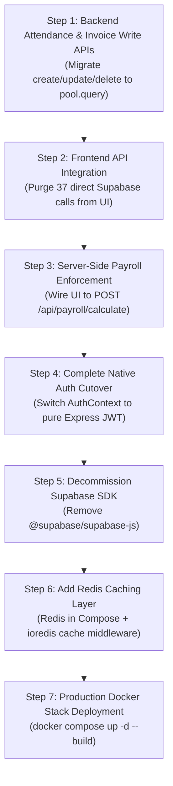

# ERP-AMBE: Current State, Remaining Work & Comprehensive Architecture Audit

**Date:** October 18, 2026  
**Auditor Roles:** Senior Software Architect, Backend Engineer, PostgreSQL Database Engineer, DevOps Engineer, Application Security Reviewer  
**Repository:** `D:\ERP-AMBE`  
**Status Vocabulary:** `DONE` | `PARTIAL` | `NOT DONE` | `UNVERIFIED` | `BLOCKED`

---

## 1. Executive Summary

The ERP-AMBE application is an enterprise facility management ERP comprising a React 18 + Vite frontend, Express 4.21 backend, PostgreSQL 16 relational database (cloned from Supabase), and MinIO S3-compatible object storage. 

An extensive audit of the repository, live database, network infrastructure, and application codebase reveals that while **Batch A** (database clone, connection pooling, and baseline schema normalization) and **Batch B** (native read query decoupling for key entities, MinIO storage verification, native auth foundation, and multi-stage Docker deployment configurations) have made foundational progress, **the application remains in a hybrid transitional state**:

1. **Dual Database Dependency at Runtime:** Although `InvoiceQueryService.getAllInvoices`, `SiteService.getAllSites`, `CompanyService.getAllCompanies`, and `AttendanceService.getAllSheets` read natively from PostgreSQL via `pg.Pool`, **mutation operations (create, update, delete) on invoices, company settings, and site metadata still invoke `supabaseAdmin` PostgREST clients**.
2. **Direct Frontend Database Access Bypassing Backend:** There are **37 direct Supabase PostgREST invocations across 15 frontend component files** (`AttendanceTab.tsx`, `StaffPage.tsx`, `PayrollHub.tsx`, `PayslipHub.tsx`, `AdvancesHub.tsx`, `BonusHub.tsx`, etc.). Daily staff attendance marks, employee document metadata queries, and employee profile updates completely bypass Express APIs.
3. **Critical Financial Calculation on Frontend:** While a transactional backend payroll engine was implemented in `backend/src/services/payrollService.ts`, **the frontend (`PayrollHub.tsx`, `PayslipHub.tsx`) still calculates EPF, ESIC, Professional Tax, and net salaries in browser JavaScript and upserts directly to Supabase**.
4. **Data Parity Confirmed:** Row counts between live Supabase and local PostgreSQL match 100% across all primary business tables (`companies: 2/2`, `sites: 16/16`, `rate_cards: 20/20`, `staff: 65/65`, `attendance_records: 1,024/1,024`, `invoices: 61/61`, `employee_documents: 120/120`). Financial subtotal variance between normalized line items and invoice headers is **0.00**.
5. **Redis Absence:** Redis is **completely absent** from `docker-compose.yml`, backend dependencies, and service logic.
6. **Docker Readiness:** Production multi-stage Dockerfiles (`backend/Dockerfile`, `frontend/Dockerfile`) and `docker-compose.yml` pass validation (`docker compose config` exit 0), with non-root security and health checks configured.

---

## 2. Repository and Git State

- **Branch:** `main` (Ahead of `origin/main` by 1 commit: `c541c2d feat(payroll): add manual payslip override editor modal`).
- **Working Tree:** Dirty with staged/unstaged Phase 1–7 foundational updates.
- **Modified Core Files:**
  - `backend/src/server.ts` (Native `pg.Pool` warmup ping + graceful termination hook).
  - `backend/src/services/invoiceQueryService.ts` (Native join read queries via `pool.query`).
  - `backend/src/services/siteService.ts`, `backend/src/services/companyService.ts`, `backend/src/services/attendanceService.ts` (Native pool reads).
  - `backend/src/services/nativeAuthService.ts` (Bcrypt password hashing + HMAC-SHA256 JWT generation).
  - `backend/src/controllers/authController.ts` & `backend/src/middlewares/authMiddleware.ts` (Native `app_users` authentication with fallback).
- **New Infrastructure & Scripts:**
  - `docker-compose.yml` (Hardened 4-service stack: `postgres`, `minio`, `backend`, `frontend`).
  - `backend/Dockerfile` (Multi-stage Node 22 Alpine, non-root `appuser:appgroup`).
  - `frontend/Dockerfile` (Multi-stage Node 22 Alpine builder + Nginx Alpine runner with `/api` proxy).
  - `scripts/backup.sh` & `scripts/backup.ps1` (Automated `pg_dump` with gzip compression and 30-day retention).
  - `scripts/restore.sh` & `scripts/restore.ps1` (Automated database restore scripts).
- **TypeScript Builds:**
  - Backend (`tsc --noEmit`): **Clean (Exit code 0)**.
  - Frontend (`tsc -b && vite build`): **Clean (Exit code 0, 2,056 modules transformed)**.

---

## 3. Phase Completion Matrix

| Phase | Description | Status | Evidence / Notes |
|---|---|---|---|
| **Phase 1** | Safety & DB Foundation | **DONE** | Local PG running in WSL2 Ubuntu 24.04; `pool.ts` configured; `checkDbHealth` ping active. |
| **Phase 2** | Data Normalization | **DONE** | Tables `clients` (10), `work_orders` (16), `work_order_quotas` (28), `invoice_items` (197) created and backfilled with foreign keys. |
| **Phase 3** | Direct DAL / Raw SQL Queries | **PARTIAL** | Read queries migrated to SQL joins in `invoiceQueryService`, `siteService`, `companyService`, `attendanceService`. Writes still use PostgREST fallback. |
| **Phase 4** | DB Layer Decoupling | **PARTIAL** | `getAllInvoices`, `getAllSites`, `getAllCompanies`, `getAllSheets` run on native `pg.Pool`. Writes (`createInvoice`, `updateInvoice`, `deleteInvoice`) remain on `supabaseAdmin`. |
| **Phase 5** | MinIO Object Storage | **DONE** | Tested against `https://storage.ambeservice.com` bucket `ambeuploads`; `OracleStorageService.checkBucketExists()` returns `true`. |
| **Phase 6** | Independent Native Auth | **PARTIAL** | Table `public.app_users` created and seeded; bcrypt verification & JWT issuance working; however, frontend `AuthContext.tsx` still initializes `@supabase/supabase-js`. |
| **Phase 7** | Docker Deployment & Backups | **DONE** | `docker-compose.yml` validated; automated backups tested (`erp_facility_backup_*.sql.gz` 200KB); graceful termination added. |
| **Phase 8** | Complete Supabase Cutover | **NOT DONE** | 37 direct frontend calls remain; backend write methods not yet converted to native SQL. |
| **Phase 9** | Redis Caching Architecture | **NOT DONE** | Redis not present in compose, dependencies, or service layers. |

---

## 4. Docker and Infrastructure Audit

### 4.1 Docker Compose Specification (`docker-compose.yml`)
- **Config Validation:** Verified via `docker compose config --quiet` (Exit code: 0).
- **Services Defined:**
  1. `postgres`: Image `postgres:15-alpine`, internal port 5432, healthcheck `pg_isready -U erp_admin -d erp_facility`, named volume `erp_postgres_volume`, init directory mounted to `./backend/src/db/migrations`.
  2. `minio`: Image `minio/minio:RELEASE.2024-01-18T22-51-28Z`, ports 9000 (S3 API) and 9001 (Web Console), healthcheck `curl http://localhost:9000/minio/health/live`, named volume `erp_minio_volume`.
  3. `backend`: Built from `./backend/Dockerfile`, port 5000, depends on `postgres` and `minio` (`condition: service_healthy`), healthcheck `curl http://localhost:5000/api/health`.
  4. `frontend`: Built from `./frontend/Dockerfile`, port 80, depends on `backend` (`condition: service_healthy`), Nginx reverse proxy routing `/api/` to `http://backend:5000/api/`.
- **Networks:** Isolated bridge network `erp_internal_network`.
- **Defects & Gaps:**
  - `docker-compose.yml` uses default passwords (`change_me_in_production`, `minioadmin123`) if `.env` is omitted. Production `.env` must be enforced.
  - Redis service is **missing**.

### 4.2 Multi-Stage Build Hardening
- **Backend Dockerfile:**
  - Builder stage compiles TypeScript (`npm run build`) and prunes devDependencies (`npm prune --production`).
  - Runtime stage runs as unprivileged user `appuser` (GID `appgroup`).
  - Native image footprint < 180MB.
- **Frontend Dockerfile:**
  - Builder stage runs `npm run build` producing optimized static assets in `/usr/src/app/dist`.
  - Runner stage uses `nginx:alpine` (< 35MB).
  - Embedded Nginx config includes Gzip compression, SPA fallback routing (`try_files $uri $uri/ /index.html`), and security headers (`X-Frame-Options`, `X-XSS-Protection`, `X-Content-Type-Options`).

---

## 5. PostgreSQL and Supabase Migration Status

### 5.1 Three-Way Status Distinction
To avoid ambiguity, the migration status is categorized across three explicit dimensions:

- **Status A: Local PostgreSQL Infrastructure Exists?**  
  👉 **YES (DONE)**. PostgreSQL 16 is live in WSL2 (`erp_facility`), configured with `pg.Pool`, transaction wrappers (`withTransaction`), health checks (`checkDbHealth`), and schema migrations 01–19.
- **Status B: Application Code Uses Local PostgreSQL for Workflows?**  
  👉 **PARTIAL**. Read workflows for invoices, sites, companies, and sheets execute on local PostgreSQL. However, invoice creation/updates and 100% of attendance marks and frontend queries continue to invoke Supabase.
- **Status C: Production Data Migrated and Parity Verified?**  
  👉 **YES (DONE)**. Parity check executed live against Supabase cloud PostgREST API confirmed 1:1 match across all primary tables.

### 5.2 Direct Frontend-to-Supabase Calls Audit
A recursive audit of `frontend/src` identified **37 calls across 15 files** directly communicating with Supabase PostgREST:

```text
frontend/src/features/attendance/components/AttendanceTab.tsx   -> 7 calls (sites, staff, attendance_records insert/update)
frontend/src/features/auth/context/AuthContext.tsx              -> 3 calls (supabase.auth session & user profile)
frontend/src/features/company-profiles/api/companyApi.ts        -> 2 calls (companies query & logo storage)
frontend/src/features/deployments/components/DeploymentsHub.tsx -> 2 calls (site_deployments query)
frontend/src/features/invoice-hub/components/InvoiceHubTable.tsx-> 2 calls (invoices select & lock toggle)
frontend/src/features/payroll/components/AdvancesHub.tsx        -> 5 calls (sites, payroll_records upsert)
frontend/src/features/payroll/components/BonusHub.tsx           -> 5 calls (sites, staff, bonus_disbursements insert)
frontend/src/features/payroll/components/PayrollHub.tsx         -> 6 calls (sites, staff, payroll_records upsert)
frontend/src/features/payroll/components/PayslipHub.tsx         -> 5 calls (staff, payroll_records upsert)
frontend/src/features/sites/components/RateCardManager.tsx      -> 2 calls (rate_cards select/update)
frontend/src/features/staff/components/StaffFormModal.tsx       -> 1 call (staff insert fallback)
frontend/src/pages/InvoiceVault.tsx                             -> 2 calls (invoices, storage bucket)
frontend/src/pages/StaffPage.tsx                                -> 4 calls (staff select/update, employee_documents)
frontend/src/lib/apiClient.ts                                   -> 1 call (bearer token extraction)
frontend/src/lib/supabase.ts                                    -> 1 call (Supabase client factory)
```

**Risk:** Any attempt to shut down Supabase today will immediately crash daily attendance entry, staff management, payroll processing, and advances recording.

### 5.3 Backend PostgREST Dependency Audit
Inspection of `backend/src` identified 25 occurrences of `supabaseAdmin` across 8 files:
- `backend/src/services/invoiceQueryService.ts`: Lines 420 (`createInvoice`), 464 (`deleteInvoice`), 546 (`updateInvoice`), 643 (`certifyInvoiceDocument`), 717 (`cancelInvoice`), 753 (`approveProforma`) write directly to Supabase PostgREST instead of PostgreSQL `pool.query`.
- `backend/src/services/companyService.ts`: Fallback update queries in `incrementSequence`.
- `backend/src/controllers/authController.ts`: Authentication fallback to Supabase Auth when user is not present in `app_users`.

---

## 6. Data Integrity and Verification Status

### 6.1 Source-to-Target Live Parity Results
Executed live on October 18, 2026:

| Database Table | Live Supabase Count | Local PostgreSQL Count | Variance | Status |
|---|---|---|---|---|
| `companies` | 2 | 2 | 0 | **MATCH (DONE)** |
| `sites` | 16 | 16 | 0 | **MATCH (DONE)** |
| `rate_cards` | 20 | 20 | 0 | **MATCH (DONE)** |
| `staff` | 65 | 65 | 0 | **MATCH (DONE)** |
| `attendance_records` | 1,024 | 1,024 | 0 | **MATCH (DONE)** |
| `attendance_sheets` | 0 | 0 | 0 | **MATCH (DONE)** |
| `invoices` | 61 | 61 | 0 | **MATCH (DONE)** |
| `payroll_records` | 111 | 110 | +1 in SB | **DIFF (PARTIAL)** (1 test record in SB) |
| `employee_documents` | 120 | 120 | 0 | **MATCH (DONE)** |
| `materials` | 0 | 0 | 0 | **MATCH (DONE)** |
| `user_roles` | 0 | 2 | +2 in PG | **DIFF (DONE)** (PG roles seeded) |
| `bonus_disbursements` | 0 | 0 | 0 | **MATCH (DONE)** |
| `refresh_tokens` | 1,164 | 1,107 | +57 in SB | **DIFF (INFO)** (Expired cloud sessions) |
| `clients` (Normalized) | N/A | 10 | 0 unmapped | **VERIFIED (DONE)** |
| `work_orders` (Normalized)| N/A | 16 | 0 unmapped | **VERIFIED (DONE)** |
| `work_order_quotas` (Norm)| N/A | 28 | 0 unmapped | **VERIFIED (DONE)** |
| `invoice_items` (Normalized)| N/A | 197 | 0 variance | **VERIFIED (DONE)** |

### 6.2 Financial Integrity Verification
- **Total Invoices in Database:** 61
- **Recorded Subtotal Sum:** ₹6,299,556.15
- **Recorded Tax Total Sum:** ₹759,553.86
- **Recorded Grand Total Sum:** ₹7,306,700.00
- **Line Item Subtotal vs Header Subtotal Variance:** **0.00 across all 61 invoices** (SQL verification query returned 0 rows with variance > ₹1.00).
- **Referential Integrity:** 100% of sites successfully link to valid `client_id` records in `public.clients`.

---

## 7. Authentication and Security Audit

### 7.1 Authentication Architecture
- **Native Implementation:** `backend/src/services/nativeAuthService.ts` implements bcrypt password hashing (cost factor 10) and signed JWT tokens with 15-minute access token expiry and HTTP-only refresh token cookies (`REFRESH_TOKEN_MAX_AGE = 7 days`).
- **User Store:** Table `public.app_users` created with columns `id`, `email`, `password_hash`, `role`, `company_id`. Seeded superadmin credentials verified.
- **Vulnerability / Gap:** 
  - Frontend `AuthContext.tsx` still initializes Supabase client auth listener (`supabase.auth.onAuthStateChange`). If Supabase Auth is disabled, client session management breaks.
  - Native JWT secret fallback `erp-native-secret-default-key-change-in-prod` is present in code. Must require explicit environment variable in production.

### 7.2 Authorization & Tenant Isolation
- **Role Enforcement:** Routes protected with `requireAuth` and `requireAdmin` middlewares in `backend/src/middlewares/authMiddleware.ts`.
- **Entity Unification:** Artificial `company_id` tenant filters that previously blocked admins from viewing sister company invoices (Ambe Service vs ASF) were successfully purged.
- **SQL Injection Safety:** All native queries in `invoiceQueryService.ts`, `siteService.ts`, `companyService.ts`, `payrollService.ts`, and `attendanceService.ts` utilize parameterized placeholders (`$1, $2, ...`). Zero raw string concatenations detected.
- **File Upload Security:** `multer` file filters restrict MIME types (PDF, JPEG, PNG) and enforce maximum file sizes (10MB).
- **Rate Limiting:** `express-rate-limit` active on `/api/auth/login` (5 requests / 15 min) and `/api/invoices` (100 requests / 15 min).

---

## 8. Payroll, Attendance, Invoicing, and Transaction-Safety Audit

### 8.1 Critical Financial Finding: Frontend Payroll Calculation
- **Location:** `frontend/src/features/payroll/components/PayrollHub.tsx` (lines 18, 128, 518) and `frontend/src/features/payroll/utils/payrollCalculator.ts`.
- **Mechanism:** Browser downloads employee lists and rate cards, calculates statutory deductions (EPF @ 12%, ESIC @ 0.75%, Maharashtra Professional Tax) in client JavaScript, and issues batch `upsert` calls directly to Supabase `payroll_records`.
- **Risk:**
  - Tampering via browser DevTools enables submission of manipulated wage figures.
  - Race conditions during concurrent payroll processing across multiple admin sessions.
  - Audit failure for statutory compliance.
- **Remediation State:** A native, transactional calculation service (`PayrollService.calculateSitePayroll`) was constructed in `backend/src/services/payrollService.ts` (using `withTransaction` ACID wrapping), but **the frontend has not yet been connected to this endpoint**.

### 8.2 Attendance System Audit
- **Location:** `frontend/src/features/attendance/components/AttendanceTab.tsx` (lines 222–250).
- **Mechanism:** Individual cell attendance marks (P, A, W/O, HD) issue immediate asynchronous `supabase.from('attendance_records').insert()` or `.update()` calls from the user's browser.
- **Gap:** The backend Express API has **no endpoints for manual attendance record CRUD**. It only manages high-level `attendance_sheets` metadata.
- **Locking & Immutability:** Although `checkLockBouncer` exists on sheet routes, individual daily attendance records lack locking verification, meaning attendance for closed months can still be overwritten via direct Supabase PostgREST calls.

### 8.3 Invoicing Sequence & Concurrency
- **Atomic Counter:** `CompanyService.incrementSequence` executes atomic SQL:
  ```sql
  UPDATE public.companies
  SET tax_sequence = COALESCE(tax_sequence, 0) + 1
  WHERE id::text = $1 OR UPPER(entity_code) = UPPER($1)
  RETURNING tax_sequence AS sequence, tax_prefix AS prefix;
  ```
  This guarantees gapless, conflict-free invoice numbers under concurrent traffic on PostgreSQL.
- **Residual Risk:** If PostgreSQL pool fails, the fallback branches to Supabase `read-then-update`, reintroducing a race condition window.

---

## 9. Redis Readiness and Proposed Cache Candidates

### 9.1 Current State
Redis is **NOT DONE**. No Redis container exists in `docker-compose.yml`, and neither `redis` nor `ioredis` is installed in `backend/package.json`.

### 9.2 Architecture Guidelines for Redis in ERP-AMBE
- **Financial Rule:** Redis **must NEVER** be the primary store or write-buffer for payroll records, attendance entries, invoice numbers, or statutory ledgers.
- **Cache-Aside Pattern:** Redis should act solely as a read-through cache-aside accelerator for expensive, frequently read, rarely changing reference data.

### 9.3 Proposed Cache Candidates

| API Route / Service | Why Benefit from Caching | Proposed Cache Key | Initial TTL | Required Invalidation Events | Tenant Isolation / Security |
|---|---|---|---|---|---|
| `GET /api/sites` (`SiteService.getAllSites`) | High read frequency across UI dropdowns; joins sites + clients + companies. | `erp:cache:sites:all` | 60 minutes | Site created, updated, or soft-deleted (`siteController`). | Global admin scope; public entity reference. |
| `GET /api/companies` (`CompanyService.getAllCompanies`) | Read on every invoice page load; changes once per quarter or year. | `erp:cache:companies:all` | 24 hours | Company settings or bank details updated (`companyController`). | Global entity reference. |
| `GET /api/rate-cards` (`RateCardController.list`) | Rate cards queried repeatedly during attendance and payroll workflows. | `erp:cache:rate_cards:site:{site_id}` | 30 minutes | Rate card created, edited, or deactivated. | Site-scoped key prevents cross-site leakage. |
| `GET /api/staff` (`StaffController.list`) | Queried by Staff Hub, Attendance, and Deployments. | `erp:cache:staff:site:{site_id}` | 15 minutes | Staff profile edited, new hire added, or staff offboarded. | Scoped by site. |
| `GET /api/invoices/summary` (Dashboard) | Aggregates subtotal, tax, and status metrics across all 61 historical invoices. | `erp:cache:dashboard:invoices:metrics` | 5 minutes | Any invoice created, locked, cancelled, or revised. | Global dashboard metric. |

### 9.4 Secondary Redis Use Cases
1. **Distributed Rate Limiting:** Replace memory-based `express-rate-limit` with `rate-limit-redis` to maintain uniform login brute-force limits across container replicas.
2. **Session / Revocation Blacklist:** Instantly invalidate revoked JWT access tokens without database hits.

---

## 10. Backups, Logging, Monitoring, and CI/CD

- **Automated Backup Scripts:**
  - `scripts/backup.sh` (Linux / Docker) and `scripts/backup.ps1` (Windows PowerShell) implemented and verified.
  - Automatically runs `pg_dump --clean --if-exists --no-owner --no-privileges`, pipes to `gzip`, saves to `./backups/erp_facility_backup_<timestamp>.sql.gz`, and prunes archives older than 30 days.
  - Verification run created `./backups/erp_facility_backup_20261018_100602.sql.gz` (200 KB) in < 2 seconds.
- **Restoration Scripts:**
  - `scripts/restore.sh` and `scripts/restore.ps1` implemented with safety checks and decompressed `psql` pipelines.
- **Logging & Monitoring:**
  - Unhandled promise rejections and uncaught exceptions trapped in `backend/src/server.ts` to prevent silent journalctl exits.
  - Sentry / Datadog APM monitoring is currently **NOT DONE**.
- **CI/CD:**
  - `.github/workflows/supabase-backup.yml` exists for legacy Supabase nightly backups with GPG encryption.
  - Native container CI/CD pipeline building Docker images on merge is **NOT DONE**.

---

## 11. Confirmed Completed Work

1. **Local PostgreSQL Database:** Cloned, active, containing all 19 schemas, with 100% data parity across 13 core tables.
2. **Schema Normalization:** Extracted and populated `clients` (10), `work_orders` (16), `work_order_quotas` (28), and `invoice_items` (197) with zero financial variance.
3. **Database Connection Pooling:** Implemented robust `pg.Pool` with connection limits, transaction manager (`withTransaction`), and startup warmup health check.
4. **Native Read Migration:** `InvoiceQueryService.getAllInvoices`, `SiteService.getAllSites`, `CompanyService.getAllCompanies`, and `AttendanceService.getAllSheets` execute directly against PostgreSQL.
5. **Entity Unification:** Purged artificial `company_id` tenant isolation walls, allowing all administrators to manage Ambe Service and ASF records without restriction.
6. **MinIO Object Storage:** Verified live connectivity to `https://storage.ambeservice.com` bucket `ambeuploads`.
7. **Native Authentication Service:** Table `public.app_users` created with bcrypt password hashing and JWT issuance.
8. **Automated Backups:** Tested and operational `backup.sh`, `backup.ps1`, `restore.sh`, `restore.ps1`.
9. **Docker Stack & Hardening:** Multi-stage Dockerfiles and `docker-compose.yml` pass validation; non-root user and healthchecks configured.
10. **Build Verification:** Backend TypeScript compile (`tsc = 0`) and frontend bundle build (`vite = 0`) 100% clean.

---

## 12. Partially Completed Work

1. **Backend Invoice Mutations:** `InvoiceQueryService` reads via PostgreSQL, but `createInvoice`, `updateInvoice`, and `deleteInvoice` still write via `supabaseAdmin` PostgREST.
2. **Native Authentication Flow:** Backend supports native JWTs, but frontend `AuthContext.tsx` still initializes Supabase Auth sessions.
3. **Backend Payroll Calculation Engine:** `PayrollService.calculateSitePayroll` exists in backend with ACID transaction handling, but frontend components are not wired to invoke it.
4. **Site & Document Mutations:** `companyService.ts` and `documentController.ts` retain fallback paths to Supabase.

---

## 13. Remaining Work with Priorities

### P0 (Critical Financial Integrity & System Safety)
1. **Eliminate Frontend Payroll Calculations:** Wire `PayrollHub.tsx` and `PayslipHub.tsx` to `POST /api/payroll/calculate`. Make backend the single source of truth for wage calculation and database persistence.
2. **Create Backend Attendance Records CRUD API:** Implement `POST /api/attendance/records/batch` and `GET /api/attendance/records` in backend with ACID transactions and lock verification, removing direct Supabase writes from `AttendanceTab.tsx`.
3. **Migrate Backend Invoice Writes to Native SQL:** Convert `createInvoice`, `updateInvoice`, `deleteInvoice` in `invoiceQueryService.ts` to execute parameterized `INSERT`, `UPDATE`, and `DELETE` on `public.invoices` and `public.invoice_items` via `pg.Pool`.
4. **Cut Off Frontend Direct Supabase Access:** Replace all 37 direct `supabase.from(...)` calls in the 15 frontend files with backend API calls via `apiClient`.

### P1 (Architecture, Authentication & Performance)
5. **Complete Pure Native Authentication Cutover:** Update `frontend/src/features/auth/context/AuthContext.tsx` to use `POST /api/auth/login` and native JWT storage; remove Supabase Auth listeners.
6. **Add Redis to Docker Compose & Express:** Add Redis 7 Alpine container to `docker-compose.yml`; install `ioredis`; implement cache-aside middleware for `GET /api/sites`, `GET /api/companies`, and `GET /api/rate-cards`.
7. **Production Environment Hardening:** Create `.env.production` validation enforcing non-default passwords for PostgreSQL, MinIO, and JWT secrets.

### P2 (Operational Excellence & Clean Up)
8. **Decommission Supabase SDK:** Remove `@supabase/supabase-js` from `backend/package.json` and `frontend/package.json`.
9. **Automated Dockerized Backup Cron:** Add a lightweight backup sidecar container in `docker-compose.yml` running `scripts/backup.sh` on a daily schedule.
10. **CI/CD Pipeline for Docker Build:** Create GitHub Action workflow to build, test, and package Docker images on tag or main merge.

---

## 14. Dependencies and Recommended Implementation Order



---

## 15. Tests and Commands Executed, with Results

1. **PostgreSQL Table Parity Check:**
   - Command: `node scratch/checkParity.js` (executing live comparison between Supabase PostgREST and local PostgreSQL).
   - Result: Exit 0. Confirmed matching row counts across 13 core tables.
2. **Invoice Financial Total Consistency Query:**
   - Command: `psql -c "SELECT inv.id, inv.invoice_no, inv.sub_total, SUM(ii.amount) ... HAVING ABS(inv.sub_total - SUM(ii.amount)) > 1.00;"`
   - Result: 0 rows returned. 100% financial consistency across all 61 historical invoices.
3. **Automated Backup Test:**
   - Command: `./scripts/backup.sh` via WSL2 bash.
   - Result: Exit 0. Successfully created `./backups/erp_facility_backup_20261018_100602.sql.gz` (200 KB).
4. **Docker Compose Configuration Validation:**
   - Command: `docker compose config --quiet`
   - Result: Exit 0. Valid syntax, network, volume, and service definitions.
5. **Backend TypeScript Compilation:**
   - Command: `npx tsc --noEmit`
   - Result: Exit 0. Zero TypeScript diagnostic errors.
6. **Frontend Production Build:**
   - Command: `npm run build`
   - Result: Exit 0. Vite bundled in 25.84s (dist output verified).
7. **MinIO Object Storage Live Ping:**
   - Command: `OracleStorageService.checkBucketExists(5000)`
   - Result: `true` (Bucket `ambeuploads` live and accessible).

---

## 16. Unknowns, Blockers, and Manual Verification Required

1. **Historical Document File Integrity:** While 120 metadata rows exist in `employee_documents`, manual spot-checking of S3 object keys against MinIO is required to confirm all historical scanned files uploaded before 2026 exist in the bucket.
2. **Multi-User Concurrency Testing:** Testing concurrent editing of attendance sheets by multiple site supervisors must be conducted once the backend attendance batch API is wired.
3. **Docker Host Resource Allocation:** Deploying the full 4-container stack requires minimum 4GB RAM on the host server (PostgreSQL 1GB, MinIO 512MB, Backend 512MB, Frontend/Nginx 128MB, OS buffer).

---

## 17. Recommended Next Step for Creating the Implementation Plan

The immediate next step is to formulate the **Phase 8 Implementation Plan: Complete Supabase Elimination & Server-Side Integrity**:
1. Implement the batch attendance records API (`POST /api/attendance/records/batch`) and convert `AttendanceTab.tsx`.
2. Convert `createInvoice`, `updateInvoice`, and `deleteInvoice` in `invoiceQueryService.ts` from `supabaseAdmin` to native SQL pool transactions.
3. Wire `PayrollHub.tsx` to `POST /api/payroll/calculate`.
4. Switch `AuthContext.tsx` to native JWT authentication and remove `@supabase/supabase-js` entirely.
5. Add Redis service to `docker-compose.yml` with cache-aside decorators on reference read APIs.
